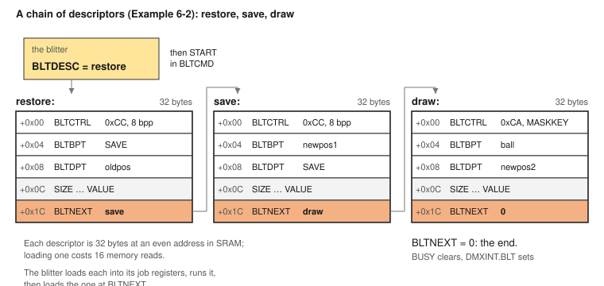
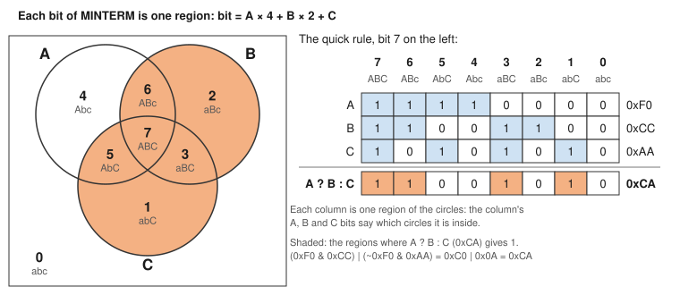
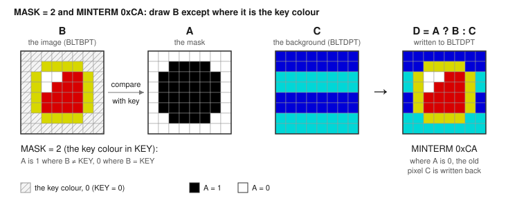
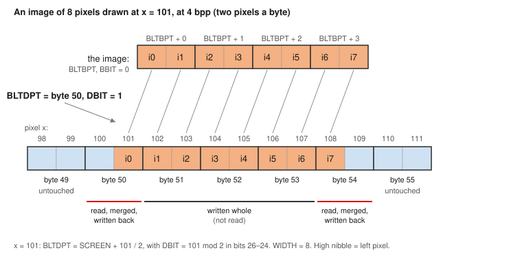
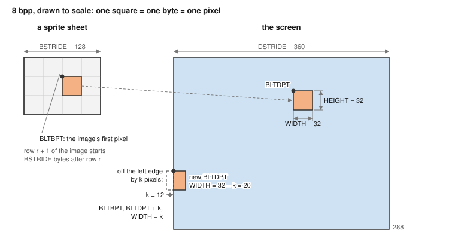
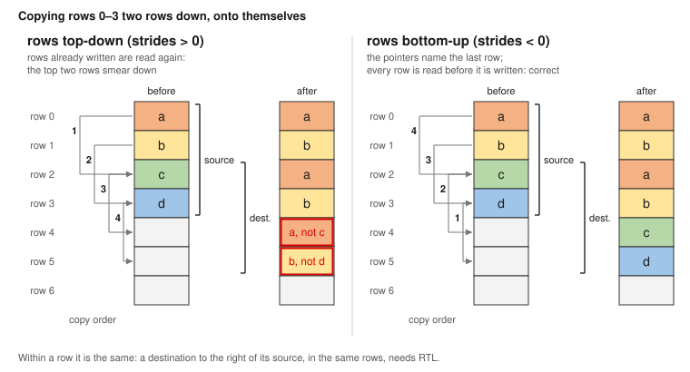
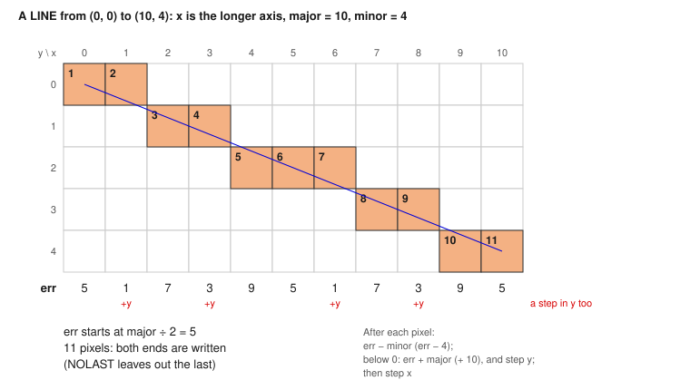
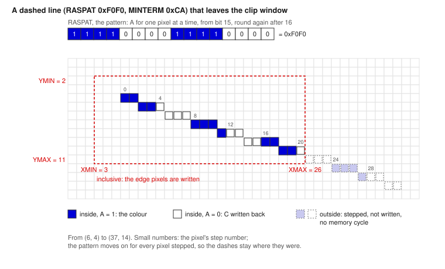
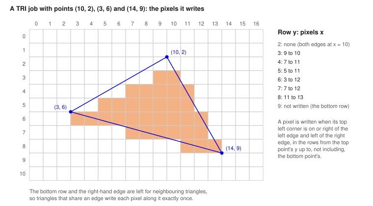
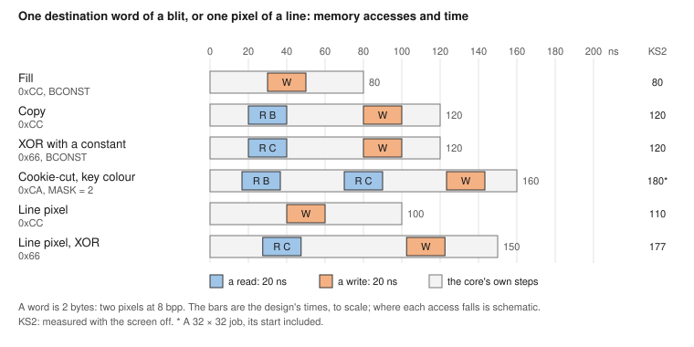

# Chapter 6: Blitter and Rasteriser Hardware

## Introduction

The **blitter** and the **rasteriser** draw for you, while the Z80 gets on with something else. The blitter works on rectangles of pixels: it copies, fills, combines and cuts out. The rasteriser draws lines and filled triangles from their end points. On the board the blitter clears a whole 360 × 288 screen in 4.6 ms, where `LDIR` would take 109 ms, and the Z80 runs at full speed meanwhile: neither unit ever takes a memory cycle the Z80 wants.

The blitter works like the Amiga's. Each job has up to three inputs and one output (Figure 6-1):

```
   A  the mask        (which pixels to draw)
   B  the source      (what to draw: an image, or a constant)
   C  the background  (what is in the destination now)
            │
            ▼
   ┌──────────────────┐
   │  MINTERM         │   any logic function of A, B and C,
   │  D = f(A, B, C)  │   worked out bit by bit
   └──────────────────┘
            │
            ▼
   D  the destination (the screen, or any SRAM)

             Figure 6-1: The Blitter's Inputs and Output
```

C and D are the same place: the blitter reads what is there, combines it, and writes the result back. A **minterm** is one byte that says how A, B and C combine. With the right minterm the same hardware copies, fills, draws with a transparent colour, sets, clears or flips bits, and inverts areas.

The rasteriser uses the same minterms. For a line, A is a 16-bit pattern (for dashed lines), B is the colour and C the pixel already there; a clip window decides which pixels are written.

Both units take a **job** of 32 bytes. You can write a job straight into a unit's registers, or leave a **chain** of jobs in memory and let the unit work through them on its own. The two units are separate: each has its own registers and runs one job at a time, and both can run at once.

This chapter covers:

- turning the two units on, and how their registers are reached;
- a blitter job's 32 bytes, field by field, with a fill worked out byte by byte;
- running a job, then a first example;
- chains of jobs;
- status, interrupts and errors;
- minterms, and how to work one out;
- masks: drawing a shape with a transparent colour;
- moving objects about: saving and restoring the background;
- pixel depths, and placing an image at any pixel;
- rectangles, strides and clipping;
- overlapping copies, and scrolling;
- filling with a constant;
- the rasteriser's job, its clip window, and drawing lines with patterns;
- wireframe objects drawn by a chain of lines;
- filled triangles (the KS3 only);
- the two units together, and starting jobs from the copper;
- moving objects over a screen split between two depths;
- speed, measured on the board;
- what the two units cannot do, and how they compare with the Amiga's blitter;
- a summary of the registers.

You should have read the Playfield Hardware chapter (Chapter 3): the blitter and the rasteriser mostly draw into the layers described there.

**The KS2 builds lines only.** The KS2's bitstream has the blitter and a rasteriser that draws lines; filled triangles and the blitter's 1 bpp mask image need room it does not have. On the KS2 a triangle job or a mask-image job stops with an error and writes nothing ("Status, Interrupts and Errors"). The KS3 builds both.

---

## Conventions in This Chapter

- Examples are Z80 assembly language for sjasmplus and start with `include "hw.inc"`. Numbers are hexadecimal when they start with `0x`.
- **Registers are reached through their ports**, as the Playfield Hardware chapter describes: `LD BC,name_P`, then `OUT (C),A` or `IN A,(C)`. "The Blitter and the Rasteriser" below gives the units' ports.
- **Addresses are physical.** Both units read and write SRAM by its physical address, not through the MMU windows: physical address = MMU page × `0x2000` + offset in the page. Names in capitals, such as `SCREEN`, are physical addresses.
- **The examples run in the boot ROM's program map.** There a Z80 address in `0x2000`–`0xFFFF` is also its physical address, so a job kept in the program, or an image, goes into a pointer as it is. A program that maps other pages adds the difference.
- The complete examples are in `examples/blitter/`. Each starts with `device zxspectrum48`, `org 0x8000` and `include "hw.inc"`, and ends by putting back what it changed and returning to the monitor.
- The examples share `examples/blitter/screen.inc`, described with Example 6-1. It borrows layer L0 from the console and makes it a **360 × 288 bitmap**, shown at 2× each way over the whole picture, at physical `SCREEN` (`0x040000`). At 8 bpp a row is 360 bytes, and the pixel at (x, y) is at `SCREEN + y × 360 + x`. The colours are palette 0's first 16 entries, the Spectrum colours. At the end it gives L0 back to the console.
- `screen.inc` names the fields of the units' control registers that `hw.inc` gives only as masks. They are 32-bit values, for `DD` lines:

```
BPP1    equ     0 << BLTCTRL_BPP_B      ; bits 9-8, in both units: 1 bit a pixel
BPP2    equ     1 << BLTCTRL_BPP_B
BPP4    equ     2 << BLTCTRL_BPP_B
BPP8    equ     3 << BLTCTRL_BPP_B      ; 0x300
MASKIMG equ     1 << BLTCTRL_MASK_B     ; 0x20000  A is the 1 bpp image at BLTAPT (not on the KS2)
MASKKEY equ     2 << BLTCTRL_MASK_B     ; 0x40000  A is 1 where B is not the KEY colour
MT      equ     1 << BLTCTRL_MINTERM_B  ; MINTERM m is m * MT, in both units
```

---

## The Blitter and the Rasteriser

The blitter and the rasteriser are two units of the chipset that read and write SRAM on their own. Each has a page of **job registers**, 32 bytes that describe a job, and a few registers that start it and report on it. Before a job can be described, you need to know how the units are turned on and how their registers are reached.

### Turning them on

The two units use memory only while **DMACON.DMAEN** and **DMACON.BLTEN** are both set. One bit, BLTEN, serves both. DMACON is a set/clear register: a write with SETCLR (bit 7) set sets the bits written as 1, and a write with it clear clears them. Do this once, when the program starts:

```
        ld      bc,DMACON_P
        ld      a,DMACON_SETCLR_M | DMACON_DMAEN_M | DMACON_BLTEN_M
        out     (c),a
```

Clearing BLTEN later holds a running job before its next memory access; setting it again lets it carry on. The boot ROM leaves DMAEN set, since the console's layer needs it, and BLTEN clear: on the board DMACON reads `0x60` (DMAEN and BPLEN) after a reset.

### Their registers

Table 6-1 lists the two units' registers. Each unit has its 32 job registers, a descriptor address for chains, a command register and a status register. The rasteriser also has its clip window. The two share an interrupt flag register and its enables.

**Table 6-1: The Blitter's and the Rasteriser's Registers**

| Offset | Ports | Name | Bytes | What it is for |
|--------|-------|------|-------|----------------|
| `0x140`–`0x15F` | `0x4011`–`0x5F11` | BLTCTRL … BLTNEXT | 32 | The blitter's job ("A Blitter Job's 32 Bytes") |
| `0x160` | `0x6011` | BLTDESC | 3 | The address of a job in memory, for START ("Chains of Jobs") |
| `0x164` | `0x6411` | BLTCMD | 1 | Start and stop ("Running a Blitter Job") |
| `0x168` | `0x6811` | BLTSTAT | 1 | Busy, error |
| `0x180`–`0x19F` | `0x8011`–`0x9F11` | RASCTRL … RASNEXT | 32 | The rasteriser's job ("The Rasteriser's Job") |
| `0x1A0` | `0xA011` | RASDESC | 3 | As BLTDESC |
| `0x1A4` | `0xA411` | RASCMD | 1 | As BLTCMD |
| `0x1A8` | `0xA811` | RASSTAT | 1 | As BLTSTAT |
| `0x1AC`–`0x1B3` | `0xAC11`–`0xB311` | RASCLIPMIN, RASCLIPMAX | 8 | The clip window ("The Clip Window") |
| `0x230` | `0x3012` | DMXINT | 1 | Interrupt flags, one for each unit ("Status, Interrupts and Errors") |
| `0x234` | `0x3412` | DMXINTEN | 1 | Their enables |

Each byte is one port, named in `hw.inc` as the register's name, a byte number and `_P`: a register of several bytes has a port for each, lowest first, `BLTDPT0_P` to `BLTDPT3_P`. The name without a byte number is the first byte's port (`BLTDPT_P` is `BLTDPT0_P`). The units' ports share their low byte, `0x11`, so after `LD BC,name_P` the register is in B and `INC B` steps to the next byte:

```
        ld      bc,BLTDPT0_P            ; BLTDPT's low byte
        out     (c),l
        inc     b                       ; its next byte
        out     (c),h
        inc     b
        out     (c),e
```

Two rules about the job registers:

- **They can be written only while the unit is idle.** A write while the unit's BUSY bit is set is ignored.
- **They keep their values.** After a job, the registers still hold it, so a second job that differs in a few fields needs only those written.

There are two ways to give a unit a job. Write its 32 job registers and write RUN to its command register, as the first example does; or leave the 32 bytes in memory, give their address to the descriptor register and write START, which "Chains of Jobs" describes. Either way the unit runs the same job from the same registers.

---

## A Blitter Job's 32 Bytes

A blitter job is eight 4-byte words, which are also the blitter's 32 job registers, in the same order (Table 6-2). Each word is stored low byte first, as the Z80 stores numbers, in the registers and in memory alike.

**Table 6-2: A Blitter Job's 32 Bytes**

| Offset | Register | What it holds |
|--------|----------|---------------|
| `+0x00` | BLTCTRL | The options: the key colour, bits per pixel, direction, interrupt, a constant B, where A comes from, and MINTERM |
| `+0x04` | BLTBPT | Where the source B starts, to the pixel |
| `+0x08` | BLTDPT | Where the destination D starts (C is read from here too), to the pixel |
| `+0x0C` | BLTSIZE | WIDTH (pixels a row) and HEIGHT (rows) |
| `+0x10` | BLTAPT | Where the mask image A starts (KS3 only) |
| `+0x14` | BLTSTRIDE | Bytes from one row to the next, for D and for B |
| `+0x18` | BLTVALUE | The constant B, and the stride for A |
| `+0x1C` | BLTNEXT | The next job in a chain, or 0 |

The fields follow, one by one, with what a fill of the whole screen puts in each; the fill is then shown as 32 bytes.

### BLTCTRL: the options and the minterm

BLTCTRL's four bytes hold every option of the job (Table 6-3).

**Table 6-3: BLTCTRL Bits**

| Bits | Byte | Name | Meaning |
|------|------|------|---------|
| 31–24 | BLTCTRL3 | MINTERM | How A, B and C combine ("Minterms") |
| 23–19 | BLTCTRL2 | – | Reserved, write 0 |
| 18–17 | BLTCTRL2 | MASK | Where A comes from: 0 none (A is 1 everywhere), 1 the 1 bpp image at BLTAPT (`MASKIMG`; KS3 only), 2 B compared with KEY (`MASKKEY`), 3 an error ("Masks") |
| 16 | BLTCTRL2 | – | Reserved, write 0 |
| 15–14 | BLTCTRL1 | – | Reserved, write 0 |
| 13 | BLTCTRL1 | BCONST | B is VALUE, not read from memory: a fill (`BLTCTRL_BCONST_M`) |
| 12 | BLTCTRL1 | IRQ | Set DMXINT.BLT when this job ends (`BLTCTRL_IRQ_M`) |
| 11 | BLTCTRL1 | – | Reserved, write 0 |
| 10 | BLTCTRL1 | RTL | Work each row right to left (`BLTCTRL_RTL_M`; "Overlapping Copies and Scrolling") |
| 9–8 | BLTCTRL1 | BPP | Bits per pixel: 0 = 1 (`BPP1`), 1 = 2, 2 = 4, 3 = 8 (`BPP8`) |
| 7–0 | BLTCTRL0 | KEY | The key colour for MASK = 2, in its low bits (as many as a pixel has) |

The reserved bits are not stored: they read 0, and setting one is not an error. A fill of an 8 bpp screen is MINTERM `0xCC` (D = B), BCONST and BPP 3: `0xCC*MT | BLTCTRL_BCONST_M | BPP8`.

### BLTBPT, BLTDPT and BLTAPT: where B, D and A are

Three pointers, each a physical address and a pixel's place in its byte (Table 6-4). C is read from BLTDPT, since C and D are the same place. A job that does not read A or B ignores BLTAPT or BLTBPT: a fill needs only BLTDPT. The addresses must be in SRAM.

**Table 6-4: BLTBPT, BLTDPT and BLTAPT Bits**

| Bits | Byte | Name | Meaning |
|------|------|------|---------|
| 31–27 | 3 | – | Reserved, write 0 |
| 26–24 | 3 | BIT | The first pixel's place in its byte, in pixels from the most significant end: 0–7 at 1 bpp, 0–3 at 2 bpp, 0–1 at 4 bpp, 0 at 8 bpp. In BLTAPT it counts 1-bit mask pixels, 0–7 |
| 23–0 | 2–0 | ADDR | The byte that holds the first pixel. Bits 23–22 are kept but not used: SRAM is 4 MB at most |

At 8 bpp a pixel is a byte, so BIT is 0 and the pointer is just the address. The fill's BLTDPT is `SCREEN`. "Pixel Depths and Positions" has the other depths.

### BLTSIZE: the size

**Table 6-5: BLTSIZE Bits**

| Bits | Bytes | Name | Meaning |
|------|-------|------|---------|
| 31–16 | 3–2 | HEIGHT | Rows, 0–65,535 |
| 15–0 | 1–0 | WIDTH | Pixels a row, 0–65,535, at the job's depth (so bytes at 8 bpp) |

A job of WIDTH or HEIGHT 0 does nothing. The screen fill is 360 across and 288 down. A long linear copy (like `LDIR`) is one row of up to 65,535 pixels, or, for more, a rectangle whose rows follow each other.

### BLTSTRIDE: from one row to the next

A **stride** is the number of bytes from the start of one row to the start of the next. B and D have their own (Table 6-6), so an image can come out of a sheet of one width into a screen of another.

**Table 6-6: BLTSTRIDE Bits**

| Bits | Bytes | Name | Meaning |
|------|-------|------|---------|
| 31–16 | 3–2 | BSTRIDE | Bytes from one row of B to the next, signed: −32,768 to 32,767 |
| 15–0 | 1–0 | DSTRIDE | Bytes from one row of D (and C) to the next, signed |

The screen's stride is its row length, 360 bytes. A fill does not read B, so its BSTRIDE does not matter. A stride of 0 repeats the same row, and a negative stride goes up through memory ("Overlapping Copies and Scrolling").

### BLTVALUE: the constant, and A's stride

**Table 6-7: BLTVALUE Bits**

| Bits | Bytes | Name | Meaning |
|------|-------|------|---------|
| 31–16 | 3–2 | ASTRIDE | Bytes from one row of the mask image A to the next, signed (KS3 only) |
| 15–8 | 1 | VALUE | The constant B for the **even** byte of each memory word |
| 7–0 | 0 | VALUE | The constant B for the **odd** byte |

With BCONST set, VALUE is B: one memory word (two bytes) of pixels. At 8 bpp a plain colour c is c in both bytes, VALUE c × `0x0101`; at 4 bpp it is c in all four pixels, c × `0x1111`. The fill in blue, colour 1, has VALUE `0x0101`. Note that VALUE is in pixel order, not in the Z80's byte order: its high byte goes to the even address ("Filling with a Constant").

### BLTNEXT: the next job

The physical address of the next job in a chain, or 0 for the last job. A job on its own has BLTNEXT 0. "Chains of Jobs" has the rest.

### A fill, byte by byte

With `SCREEN` at physical `0x040000`, this is the job that fills the examples' screen with blue, as Example 6-1 keeps it:

```
clearjob:
        dd      0xCC*MT | BLTCTRL_BCONST_M | BPP8 ; BLTCTRL: D = B, B is VALUE, 8 bpp
        dd      0                       ; BLTBPT: not read
        dd      SCREEN                  ; BLTDPT: the first pixel, BIT 0
        dw      360, 288                ; BLTSIZE: WIDTH, HEIGHT
        dd      0                       ; BLTAPT: no mask image
        dw      360, 0                  ; BLTSTRIDE: DSTRIDE (the screen's rows), BSTRIDE
        dw      0x0101, 0               ; BLTVALUE: VALUE (colour 1 in both pixels), ASTRIDE
        dd      0                       ; BLTNEXT: no more jobs
```

The assembler turns it into the 32 bytes below. Each raw line has the source form in its comment, and the two give the same job:

```
        db      0x00,0x23,0x00,0xCC     ; BLTCTRL: 0xCC*MT | BLTCTRL_BCONST_M | BPP8
        db      0x00,0x00,0x00,0x00     ; BLTBPT: 0
        db      0x00,0x00,0x04,0x00     ; BLTDPT: SCREEN, 0x040000, low byte first
        db      0x68,0x01,0x20,0x01     ; BLTSIZE: WIDTH 360 = 0x0168, HEIGHT 288 = 0x0120
        db      0x00,0x00,0x00,0x00     ; BLTAPT: 0
        db      0x68,0x01,0x00,0x00     ; BLTSTRIDE: DSTRIDE 360, BSTRIDE 0
        db      0x01,0x01,0x00,0x00     ; BLTVALUE: VALUE 0x0101, ASTRIDE 0
        db      0x00,0x00,0x00,0x00     ; BLTNEXT: 0
```

BLTCTRL1 is `0x23`: BCONST (bit 13, so bit 5 of the byte) and BPP 3 (bits 9–8, bits 1–0 of the byte) in Table 6-3. BLTCTRL3 is the minterm, `0xCC`.

---

## Running a Blitter Job

A job in the registers is started and watched through two one-byte registers: **BLTCMD** (Table 6-8) starts and stops the blitter, and **BLTSTAT** (Table 6-9) says what it is doing. The rasteriser's RASCMD and RASSTAT have the same bits.

**Table 6-8: BLTCMD and RASCMD Bits**

| Bits | Name | Meaning |
|------|------|---------|
| 7–3 | – | Reserved, write 0 |
| 2 | STOP | End the job after the word (blitter) or pixel or row (rasteriser) in hand; the chain is not followed and the job cannot be resumed. Ignored while idle |
| 1 | RUN | Run the job already in the job registers, then follow its BLTNEXT. Ignored while busy |
| 0 | START | Load the descriptor at BLTDESC into the job registers and run it. Ignored while busy. START wins over RUN |

**Table 6-9: BLTSTAT and RASSTAT Bits**

| Bits | Name | Meaning |
|------|------|---------|
| 7–3 | – | Read 0 |
| 2 | ERR | The last job stopped on an error. Cleared by the next START or RUN |
| 1 | – | Reads 0 |
| 0 | BUSY | A job or a chain is running, or waiting for DMACON.BLTEN |

BLTCMD reads 0. BUSY is set by the write of START or RUN itself, so a read of BLTSTAT straight after it already sees the job. Running a job from the registers takes four steps.

### Step 1: Wait until the blitter is idle

The job registers can be written only while the blitter is idle. BUSY is bit 0 of BLTSTAT, so `RRA` puts it in carry. This is `bltwait` in `screen.inc`:

```
bltwait:
        ld      bc,BLTSTAT_P
.busy:  in      a,(c)
        rra                             ; BUSY into carry
        jr      c,.busy
        rla
        ret
```

### Step 2: Write the job registers

The easiest way to set a job is to keep it in memory as 32 bytes, as `clearjob` above, and copy it into the job registers with a loop, one port after another. `OTIR` cannot do it: it counts B down, and B is the register.

```
bltload:
        ld      bc,BLTCTRL0_P           ; B = the first register, C = 0x11
.next:  ld      a,(hl)
        out     (c),a
        inc     hl
        inc     b                       ; the next register
        ld      a,b
        cp      (high BLTCTRL0_P) + 32
        jr      nz,.next
        ret
```

Since the registers keep their values, a job that differs from the last in a few fields needs only those fields written.

### Step 3: Start it

Write **RUN** to BLTCMD:

```
        ld      bc,BLTCMD_P
        ld      a,BLTCMD_RUN_M
        out     (c),a
```

The blitter is busy from that moment.

### Step 4: Wait, or do something else

The job runs by itself. The Z80 carries on at full speed: the blitter never takes a memory cycle the CPU wants. When you need the result, wait until BUSY is clear, with `bltwait` again. Or ask for an interrupt when the job ends, described in "Status, Interrupts and Errors".

### Example 6-1: Clear the screen

`examples/blitter/clear.asm` turns the blitter on, fills the screen with blue with the job above, and keeps the picture up until a key is pressed. It also times the fill with TIME, the microsecond counter (Chapter 2). Then it gives the screen back to the console and prints the time.

```
; Example 6-1 (docs/guide/blitter.md): clear the screen with one blitter job.
; It shows a 360 x 288 8 bpp layer, fills it with blue from the job
; registers, and keeps the picture up until a key is pressed. Then it puts
; the console back and prints how long the fill took.

        device  zxspectrum48            ; sjasmplus writes source lines (--sld) only inside a DEVICE
        org     0x8000

        include "hw.inc"

start:  ld      a,3                     ; the layer: 8 bpp,
        ld      hl,360                  ; 360 bytes a row
        call    scr_on                  ; also sets DMACON's DMAEN and BLTEN
        call    bltwait                 ; Step 1: wait until the blitter is idle
        ld      hl,clearjob
        call    bltload                 ; Step 2: the job into the job registers
        ld      bc,TIME0_P
        in      e,(c)                   ; TIME in us: reading TIME0 captures all 4 bytes
        inc     b
        in      d,(c)
        ld      bc,BLTCMD_P
        ld      a,BLTCMD_RUN_M
        out     (c),a                   ; Step 3: go
        call    bltwait                 ; Step 4: BUSY clear, the screen is blue
        ld      bc,TIME0_P
        in      l,(c)
        inc     b
        in      h,(c)
        or      a
        sbc     hl,de
        ld      (took),hl               ; us, to print once the console is back
        call    waitkey                 ; the picture until a key is pressed
        call    scr_off
        ld      hl,msg
        rst     18h                     ; PUTS
        ld      hl,(took)
        rst     28h
        db      0x08                    ; PUTDEC
        ld      hl,us
        rst     18h
        ret                             ; back to the monitor

took:   dw      0
msg:    db      "The fill took ", 0
us:     db      " us", 13, 10, 0

clearjob:
        ; ... the 32 bytes of "A fill, byte by byte"

        include "screen.inc"
```

The blitter's part is the four steps: `bltwait`, `bltload`, RUN, `bltwait`. The rest is the screen and the console. `examples/blitter/screen.inc`, which every example in this chapter includes, holds the equates of the conventions and these routines:

- `scr_on` saves L0's registers and makes L0 a bitmap of A bits per pixel (the layer's BPP code, 0–3), HL bytes a row, at `SCREEN`, shown at 2× each way, as the Playfield Hardware chapter describes. Then it sets DMACON's DMAEN, BPLEN and BLTEN.
- `frame` waits for the vertical blank, then points L0 at `SCREEN` again: nothing resets a bitmap's pointer at the start of a frame.
- `waitkey` calls `frame` until a key is pressed.
- `scr_off` waits for both units, puts L0's registers back, clears BLTEN, and clears DMXINT.
- `bltwait` and `bltload` are Steps 1 and 2 above; `bltrun` runs the job at HL and waits for it; `bltstart` starts the chain whose first job is at HL ("Chains of Jobs").
- `raswait`, `rasload` and `rasstart` do the same for the rasteriser, and `setclip` sets its clip window ("The Clip Window").
- `t0` notes the time, and `t1` returns in HL the microseconds since.

On the board the whole picture turns blue at once, and after a key the console comes back with `The fill took 4654 us`: 103,680 bytes at 22 MB/s. The job "draws" B onto D, and B is the constant VALUE: so every pixel becomes colour 1. With VALUE 0 it clears to black.

---

## Chains of Jobs

Each job ends with BLTNEXT: the physical address of another job in SRAM, or 0. A chain of jobs runs one after another, with no help from the CPU. Jobs in memory are called **descriptors**; they start at an even address (`align 2`). Figure 6-2 shows a chain of three, as Example 6-2 uses.



*Figure 6-2: A Chain of Jobs*

To start a chain, write the first descriptor's address to **BLTDESC** and **START** to BLTCMD. The blitter loads each descriptor in turn into its job registers and runs it. This is `bltstart` from `screen.inc`, with HL the first descriptor:

```
bltstart:
        ld      bc,BLTDESC0_P
        out     (c),l
        inc     b
        out     (c),h
        inc     b
        xor     a                       ; bits 23-16: the program is below 0x10000
        out     (c),a
        ld      bc,BLTCMD_P
        ld      a,BLTCMD_START_M
        out     (c),a
        ret
```

RUN follows BLTNEXT too: a job written into the registers with a BLTNEXT that is not 0 runs, and then the chain at BLTNEXT. While a chain runs, BLTDESC reads as the descriptor now running; reading its low byte captures all three bytes, so read it low byte first. BLTDESC keeps neither bit 0 nor bits 23–22. After a chain the job registers hold its last job, since each descriptor was loaded into them.

Chains are the quickest way to start a lot of work: the CPU writes four registers, and a whole frame's drawing runs on its own. A chain can be built once and reused, changing only the positions each frame, as Example 6-2 does. The descriptors must stay where they are while the blitter uses them, and a program changes them only while it is idle. Loading a descriptor costs 16 memory reads: on the board a chain of eight empty jobs (WIDTH 0) took 21 µs, about 2.6 µs a descriptor.

---

## Status, Interrupts and Errors

**DMXINT** has one flag for each unit (Table 6-10). The blitter sets BLT whenever it stops: at the end of a chain, after STOP, and after an error. It also sets it at the end of any job with IRQ in BLTCTRL, so a flag part-way through a chain is possible. The rasteriser sets RAS in the same way. A flag stays set until you clear it by writing 1 to it.

**Table 6-10: DMXINT and DMXINTEN Bits**

| Bits | Name | Meaning |
|------|------|---------|
| 7–2 | – | Read 0 |
| 1 | RAS | The rasteriser stopped, or ended a job with IRQ (`DMXINT_RAS_M`) |
| 0 | BLT | The blitter stopped, or ended a job with IRQ (`DMXINT_BLT_M`) |

**Interrupts.** If a flag is set in DMXINT and the same bit in **DMXINTEN**, the units interrupt the Z80: source **BLT** (`INTB_BLT`) in the interrupt controller, IM 2 vector VECBASE + 8, which the two units share. The Interrupts chapter (Chapter 2) describes setting up IM 2. The handler reads DMXINT to see which unit asked, and writes back what it read to clear the flags it has seen. A flag that comes due in the same clock as the write that clears it stays set, so no event is lost.

```
blt_int:
        push    af
        push    bc
        ld      bc,DMXINT_P
        in      a,(c)                   ; BLT (bit 0), RAS (bit 1): which unit stopped
        out     (c),a                   ; W1C: clear the flags seen
        ...                             ; the work, by bit
        pop     bc
        pop     af
        ei
        reti
```

**Errors** are found before a job writes anything. The job and its chain end, BUSY clears, ERR is set in the unit's status register, and its DMXINT flag is set. The descriptor register still names the job that failed. The next START or RUN clears ERR. The errors are few:

- the blitter: MASK = 3, and on the KS2, MASK = 1 (the mask image, which the KS2 does not build);
- the rasteriser: a reserved bit of RASCTRL set, and on the KS2, a triangle job.

Addresses are not checked: an address past the end of SRAM wraps round to its start (on the KS2's 2 MB, `0x200000` is `0x000000`). A runaway job can therefore overwrite the program, its stack or anything else in SRAM. Check addresses, sizes and strides before you start a job.

On the board, a mask-image job and a job with MASK = 3, started with RUN, each ended with BLTSTAT `0x04` (ERR) and DMXINT `0x01` (BLT), and the bytes they would have filled were untouched. A good job straight after left BLTSTAT `0x00`. A triangle job and a job with RASCTRL bit 10 set each left RASSTAT `0x04` and DMXINT's RAS set, with nothing written. A chain of a line, a triangle and another line drew the first line only, and RASDESC read the triangle's address.

---

## Minterms

For every bit of every pixel, the blitter takes the bits of A, B and C at that place and looks up the result in MINTERM (Table 6-11).

**Table 6-11: MINTERM Bits**

| Bits | Name | Meaning: D when |
|------|------|-----------------|
| 7 | ABC | A = 1, B = 1, C = 1 |
| 6 | ABc | A = 1, B = 1, C = 0 |
| 5 | AbC | A = 1, B = 0, C = 1 |
| 4 | Abc | A = 1, B = 0, C = 0 |
| 3 | aBC | A = 0, B = 1, C = 1 |
| 2 | aBc | A = 0, B = 1, C = 0 |
| 1 | abC | A = 0, B = 0, C = 1 |
| 0 | abc | A = 0, B = 0, C = 0 |

(The names are the Amiga's: a capital letter for an input at 1, a small one for an input at 0.)

So the minterm is a truth table of the function you want. Figure 6-3 shows it as a diagram: each of the eight areas of the three circles is one combination of A, B and C, and so one bit of MINTERM.



*Figure 6-3: How MINTERM's Bits Map to A, B and C*

There is a quick way to work one out, as on the Amiga: write the function you want with **A = `0xF0`, B = `0xCC`, C = `0xAA`**, and work it out with ordinary logic. The answer is the minterm.

- D = B: `0xCC`.
- D = B OR C: `0xCC | 0xAA` = `0xEE`.
- D = B XOR C: `0xCC ^ 0xAA` = `0x66`.
- D = A ? B : C, "B where the mask is set, otherwise C": `(0xF0 & 0xCC) | (~0xF0 & 0xAA)` = `0xC0 | 0x0A` = `0xCA`.

The assembler can do the working for you. These two lines give the same byte:

```
        db      0xCA                            ; MINTERM: A ? B : C
        db      (0xF0 & 0xCC) | (~0xF0 & 0xAA)  ; the same, worked out by sjasmplus
```

Table 6-12 lists the ones you will use most.

**Table 6-12: Common Minterms**

| MINTERM | D = | Use |
|---------|-----|-----|
| `0xCC` | B | Copy an image; with BCONST, fill with a colour |
| `0xCA` | A ? B : C | Draw a shape: B where the mask is set, the background elsewhere |
| `0x0A` | A ? 0 : C | Cut a shape out (colour 0 where the mask is set) |
| `0xEE` | B OR C | Set bits |
| `0x88` | B AND C | Keep only bits set in both |
| `0x22` | C AND NOT B | Clear the bits B has set |
| `0x66` | B XOR C | Flip bits: drawing the same thing twice removes it again |
| `0x55` | NOT C | Invert an area |
| `0x00`, `0xFF` | 0, all ones | Clear or set an area |

With MASK = 0, A is 1 everywhere, so only MINTERM's high four bits matter: `0xCA` is then just a copy.

**The minterm works on bits, not colours.** At 8 bpp, B XOR C flips the bits of each pixel's colour number, which gives another colour; it is drawing and undrawing that make XOR useful, not the colour you see.

**What a minterm reads.** The blitter reads B only when the minterm depends on B (or MASK = 2 needs it), and C only when it depends on C, or where a row's first or last memory word is only partly inside the row. So `0xCC` with BCONST (a fill) only writes; `0xCC` (a copy) reads B and writes; `0x66` with BCONST reads C and writes; `0xCA` with a key mask reads B and C and writes. "Speed" gives what each costs.

---

## Masks

The mask, A, says which pixels to draw. It is one bit per pixel: where it is 1, the minterm sees A = 1 in all of that pixel's bits; where it is 0, A = 0. MASK in BLTCTRL says where it comes from (Table 6-13).

**Table 6-13: MASK Values**

| MASK | A comes from | Costs |
|------|--------------|-------|
| 0 (none) | Nothing: A is 1 everywhere | Nothing |
| 1 (`MASKIMG`) | A **mask image** at BLTAPT: 1 bit per pixel, the leftmost pixel in bit 7 of each byte, rows ASTRIDE bytes apart. KS3 only: an error on the KS2 | One memory read per 16 pixels |
| 2 (`MASKKEY`) | Comparing each pixel of B with the **key colour** in KEY: A is 0 where B is that colour, 1 elsewhere | Nothing: no memory is read for A |
| 3 | An error | – |

### Drawing with a transparent colour

Most game graphics keep one colour, usually 0, for "nothing here". MASKKEY with KEY = that colour and MINTERM `0xCA` draws only the other pixels:

```
        dd      0xCA*MT | MASKKEY | BPP8 ; A ? B : C, KEY 0: colour 0 is transparent
```

The assembler makes BLTCTRL `0x00`, `0x03`, `0x04`, `0xCA`: KEY 0, BPP 3, MASK 2 (bits 18–17, so `0x04` in BLTCTRL2), and the minterm. Where A is 0 the blitter writes the old pixel C back, so a cookie-cut reads the background at every depth: it costs a read of B, a read of C and a write for each memory word. Examples 6-2 and 6-3 draw this way. Figure 6-4 follows one small image through.



*Figure 6-4: Drawing with a Key Colour (Cookie-Cut)*

With BCONST, a key mask compares VALUE's pixels with KEY, so it is either all ones or all zeros: it cannot paint a shape in one colour. That needs a mask image.

### Drawing through a mask image

When a shape uses every colour, or when the same image needs different shapes, keep a mask image: 1 bit per pixel, 1 where the image should show. Set MASK to `MASKIMG`, BLTAPT to the mask and ASTRIDE to its row length, which is an eighth of an 8 bpp image's. With BCONST and `0xCA` it paints the shape in VALUE's colour (a shadow, or a character from a 1 bpp font).

**The KS2 has no room for mask images.** There a `MASKIMG` job stops with an error, as tried above in "Status, Interrupts and Errors". The KS3 has them. On the KS2, use `MASKKEY`.

---

## Moving Objects: Save, Draw, Restore

The classic way to move an object around a screen ("bobs", blitter objects, on the Amiga) uses three jobs per object, per frame:

1. **Restore** the background where the object was last frame, from a saved copy.
2. **Save** the background where it is going.
3. **Draw** it there.

### Example 6-2: One moving object

`examples/blitter/bob.asm` bounces a 32 × 32 ball over eight bands of colour. The ball is at 8 bpp, 32 bytes a row, with colour 0 transparent. `SAVE` (physical `0x060000`) is 1,024 bytes for the saved background. The three jobs are a chain, as Figure 6-2 shows; each frame the program writes the old and new positions into them and starts the chain with `bltstart`. These are the jobs:

```
SAVE    equ     0x060000                ; physical: 1,024 bytes for the saved background

        align   2
restore: dd     0xCC*MT | BPP8          ; copy
        dd      SAVE                    ; BLTBPT: the saved background
oldpos: dd      SCREEN                  ; BLTDPT: where the ball was (set each frame)
        dw      32, 32                  ; WIDTH, HEIGHT
        dd      0
        dw      360, 32                 ; DSTRIDE: the screen's rows; BSTRIDE: SAVE's
        dw      0, 0
        dd      save                    ; BLTNEXT

save:   dd      0xCC*MT | BPP8          ; copy
newpos1: dd     SCREEN                  ; BLTBPT: where the ball goes (set each frame)
        dd      SAVE                    ; BLTDPT
        dw      32, 32
        dd      0
        dw      32, 360                 ; DSTRIDE: now SAVE's rows; BSTRIDE: the screen's
        dw      0, 0
        dd      draw

draw:   dd      0xCA*MT | MASKKEY | BPP8 ; A ? B : C, KEY 0: colour 0 is transparent
        dd      ball                    ; BLTBPT: the ball
newpos2: dd     SCREEN                  ; BLTDPT: where the ball goes (set each frame)
        dw      32, 32
        dd      0
        dw      360, 32
        dw      0, 0
        dd      0                       ; BLTNEXT: the end of the chain
```

And this is the frame loop:

```
loop:   call    frame                   ; once a frame, in the vertical blank
        call    bltwait                 ; last frame's chain is long done
        ld      hl,(newpos2)            ; where the ball is now ...
        ld      (oldpos),hl
        ld      a,(newpos2+2)
        ld      (oldpos+2),a            ; ... is where to restore next
        call    move
        call    place
        ld      hl,restore              ; restore, save, draw
        call    bltstart
        rst     20h                     ; POLLC: a key ends it
        jr      z,loop
```

The file has the rest: `move` steps the ball and bounces it off the edges, `place` works out `SCREEN + y × 360 + x` (360 = 256 + 104) into `newpos1` and `newpos2`, the background is a chain of eight fills made by a macro, and the first frame starts at `save`, since it has nothing to restore. The ball itself is made by the assembler with `DUP`.

A job's own Z80 address is its physical address in the program map, so `save` and `draw` go into BLTNEXT as they are (see "Conventions"). Note how the strides swap: when the screen is the source, its stride is BSTRIDE; when it is the destination, DSTRIDE.

On the board the ball moves smoothly over the bands, and the bands stay whole behind it: each restore puts back exactly what the save took. The three jobs take 253 µs a frame (Table 6-21).

---

## Pixel Depths and Positions

BPP in BLTCTRL sets the bits per pixel: 1, 2, 4 or 8. A job works on whole pixels at that depth. B and D are read and written at the same depth; A is always 1 bit per pixel.

Below 8 bpp, a byte holds several pixels, the leftmost in the most significant bits (Table 6-14).

**Table 6-14: Pixels in a Byte**

| BPP | Pixels per byte | Pixel x is in byte | At place (BIT) |
|-----|-----------------|--------------------|----------------|
| 0 (1 bpp) | 8 | x / 8 | x mod 8 |
| 1 (2 bpp) | 4 | x / 4 | x mod 4 |
| 2 (4 bpp) | 2 | x / 2 | x mod 2 |
| 3 (8 bpp) | 1 | x | 0 |

An image can start at any pixel. Give its byte address in the pointer's ADDR, and its place within that byte in the pointer's **BIT**, bits 26–24 (Table 6-4): BBIT in BLTBPT, DBIT in BLTDPT, ABIT in BLTAPT. The blitter shifts B into line with D, so an image stored at the start of its bytes can be drawn at any x.

### Example 6-3: Placing an image at any x, at 4 bpp

`examples/blitter/shift.asm` makes the screen 4 bpp, 360 pixels across, so 180 bytes a row. It draws a yellow line one pixel wide at x = 99, then the same 16 × 16 image (8 bytes a row, starting at the beginning of its bytes) eight times, at x = 100, 101, … 107, one under another. The corners of the image are colour 0, the key. The jobs are a chain, made by the assembler; this is the part that makes the eight image jobs:

```
ROW     equ     180                     ; bytes a row at 4 bpp

; Image k at x = 100 + k, y = 8 + 35 k: BLTDPT the byte holding pixel x,
; and DBIT where x falls in it
img0:
k = 0
        DUP     8
x = 100 + k
y = 8 + 35 * k
        dd      0xCA*MT | MASKKEY | BPP4        ; A ? B : C, KEY 0
        dd      image                           ; BLTBPT: the image, BBIT 0
        dd      (SCREEN + y * ROW + x / 2) | (x % 2) << 24 ; BLTDPT: the byte holding pixel x, DBIT = x mod 2
        dw      16, 16
        dd      0
        dw      ROW, 8                          ; DSTRIDE: the screen's rows; BSTRIDE: the image's
        dw      0, 0
        IF k < 7
        dd      $ + 4                           ; BLTNEXT: the next image
        ELSE
        dd      0
        ENDIF
k = k + 1
        EDUP
```

For the second image, x = 101 and y = 43, the assembler makes these two words:

```
        db      0x00,0x02,0x04,0xCA     ; BLTCTRL: the same as 0xCA*MT | MASKKEY | BPP4
        db      0x6E,0x1E,0x04,0x01     ; BLTDPT: SCREEN + 43*180 + 101/2 = 0x041E6E, DBIT 1
```

BLTCTRL1 is `0x02`, BPP 2 (4 bpp), and the top byte of BLTDPT is DBIT, 1: pixel 101 is the second pixel of byte 50. The blitter handles the bytes at each end of every row that the image covers only in part: it reads them, changes only the image's pixels, and writes them back. You never set edge masks. Figure 6-5 shows one row of it.



*Figure 6-5: An Image Drawn from the Second Pixel of a Byte (4 bpp)*

On the board the eight images step one pixel to the right each, away from the line, and the console shows `BLTSTAT 00` after a key. The bytes show it: the second image's second row reads `16 12 77 77 77 77 77 77 77 21` from byte 49. Byte 49 holds pixel 98 (background, 1) and the line at 99 (6); byte 50 holds pixel 100 (background) and the image's red edge at 101; byte 58 holds the right edge at 116 and the background at 117. The first row reads `16 11 22 … 22 11`: the corner pixels at 101 and 116 are the key colour, so the background shows through them.

---

## Rectangles, Strides and Clipping

A job covers WIDTH × HEIGHT pixels. After each row it moves on by the **stride**: BSTRIDE bytes for B, DSTRIDE for C and D, ASTRIDE for a mask image. So an image can come out of a sheet of many images, of any row length, into a screen of a different row length.

- A **linear** job (one long run, like `LDIR`) is HEIGHT 1 and WIDTH the length; at 8 bpp the width is in bytes.
- A stride of **0** repeats the same row: a 1-row pattern fills a whole rectangle.
- A **negative** stride runs up through memory: an image drawn upside down, or rows worked bottom-up.

Figure 6-6 shows an image copied out of a sheet into the screen, and the same job trimmed where it runs off the left edge.



*Figure 6-6: Rectangles and Strides*

**Clipping is up to you.** The blitter writes exactly the rectangle it is given. Before starting a job, trim it to the screen, keeping the strides as they are:

- **Off the left edge by k pixels:** move BLTBPT and BLTDPT on by k pixels (bytes, plus BBIT and DBIT below 8 bpp), BLTAPT by k bits (bytes, plus ABIT), and take k from WIDTH.
- **Off the right edge:** take the pixels past the edge from WIDTH.
- **Off the top by r rows:** add r × BSTRIDE to BLTBPT, r × DSTRIDE to BLTDPT and r × ASTRIDE to BLTAPT, and take r from HEIGHT.
- **Off the bottom:** take the rows past the edge from HEIGHT.

If WIDTH or HEIGHT comes to 0 or less, the object is off the screen: skip the job (a job with WIDTH or HEIGHT 0 does nothing).

**Reads past a row.** The blitter may read one source or mask word past a row's last pixel. It never writes outside the rows, so this changes nothing in memory, but a source that ends at the very end of SRAM reads a word from its start, and a watchpoint just past an image may fire.

---

## Overlapping Copies and Scrolling

The blitter reads a word of the source just before it writes the destination word that needs it. When the source and destination overlap, it must not write a word before it has read it as a source for a later pixel. A copy is defined only when no memory word is written before it is read; worked the wrong way, the result is not specified. So the direction has to suit the overlap (Table 6-15).

**Table 6-15: Which Way to Copy**

| The destination is | Use |
|--------------------|-----|
| To the left of the source, or above it | The job as it is |
| To the right of the source, in the same rows | **RTL**: each row right to left. The pointers name each row's **last** pixel |
| Below the source | Rows bottom-up: the pointers name the **last** row, and the strides are negative |

With RTL the blitter works each row from the pixel the pointers name towards lower addresses: so BLTBPT and BLTDPT (and their BIT fields) name the last pixel of the first row. Rows always go from the row the pointers name to the next by adding the strides, so to work from the bottom up, give the bottom row's addresses and negative strides. When source and destination do not overlap, every direction gives the same result. Figure 6-7 shows why the rows must go bottom-up for a copy downwards.



*Figure 6-7: An Overlapping Copy Downwards*

### Example 6-4: Scrolling right and down

`examples/blitter/scroll.asm` scrolls the top half of the screen right by 4 pixels every frame, and the bottom half down by 8 rows, and fills the new columns and rows with a colour that changes every three frames. Stripes move right across the top and bands roll down the bottom. The four jobs are one chain, started in the vertical blank; these are the two copies:

```
; The top half, rows 0-143, right by 4 pixels. Source and destination share
; their rows, and the destination is to the right: so RTL, and the pointers
; name each row's last pixel (source x = 355, destination x = 359).
right:  dd      0xCC*MT | BLTCTRL_RTL_M | BPP8 ; copy, each row right to left
        dd      SCREEN + 355            ; BLTBPT: row 0's last source pixel
        dd      SCREEN + 359            ; BLTDPT: row 0's last destination pixel
        dw      356, 144                ; WIDTH, HEIGHT
        dd      0
        dw      ROW, ROW                ; DSTRIDE, BSTRIDE: rows top-down as usual
        dw      0, 0
        dd      edgejob

; The bottom half, rows 144-287, down by 8 rows: source rows 144-279 to
; destination rows 152-287. The destination is below, so the rows go
; bottom-up: the pointers name the last row, and the strides are negative.
down:   dd      0xCC*MT | BPP8          ; copy
        dd      SCREEN + 279 * ROW      ; BLTBPT: the last source row
        dd      SCREEN + 287 * ROW      ; BLTDPT: the last destination row
        dw      360, 136                ; WIDTH, HEIGHT
        dd      0
        dw      -ROW, -ROW              ; DSTRIDE, BSTRIDE: up a row each time
        dw      0, 0
        dd      topjob
```

The assembler makes `right`'s BLTCTRL `0x00`, `0x07`, `0x00`, `0xCC` (RTL is bit 2 of BLTCTRL1, beside BPP 3), and `down`'s BLTSTRIDE `0x98`, `0xFE`, `0x98`, `0xFE`: −360 is `0xFE98`. Between them, `edgejob` fills the 4 new columns on the left, and `topjob` the 8 new rows at the top of the bottom half; each frame the program writes the colour into their VALUE. On the board the stripes and bands move cleanly, and after a key the console shows `The last frame's chain took 6755 us`: two copies of about 50,000 bytes each and two small fills.

---

## Filling with a Constant

With BCONST set, B is not read: B is VALUE. VALUE is one memory word of pixels, 16 bits, and it lies over every word of the destination, the two bytes at an even address: **bits 15–8 over the even byte, bits 7–0 over the odd byte**. A pixel takes the bits of VALUE at its own place in its word. So:

- **a plain colour** is the pixel value repeated to fill 16 bits: c × `0x0101` at 8 bpp, c × `0x1111` at 4 bpp, `0x5555` for colour 1 at 2 bpp, `0xFFFF` for colour 1 at 1 bpp;
- **a pattern** lines up with memory words, not with the rectangle's left edge: a 2-pixel pattern at 8 bpp starts again at every even address, whatever x the rectangle starts at;
- **VALUE is in pixel order, not in the Z80's byte order.** The Z80 stores a word low byte first, but VALUE's high byte, BLTVALUE1, goes to the even address. So a tile map entry `0x1234`, which the Z80 keeps as `0x34` then `0x12`, is filled with VALUE `0x3412` (`dw 0x3412` assembles to `12 34`: BLTVALUE0 = `0x12`, BLTVALUE1 = `0x34`), starting at an even address.

On the board, a fill of 6 bytes with VALUE `0x1234` from an even address wrote `12 34 12 34 12 34`, and a fill of 5 bytes from the odd address after it wrote `34 12 34 12 34`: the pattern kept to the memory words.

---

## The Rasteriser's Job

The rasteriser draws lines and filled triangles into a bitmap in SRAM, from screen coordinates. You give it two or three points; it works out which pixels they cover, cuts them to its clip window, and draws each pixel through the minterm, as the blitter does. Its job is 32 bytes, laid out as the blitter's: the same places for the control register, BPP, IRQ, MINTERM and the next pointer (Table 6-16).

**Table 6-16: A Rasteriser Job's 32 Bytes**

| Offset | Register | What it holds |
|--------|----------|---------------|
| `+0x00` | RASCTRL | The colour, bits per pixel, interrupt, LINE or TRI, NOLAST, and MINTERM |
| `+0x04` | RASP0 | Point 0: a line's start |
| `+0x08` | RASP1 | Point 1: a line's end |
| `+0x0C` | RASP2 | Point 2, for a triangle. A line ignores it |
| `+0x10` | RASDPT | ADDR (bits 23–0): the byte that holds pixel (0, 0) of the bitmap |
| `+0x14` | RASSTRIDE | DSTRIDE (bits 15–0, signed): bytes from one row of the bitmap to the next |
| `+0x18` | RASPAT | PATTERN (bits 15–0): a line's pattern, A for each pixel in turn from bit 15. `0xFFFF` is solid. A triangle ignores it |
| `+0x1C` | RASNEXT | ADDR (bits 23–0): the next job in a chain, or 0 |

The bits of RASDPT, RASSTRIDE, RASPAT and RASNEXT not listed are reserved: they are not stored, read 0, and are not an error.

### RASCTRL: the options and the colour

**Table 6-17: RASCTRL Bits**

| Bits | Byte | Name | Meaning |
|------|------|------|---------|
| 31–24 | RASCTRL3 | MINTERM | How A (the pattern), B (the colour) and C (the old pixel) combine, as for the blitter |
| 23–18 | RASCTRL2 | – | Reserved, write 0: **a job with one set is an error** |
| 17 | RASCTRL2 | NOLAST | LINE: the last pixel, at point 1, is not drawn (`RASCTRL_NOLAST_M`) |
| 16 | RASCTRL2 | TRI | 0 = LINE, 1 = TRI, a filled triangle (`RASCTRL_TRI_M`). KS3 only: an error on the KS2 |
| 15–13 | RASCTRL1 | – | Reserved, write 0: an error |
| 12 | RASCTRL1 | IRQ | Set DMXINT.RAS when this job ends (`RASCTRL_IRQ_M`) |
| 11–10 | RASCTRL1 | – | Reserved, write 0: an error |
| 9–8 | RASCTRL1 | BPP | Bits per pixel: 0 = 1, 1 = 2, 2 = 4, 3 = 8, as BLTCTRL |
| 7–0 | RASCTRL0 | VALUE | The colour, in its low bits (as many as a pixel has): B for every pixel |

RASCTRL's reserved bits are stored, so a job that sets one is refused, but they read 0. So a blitter descriptor given to the rasteriser by mistake is refused if it has RTL, BCONST or a mask set. VALUE is one pixel's colour, not a word of pixels: colour 5 is VALUE 5 at any depth.

### RASP0, RASP1 and RASP2: the points

Each point is two signed 16-bit numbers, in whole pixels from pixel (0, 0), x to the right and y down (Table 6-18). **Y comes first**, in the low half, so in memory a point is `dw y,x`.

**Table 6-18: RASP0, RASP1 and RASP2 Bits**

| Bits | Bytes | Name | Meaning |
|------|-------|------|---------|
| 31–16 | 3–2 | X | The point's x, signed: −32,768 to 32,767 |
| 15–0 | 1–0 | Y | The point's y, signed |

A point may be anywhere, even far off the bitmap: pixel (−1, 0) is the pixel before (0, 0) in memory, and whether it is drawn is the clip window's business. This is the line job Example 6-5 keeps, with the raw bytes from the assembler's listing beside each line:

```
linejob:
        dd      0xCA*MT | BPP8 | 9      ; 09 03 00 CA: RASCTRL: A ? B : C, 8 bpp, LINE, colour 9
        dw      CY, CX                  ; 6C 00 B4 00: RASP0: y 108, x 180, the centre
        dw      0, 0                    ; 00 00 00 00: RASP1: set for each line
        dw      0, 0                    ; 00 00 00 00: RASP2: not used by a line
        dd      SCREEN                  ; 00 00 04 00: RASDPT: pixel (0, 0)
        dd      ROW                     ; 68 01 00 00: RASSTRIDE: 360
        dd      0xFFFF                  ; FF FF 00 00: RASPAT: solid
        dd      0                       ; 00 00 00 00: RASNEXT: none
```

RASCTRL1 is `0x03`, BPP 3; RASCTRL2 is 0, a LINE without NOLAST.

### The bitmap

RASDPT is the byte that holds pixel (0, 0), and row y starts DSTRIDE × y bytes after it; pixels are packed from the most significant end of each byte, as for the blitter. So for a layer's bitmap, RASDPT is the layer's pointer and DSTRIDE its bytes a row. To draw into a part of a bitmap with its own origin, point RASDPT at that part's pixel (0, 0); below 8 bpp, if that pixel is not at the start of a byte, add its place in the byte to every x instead.

### Running a rasteriser job

RASCMD and RASSTAT work as BLTCMD and BLTSTAT (Tables 6-8 and 6-9); RASDESC as BLTDESC. `screen.inc` has `raswait`, `rasload` and `rasstart` for them, made as `bltwait`, `bltload` and `bltstart`. Since the job registers keep their values, a polyline needs only RASP0 and RASP1 written for each line, and a fan of lines from one point only RASP1.

---

## The Clip Window

Two registers, RASCLIPMIN and RASCLIPMAX, set a window in the bitmap's coordinates (Table 6-19). Only pixels inside it are written: XMIN ≤ x ≤ XMAX and YMIN ≤ y ≤ YMAX. The window is shared by every job, and it is not part of a descriptor: a whole chain runs under one window.

**Table 6-19: RASCLIPMIN and RASCLIPMAX Bits**

| Bits | Bytes | Name | Meaning |
|------|-------|------|---------|
| 31–16 | 3–2 | XMIN, XMAX | The window's first (RASCLIPMIN) or last (RASCLIPMAX) column, signed, inclusive |
| 15–0 | 1–0 | YMIN, YMAX | Its first or last row, signed, inclusive |

- **The window is the only thing that keeps a job inside its bitmap.** There is no address check: set it to the bitmap, or to a smaller box to clip to a window on the screen.
- The points may be anywhere; the window decides only which of the shape's pixels are written. A window with XMAX < XMIN or YMAX < YMIN draws nothing.
- The registers are not reset: they are 0 after power-on, a window of the one pixel (0, 0). Set the window before the first job. Writes are ignored while the rasteriser is busy.

The eight bytes follow each other, Y before X, so `setclip` in `screen.inc` writes them from a table with a loop, as `bltload` writes a job:

```
box:    dw      16, 30, 199, 329        ; YMIN, XMIN, YMAX, XMAX, inclusive
```

---

## Drawing Lines

A **LINE** job (TRI = 0) draws the straight line from point 0 to point 1. The rasteriser works out the direction and the lengths itself, steps from pixel to pixel by Bresenham's rule, and draws each pixel inside the window through the minterm. A line works at 1, 2, 4 and 8 bpp, into any bitmap in SRAM.

### How a line is stepped

The longer of the two lengths is **major**, the shorter **minor**; a tie goes along x. The rasteriser keeps an error term, err, which starts at major ÷ 2 (rounded down). For each pixel, starting at point 0:

1. It draws the pixel, if it is inside the window.
2. It takes minor from err. If err is now below 0, it adds major to err and steps one pixel along the shorter axis.
3. It steps one pixel along the longer axis.

It does this major + 1 times, so both ends are drawn. Figure 6-8 follows a short line through.



*Figure 6-8: Stepping a Line*

A line and the same line drawn the other way may differ by a pixel, where err is exactly on a tie. To undraw a line with XOR, draw it the same way both times.

### Colour, pattern and minterm

Each pixel goes through the minterm as for the blitter: **A** is the pattern's bit for that pixel, **B** the colour and **C** the pixel already in the bitmap (Table 6-20).

**Table 6-20: Minterms for Lines**

| MINTERM | D = | The line |
|---------|-----|----------|
| `0xCC` | B | The colour everywhere: the pattern has no effect |
| `0xCA` | A ? B : C | The colour where the pattern is 1; the bitmap shows through the gaps |
| `0xC0` | A ? B : 0 | The colour where the pattern is 1; colour 0 in the gaps |
| `0x66` | B XOR C | Flips the colour's bits: the same job draws and undraws (use NOLAST for joined lines) |
| `0xEE`, `0x88` | B OR C, B AND C | Set or keep bits of each pixel |
| `0x55` | NOT C | Invert the pixels |

The pattern is A for one pixel at a time: bit 15 for the first pixel, bit 14 for the next, and round again after bit 0. It moves on for every pixel stepped, written or not, and starts again at bit 15 for each job. So a dashed line keeps its dashes where the window cuts it (Figure 6-9). A pixel inside the window is written whatever its pattern bit: with `0xCA` a gap writes the old pixel back.



*Figure 6-9: The Pattern and the Clip Window*

**Joined lines and NOLAST.** Pixels are drawn one at a time, in order. Where two joined lines meet, the corner is drawn by both; with a minterm that reads C, such as XOR, it is combined twice and comes out undrawn. **NOLAST** leaves out each line's last pixel, so in a polyline each corner is drawn once, by the line that starts there.

**Long lines.** A line whose ends are both beyond the same side of the window is skipped whole, at no cost. Any other line is stepped **every pixel**, inside the window or not: a pixel outside costs a clock, 10 ns, and no memory cycle. A line across the whole range, from −32,768 to 32,767, costs about 650 µs. Cut very long lines down roughly in software first (to a box a few times the window's size, say), and let the window do the exact clipping.

### Example 6-5: Lines through a clip window

`examples/blitter/line.asm` draws 48 lines from the centre of the 8 bpp screen to points round a rectangle twice the screen's size, far outside it, in the eight bright colours. A clip window a little inside the screen (`box` above) cuts every one of them, and a white frame drawn by the blitter just outside it shows where it is. Below, with the window opened to the whole screen, four lines show four patterns: solid (`0xFFFF`), long dashes (`0xFF00`), short dashes (`0xF0F0`), and dash and dot (`0xFF18`). At the bottom, two zig-zags of eight lines are drawn with XOR: the left one without NOLAST, the right one with it.

The fields every ray shares are loaded once, with `rasload`, from `linejob` above. Then each ray needs only its colour, in RASCTRL0, and its far end, in RASP1:

```
        ld      hl,ends                 ; RASP0 is the centre: only RASP1 changes
.ray:   call    raswait                 ; the last line is drawn: its registers can change
        ld      bc,RASCTRL0_P
        ld      a,(col)
        out     (c),a                   ; the colour: RASCTRL bits 7-0
        ...                             ; the next colour into col
        ld      bc,RASP1_P
        call    out4                    ; the far end: Y, then X
        ld      bc,RASCMD_P
        ld      a,RASCMD_RUN_M
        out     (c),a                   ; draw it
```

`out4` writes 4 bytes from HL to the port in BC and the three after it. The zig-zags keep their nine points as a table, and each line writes 8 bytes of it, point i and point i + 1, into RASP0 and RASP1. The program also times one line of 64,001 pixels, along row 5 from x = −32,000 to 32,000, in black on black.

On the board the rays fan out from the centre and every one stops exactly at the frame; the patterned lines keep their dashes along their whole length. The left zig-zag has a gap at each corner and the right one none: the bytes at the corners read 0 on the left and `0x0F` on the right. After a key the console shows:

```
48 rays took 1851 us; a 300-pixel line 57 us; a 64001-pixel line 678 us
```

The rays take about 39 µs each, most of it for the 150 to 250 pixels each draws inside the window, at about 120 ns a pixel; the pixels outside cost 10 ns each, and the Z80's writes for the next ray overlap the drawing. The 300-pixel line is the dash and dot one: `0xCA` reads each pixel before it writes it, about 190 ns a pixel. The 64,001-pixel line wrote 360 pixels and stepped the rest at a clock each: 678 µs.

---

## Drawing Wireframe Objects

A wireframe object is a set of edges between points. Each edge is a LINE job, and a chain draws them all with one START. The Z80 works out the points; the rasteriser draws and clips the lines.

### Example 6-6: A turning cube

`examples/blitter/cube.asm` turns a cube and moves it from side to side through a clip window, at 50 frames a second. `examples/blitter/cube.py` works out the cube's 8 points for each of 64 frames and writes them to `cube.inc`, Y then X, 32 bytes a frame:

```
cube_pts:
        dw      62, 98, 62, 262, 226, 98, 226, 262, 89, 125, 89, 235, 199, 125, 199, 235   ; frame 0
        ...
```

Point i is the corner with x, y and z given by its bits 0, 1 and 2, so an edge joins two points that differ in one bit:

```
edges:  db      0,1, 2,3, 4,5, 6,7      ; along x
        db      0,2, 1,3, 4,6, 5,7      ; along y
        db      0,4, 1,5, 2,6, 3,7      ; along z
```

The chain is 24 descriptors, made by a macro: 12 lines in black, which draw last frame's cube again and so remove it, then 12 in bright cyan for this frame's. They differ only in their colour and points:

```
    MACRO EDGE colour, nxt
        dd      0xCC*MT | BPP8 | colour ; RASCTRL: D = B, 8 bpp, LINE
        dw      0, 0, 0, 0              ; RASP0, RASP1: set by fill
        dw      0, 0                    ; RASP2: not used
        dd      SCREEN                  ; RASDPT
        dd      ROW                     ; RASSTRIDE
        dd      0xFFFF                  ; RASPAT: solid
        dd      nxt                     ; RASNEXT
    ENDM
```

Each frame, in the vertical blank, the program starts the chain with `rasstart` and waits for it. Then `fill` copies, for each edge, its two points from a frame of `cube.inc` into the descriptor's RASP0 and RASP1, 8 bytes with `LDI`: this frame's points into the black lines, the next frame's into the cyan ones. The file has the loop.

On the board the cube turns smoothly and leaves no trace behind it. As it drifts past the frame, its edges are cut exactly at the window, and the ones wholly outside disappear. After a key the console shows `The chain took 247 us`: 24 descriptors loaded and 24 lines drawn, about 10 µs a line.

---

## Filling Triangles

A **TRI** job (TRI = 1) fills the triangle between points 0, 1 and 2, in the colour, through the minterm with A = 1 for every pixel (so only MINTERM's high four bits matter). The points may be given in any order. **Triangles are built on the KS3 only.** On the KS2 a TRI job is an error: it stops at once, writes nothing, sets RASSTAT.ERR and DMXINT.RAS, and ends its chain, as tried on the board in "Status, Interrupts and Errors". Nothing in this section has run on the board.

### Which pixels a triangle fills

The rasteriser sorts the points by y and works out the three edges' slopes, in fixed point with 16 fraction bits. Then it fills row by row, from the top point's y up to, not including, the bottom point's y. In each row it writes the pixels whose left edge (x, the pixel's top left corner) is on or right of the triangle's left edge, and left of its right edge (Figure 6-10).



*Figure 6-10: The Pixels of a Triangle*

So:

- two triangles that share an edge fill every pixel along it exactly once: no gaps, and nothing doubled under XOR;
- a triangle's bottom row and right-hand edge are left for its neighbours;
- a triangle with no area draws nothing, and the result does not depend on the order of the points;
- any minterm works, since each pixel is written once.

Rows outside the window are stepped without writing, and each row's span is cut to the window's columns. Other filled shapes are chains of triangles: a convex polygon of n corners is a fan of n − 2 triangles from one corner, and each triangle after the first needs only one point written.

### A triangle job

This is the triangle of Figure 6-10 in colour 5, as a descriptor, with the raw bytes from the assembler beside each line:

```
        align   2
tri:    dd      0xCC*MT | RASCTRL_TRI_M | BPP8 | 5 ; 05 03 01 CC: D = B, TRI, 8 bpp, colour 5
        dw      2, 10                   ; 02 00 0A 00: RASP0: y 2, x 10
        dw      6, 3                    ; 06 00 03 00: RASP1
        dw      9, 14                   ; 09 00 0E 00: RASP2
        dd      SCREEN, 360, 0xFFFF, 0  ; RASDPT, RASSTRIDE, RASPAT (not used), RASNEXT
```

RASCTRL2 is `0x01`: TRI. **A triangle costs about 1.5 µs before its first pixel**: about 25 clocks to set up, then about 110 clocks to sort the points and work out the three slopes on the one divider, and in a chain its descriptor's load before that. Then each row costs a few clocks and each memory word of its span one write, as fast as a blitter fill. So many tiny triangles are slow; a few pixels may be quicker as a line, and a rectangle as a blitter fill.

---

## The Blitter and the Rasteriser Together

The two units are separate: each has its own registers, descriptors and memory requests, and neither waits for the other. Both use only free memory cycles, the blitter first. Nothing stops them writing the same memory, and where their destinations overlap, the order of the writes is not specified. So a program that clears a screen with the blitter and then draws on it with the rasteriser waits for the blitter first, as Examples 6-5 and 6-6 do:

```
        ld      hl,clsjob               ; the blitter: black, and the frame round the window
        call    bltstart
        call    bltwait                 ; the rasteriser draws over it: wait first
        ld      hl,linejob
        call    rasload
```

The copper's WAIT with the B bit waits until **both** units are idle, and the shared interrupt source tells the handler which one stopped, by its DMXINT flag.

---

## Starting Jobs from the Copper

The **copper** can start jobs at a chosen place on the screen. The units' registers are beyond a copper MOVE's reach, so it uses MOVEF, two words a byte: four MOVEFs write a descriptor's address and START. With the **B** bit, a copper WAIT also waits until the blitter and the rasteriser are both idle, so a copper list can start a chain and wait for it:

```
        CWAIT   100,0                   ; line 100
        CMOVEF  BLTDESC0,low 0x8100     ; a chain at physical 0x008100
        CMOVEF  BLTDESC1,high 0x8100
        CMOVEF  BLTDESC2,0
        CMOVEF  BLTCMD,BLTCMD_START_M
        CWAITB  101,0                   ; line 101, and both units idle
```

The assembler makes the START `0xFC01`, `0x6401`: MOVEF to offset `0x164`, value 1. BUSY is set by the write of START itself, so a WAIT with B straight after it waits for this chain. A job waiting for DMACON.BLTEN is not idle. Set a job up only while the unit is idle, and let one of the CPU and the copper own a unit at a time, so their bytes never mix. The Coprocessor Hardware chapter (Chapter 5), "Starting Blitter Jobs", has the details.

---

## Objects on a Split Screen

A layer's depth can change part-way down the picture (Playfield Hardware chapter, "Split Screens"). One layer then shows one part of the screen at 8 bpp, with all 256 colours, and the rest at 4 bpp, with 16 at a time, and uses memory for each part accordingly. The blitter only needs to know, for each job, which depth the pixels it touches are at. This section puts it together: eight balls, four in each half.

### The two halves in memory

The picture is 360 × 288 pixels, shown at 2× each way. Source lines 0–143 are the top half, at 8 bpp: 360 bytes a row, 51,840 bytes in all. Source lines 144–287 are the bottom half, at 4 bpp: 180 bytes a row, straight after the top half, at `BOT` = `SCREEN + 144 × 360`. The layer's pointer starts at `SCREEN` and the stride carries it on, so the bottom half needs no pointer of its own: it is only a change of depth, palette block and stride at the right place.

### Changing depth at the split

Source line 143 is shown on beam lines 335 and 336, and line 144 on 337 and 338. A copper list makes the change, at three moments, each set by when the hardware takes the setting (Playfield Hardware chapter, "When Register Writes Take Effect"):

- **The depth**, CTRL0.BPP, is taken as each group of 16 source pixels starts. It changes after line 336's last group has begun showing (beam pixel 848) and before line 337 starts.
- **The palette block**, CTRL1.PALOFS, acts at once, so it changes in line 337's horizontal blank.
- **The stride** is read at the end of each line (beam pixel 0). Line 336 must still step 360 bytes on, to the start of the bottom half; 180 is written in the middle of line 337, in time for the end of line 338, the last copy of source line 144. Written straight after line 337's start, it was read at the end of line 336 on the board, and the bottom half came out a row out of step.

```
copl:   CMOVE   L0_CTRL0,CTRL0_8        ; the top of the frame: 8 bpp,
        CMOVE   L0_CTRL1,CTRL1_8        ; palette block 0,
        CMOVE   L0_BPLSTRIDE0,low 360   ; 360 bytes a row
        CMOVE   L0_BPLSTRIDE1,high 360
        CWAIT   SPLIT,852               ; line 336's last group is showing
        CMOVE   L0_CTRL0,CTRL0_4        ; 4 bpp from line 337's first group
        CWAIT   SPLIT+1,0               ; line 337's horizontal blank
        CMOVE   L0_CTRL1,CTRL1_4        ; the bottom half's palette block
        CWAIT   SPLIT+1,400             ; well clear of the end of line 336
        CMOVE   L0_BPLSTRIDE0,low 180
        CMOVE   L0_BPLSTRIDE1,high 180  ; 180 bytes a row for the rest of the frame
        CSTOP
```

The copper runs the list from the top of every frame, so the top half is put back each time.

### Colours at two depths

An 8 bpp pixel is a palette entry number, so the top half can use 256 colours. A 4 bpp pixel is an entry within a block of 16, chosen by PALOFS, so the bottom half has a block to itself. The example loads 110 entries into palette 0 before it starts:

- entries 18 up, 14 to a block, for the top half: a sunset of 48 shades for the background and 24 shades for each of two balls;
- colours 2–15 of block 9 (entries 144–159) for the bottom half: a sea of 6 shades and 4 shades for each of two balls.

The boot ROM's console keeps its colours in entries 16 and 17 of each block, so the example leaves those alone, and puts all it loaded back to black before it returns.

### One chain for all the balls

Each ball has the three jobs of Example 6-2: restore, save and draw. The jobs differ with the half the ball is in:

- **BLTCTRL** has `BPP8` or `BPP4`, and the draw job adds `MASKKEY`, with colour 0 as the key.
- **WIDTH** is 32 pixels in both halves, and HEIGHT is 32.
- **DSTRIDE** and **BSTRIDE** are 360 or 180 for the screen's rows, and 32 or 16 bytes for the ball's and the save area's.
- **The BIT fields** are 0 at 8 bpp. At 4 bpp a ball at an odd x starts at the second pixel of its byte: DBIT is 1 in the draw and restore jobs, BBIT is 1 in the save job.

All the balls' jobs go in one chain. The restores come first, last ball first, so that balls that overlap are put back in the opposite order to the one they were drawn in; then each ball's save and draw, in turn (Figure 6-11). The first frame starts the chain at the first save, since there is nothing to restore yet.

```
   restore 7 → restore 6 → ... → restore 0 → save 0 → draw 0 → save 1 → draw 1 → ... → draw 7 → end

                      Figure 6-11: The Order of the Jobs in the Chain
```

Each frame the program writes only the pointers into the jobs: the restore's BLTDPT from where the ball was drawn last, the save's BLTBPT and the draw's BLTDPT from where it goes next. For a ball at (x, y), the address is the half's base + y × row length + x at 8 bpp, or + x ÷ 2 at 4 bpp, with x mod 2 in the pointer's top byte as its BIT. The Z80 does this while the display is drawing, and starts the chain in the vertical blank:

```
loop:   call    frame                   ; the vertical blank has begun
        call    t0
        ld      hl,(first)              ; frame 1 has nothing to restore
        call    bltstart
        ld      hl,restores
        ld      (first),hl
        call    bltwait
        ...                             ; the longest time kept
        call    prepare                 ; next frame's places into the jobs
        rst     20h                     ; POLLC: a key ends it
        jr      z,loop
```

### Example 6-7: Four balls at 8 bpp and four at 4 bpp

`examples/blitter/split.asm` is the whole program. It has the jobs for the eight balls made by a macro, the palette tables and the balls' pictures made by the assembler (a sphere lit from the upper left, in 24 or 4 shades), `prepare` for the positions, and the copper list above. The balls bounce off the edges of their halves: when a step would take one past an edge, `bounce` puts it on the edge and turns it round, so it never draws outside its half.

On the board it ran at 50 frames a second. The top half showed the smooth sunset and shaded spheres; the bottom half the banded sea and balls of four shades, and the split was clean on one line for the whole run. Balls that overlapped came back whole. After a key the console showed `The longest chain took 1354 us; preparing the next frame took 879 us`: the chain of 24 jobs fits in the 49 lines (1.6 ms) of the vertical blank, so no ball is half drawn when the picture starts.

---

## Speed

The blitter and the rasteriser use only memory cycles that nobody else wants: the Z80, the display, the sprites, sound and the copper always come first. How fast they go depends a little on the screen, and mostly on their own steps.

### Example 6-8: Timing jobs with TIME

`examples/blitter/speed.asm` times nine jobs with TIME, which counts microseconds. Each job starts on the first visible line of a frame, so it runs while the display is fetching. Every job is timed twice: with the 360 × 288 8 bpp screen showing, and with the layers' fetches off (DMACON.BPLEN clear). Then the program puts the console back and prints the results. This is how one blitter job is timed: TIME's low 16 bits before RUN and after `bltwait`, which is enough for anything up to 65 ms:

```
        call    bltload                 ; the job into the registers
        call    t0                      ; note the time
        ld      bc,BLTCMD_P
        ld      a,BLTCMD_RUN_M
        out     (c),a
        call    bltwait
        jp      t1                      ; HL = the us since t0
```

The jobs, the wait for the first visible line, the list of tests and the printing are in the file.

### Measured times

Table 6-21 gives what the KS2 printed. **Screen on** is the examples' screen: L0 a 360 × 288 8 bpp bitmap at 2× each way, no sprites, the copper off. **Screen off** has the layers' fetches off as well. In both, the CPU runs at 20 MHz in a polling loop. The times include starting the job and reading TIME, a few µs.

**Table 6-21: Times Measured on the KS2**

| Job | Bytes of D | Screen on | Screen off |
|-----|------------|-----------|------------|
| Fill, 360 × 288 (Example 6-1) | 103,680 | 4,646 µs (22.3 MB/s) | 4,169 µs (24.9 MB/s) |
| Copy, 360 × 288 | 103,680 | 7,016 µs (14.8 MB/s) | 6,242 µs (16.6 MB/s) |
| XOR with VALUE, which reads C | 103,680 | 7,013 µs | 6,242 µs |
| Draw a 32 × 32 object with a key colour | 1,024 | 105 µs | 93 µs |
| Restore, save and draw one 32 × 32 object (Example 6-2) | 3 × 1,024 | 253 µs | 226 µs |
| Eight jobs of WIDTH 0 in a chain | – | 22 µs | 21 µs |
| A 300-pixel line, `0xCC` | 300 pixels | 36 µs | 33 µs |
| A 300-pixel line, XOR (`0x66`) | 300 pixels | 57 µs | 53 µs |
| `LDIR`, for comparison | 16,384 | 17,211 µs (0.95 MB/s) | 17,210 µs |

So on the board the blitter fills about 23 times as fast as `LDIR` copies, and copies about 15 times as fast: `LDIR` would take 109 ms for the screen. `LDIR` takes the same time with the screen on or off, because the CPU never waits for memory. With the screen on the units run about a tenth slower, for the free cycles the display takes.

### What a job costs

The blitter works through each row a memory word (two bytes) at a time, and each word costs the memory accesses its minterm needs: a read of B if it depends on B, a read of C if it depends on C (or the word is only partly inside the row), and a write. A line pixel is the same: a read of C where the minterm needs it, and a write. Figure 6-12 shows what each costs, to scale, beside the board's figures.



*Figure 6-12: Memory Accesses and Time for One Word or One Pixel*

Tips:

- **Use fills where you can:** a fill takes about two thirds of the time of a copy of the same size.
- **Use 8 bpp for moving graphics.** A row's first and last words are read back only when a byte of them is shared with pixels outside the row.
- **A key colour costs a read of C** for every word, at every depth: a cookie-cut is about a third slower than a copy.
- **Put several jobs in a chain** rather than starting each from the CPU, but count about 2.6 µs for each descriptor.
- **Long lines:** cut them roughly to the window first; each pixel outside it costs 10 ns.
- **Triangles:** each pays about 1.5 µs before its first pixel.
- Waiting for a unit in a loop gives it few extra cycles: the CPU's reads in a polling loop take about as many cycles as other code.

---

## What the Blitter and the Rasteriser Cannot Do

- **No triangles on the KS2**, and no mask image: both stop with an error there. The KS3 has them.
- **SRAM only.** A job cannot read or write the hardware registers, the palettes, the boot ROM, the SD card or the USB serial link. The CPU or the copper loads registers and palettes.
- **No address check.** An address past the end of SRAM wraps round to its start; on the KS2's 2 MB, the top half of the 4 MB range mirrors the bottom. A wrong job can overwrite anything in SRAM, the program and the stack included.
- **No clipping for the blitter.** Trim its jobs yourself ("Rectangles, Strides and Clipping").
- **No overlap check.** Choose RTL or negative strides yourself; an overlapping copy worked the wrong way is not specified.
- **One clip window for every rasteriser job**, and it is not part of a descriptor: a chain runs under one window.
- **Lines are one pixel wide** and start and end on whole pixels: there are no sub-pixel coordinates. Every pixel of a line that is not skipped whole is stepped, inside the window or not.
- **Triangles are flat-filled**, in one colour; there is no shading or depth. Other shapes are chains of triangles.
- **No scaled or rotated blits.**
- **No descriptor memory of its own.** Every descriptor is in SRAM and costs 16 memory reads to load.
- **No pause.** STOP ends a job for good: it cannot be resumed.
- **They never take a cycle from the CPU**, so they cannot be made faster by holding the Z80 up.
- **Strides are 16 bits, signed**: rows at most 32,767 bytes apart. WIDTH and HEIGHT are at most 65,535.

---

## Comparison with the Amiga

If you have used the Amiga's blitter, the ideas are the same. Table 6-22 lists the differences.

**Table 6-22: The Blitter and the Rasteriser Compared with the Amiga's Blitter**

| Feature | Amiga | Here |
|---------|-------|------|
| Inputs and output | A, B, C into D, minterm LF7–LF0 | The same, with the same minterm numbering |
| Pixels | Planar: one bitplane per blit | Chunky: 1, 2, 4 or 8 bits per pixel, all of a pixel's bits in one job |
| Shifting | A and B shifted 0–15 bits (ASH, BSH) | B, D and A each start at any pixel in a byte; the blitter lines them up for you |
| Edge masks | First and last word masks (BLTAFWM, BLTALWM) set by software | Automatic, from the destination's place and the width |
| Mask | Channel A, read from memory | A from memory (1 bit per pixel; KS3 only), or made on the fly by comparing B with a key colour, which costs no memory |
| Direction | Descending mode, for the whole blit | RTL for each row, and rows bottom-up by negative strides |
| Starting | Writing BLTSIZE | RUN or START in BLTCMD; also the copper, or a chain |
| Jobs | One blit at a time, each set up by the CPU or copper | Chains of descriptors in memory, run with no CPU in between |
| CPU | The blitter can hold up the CPU ("blitter nasty") | Never: both units use only memory cycles nobody else wants |
| Lines | Software works out the octant, the Bresenham terms and the first word; one bitplane per line | The rasteriser takes the two points, at any depth, with a 16-bit pattern and a clip window in hardware |
| Area fill | Fill mode: outlines one pixel a row into a spare plane, then a fill blit | Triangles filled directly, with no gaps or doubled pixels between neighbours (KS3) |

---

## Summary of Registers

The registers are custom offsets, reached through ports named with `_P` and, in the register page, at offset `0x1000` + the custom offset. Each multi-byte register is low byte first, and each byte takes effect when it is written. Table 6-23 lists the blitter's registers, and Table 6-24 the rasteriser's and the shared ones.

**Table 6-23: Blitter Registers**

| Offset | Port | Name | Bytes | Access | Bits |
|--------|------|------|-------|--------|------|
| `0x140` | `0x4011` | BLTCTRL | 4 | RW | MINTERM (31–24), MASK (18–17), BCONST (13), IRQ (12), RTL (10), BPP (9–8), KEY (7–0): Table 6-3 |
| `0x144` | `0x4411` | BLTBPT | 4 | RW | BIT (26–24), ADDR (23–0): the source B. Table 6-4 |
| `0x148` | `0x4811` | BLTDPT | 4 | RW | BIT (26–24), ADDR (23–0): the destination D and C |
| `0x14C` | `0x4C11` | BLTSIZE | 4 | RW | HEIGHT (31–16), WIDTH (15–0): Table 6-5 |
| `0x150` | `0x5011` | BLTAPT | 4 | RW | BIT (26–24), ADDR (23–0): the mask image A (KS3 only) |
| `0x154` | `0x5411` | BLTSTRIDE | 4 | RW | BSTRIDE (31–16), DSTRIDE (15–0), signed: Table 6-6 |
| `0x158` | `0x5811` | BLTVALUE | 4 | RW | ASTRIDE (31–16, signed), VALUE (15–0, high byte to the even address): Table 6-7 |
| `0x15C` | `0x5C11` | BLTNEXT | 4 | RW | ADDR (23–0): the next descriptor, or 0 |
| `0x160` | `0x6011` | BLTDESC | 3 | RW, capture | ADDR (23–0): the descriptor for START; the one running. Bit 0 and bits 23–22 read 0 |
| `0x164` | `0x6411` | BLTCMD | 1 | W | STOP (2), RUN (1), START (0): Table 6-8. Reads 0 |
| `0x168` | `0x6811` | BLTSTAT | 1 | R | ERR (2), BUSY (0): Table 6-9 |

**Table 6-24: Rasteriser and Shared Registers**

| Offset | Port | Name | Bytes | Access | Bits |
|--------|------|------|-------|--------|------|
| `0x180` | `0x8011` | RASCTRL | 4 | RW | MINTERM (31–24), NOLAST (17), TRI (16), IRQ (12), BPP (9–8), VALUE (7–0); others reserved, an error: Table 6-17 |
| `0x184` | `0x8411` | RASP0 | 4 | RW | X (31–16), Y (15–0), signed: Table 6-18 |
| `0x188` | `0x8811` | RASP1 | 4 | RW | X (31–16), Y (15–0) |
| `0x18C` | `0x8C11` | RASP2 | 4 | RW | X (31–16), Y (15–0): a triangle's third point |
| `0x190` | `0x9011` | RASDPT | 4 | RW | ADDR (23–0): pixel (0, 0) of the bitmap |
| `0x194` | `0x9411` | RASSTRIDE | 4 | RW | DSTRIDE (15–0), signed |
| `0x198` | `0x9811` | RASPAT | 4 | RW | PATTERN (15–0): a line's A, from bit 15 |
| `0x19C` | `0x9C11` | RASNEXT | 4 | RW | ADDR (23–0): the next descriptor, or 0 |
| `0x1A0` | `0xA011` | RASDESC | 3 | RW, capture | As BLTDESC |
| `0x1A4` | `0xA411` | RASCMD | 1 | W | As BLTCMD |
| `0x1A8` | `0xA811` | RASSTAT | 1 | R | As BLTSTAT |
| `0x1AC` | `0xAC11` | RASCLIPMIN | 4 | RW | XMIN (31–16), YMIN (15–0), signed: Table 6-19 |
| `0x1B0` | `0xB011` | RASCLIPMAX | 4 | RW | XMAX (31–16), YMAX (15–0), signed, inclusive |
| `0x230` | `0x3012` | DMXINT | 1 | W1C | RAS (1), BLT (0): a unit stopped, or ended a job with IRQ. Table 6-10 |
| `0x234` | `0x3412` | DMXINTEN | 1 | RW | RAS (1), BLT (0): the interrupt enables |
| `0x00C` | `0x0C10` | DMACON | 1 | Set/clear | SETCLR (7): a write sets (1) or clears (0) the bits written as 1. DMAEN (6) and BLTEN (3) let both units use memory |

Writes to the job registers, the descriptor registers and the clip window are ignored while the unit is busy. Reserved offsets in `0x140`–`0x23F` read `0xFF` and ignore writes.

### State after reset and when a program starts

After a reset both units are idle, BLTDESC and RASDESC are 0, and ERR, DMXINT and DMXINTEN are clear. The job registers and the clip window are not reset: they are 0 after power-on and otherwise keep what they held (on the board they held the last program's job and window after a reset). A clip window of 0 is the one pixel (0, 0), so set the window before the first rasteriser job. DMACON.BLTEN is clear, so no job runs until a program sets it ("The Blitter and the Rasteriser").

When the boot ROM starts a program, both units are idle and BLTEN is clear; DMAEN is set, since the console's layer needs it. The examples set BLTEN when they start and clear it again before they return.

### Names in `hw.inc`

- `BLTCTRL` … `BLTSTAT`, `RASCTRL` … `RASCLIPMAX`, `DMXINT`, `DMXINTEN`: each register's custom offset; `name_P` its first byte's port (`BLTCMD_P`). Each byte of a wider register has a name too, lowest first: `BLTDESC0_P`, `BLTDESC1_P`, `BLTDESC2_P`; the rasteriser's points as `RASP0_0_P` to `RASP0_3_P`.
- `name_field_M`, `_B` and `_W`: a field's mask, lowest bit and width, for the whole 32-bit register (`BLTCTRL_MINTERM_B` is 24, `BLTCTRL_BCONST_M` is `0x2000`, `RASCTRL_TRI_M` is `0x10000`). Shift a mask down by 8, 16 or 24 for the byte that holds it (`RASCTRL_NOLAST_M >> 16` is RASCTRL2's bit).
- `BLTCMD_START_M`, `BLTCMD_RUN_M`, `BLTCMD_STOP_M`, `BLTSTAT_BUSY_M`, `BLTSTAT_ERR_M`, and the same for `RASCMD` and `RASSTAT`.
- `DMXINT_BLT_M`, `DMXINT_RAS_M`, `DMXINTEN_BLT_M`, `DMXINTEN_RAS_M`; `INTB_BLT` and `INTR_BLT`, the interrupt source.
- `hw.inc` has no names for field values: `screen.inc` adds `BPP1`–`BPP8`, `MASKIMG`, `MASKKEY` and `MT` (Conventions).

The full definitions are spec 14 (`docs/spec/dma-engine.md`), for the blitter, and spec 19 (`docs/spec/rasteriser.md`), for the rasteriser.
