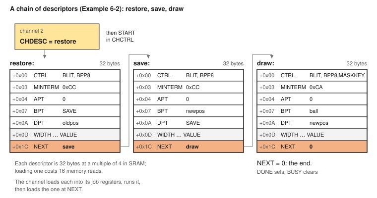
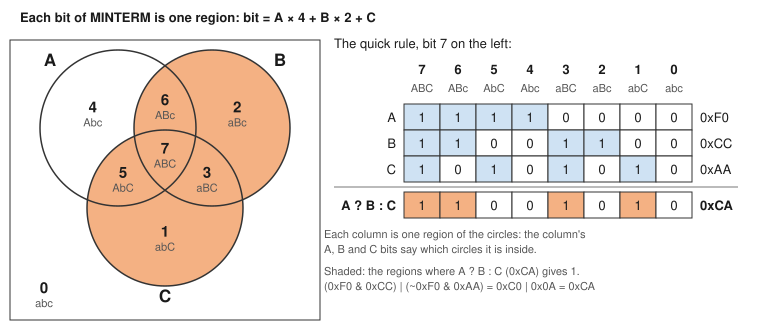
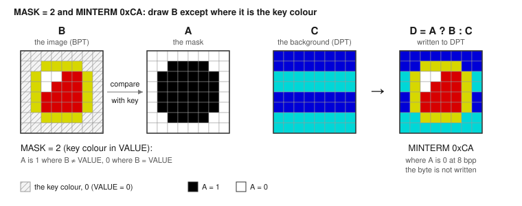
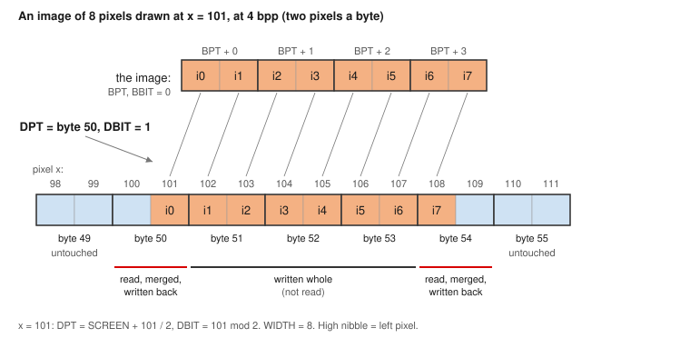
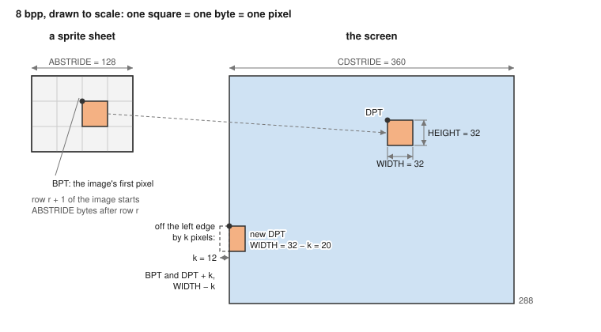
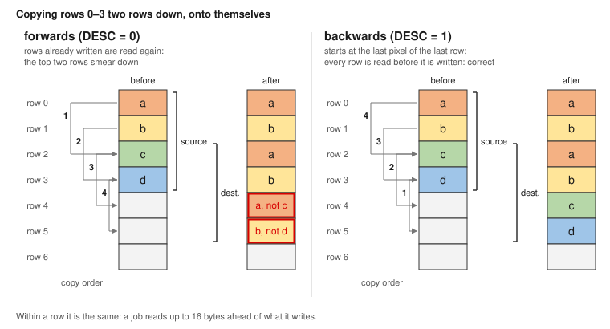
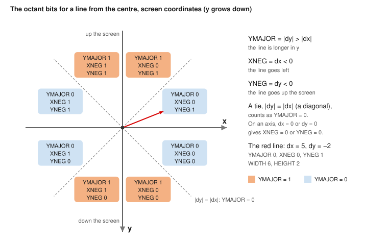
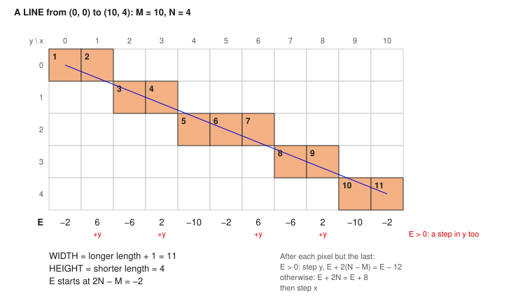
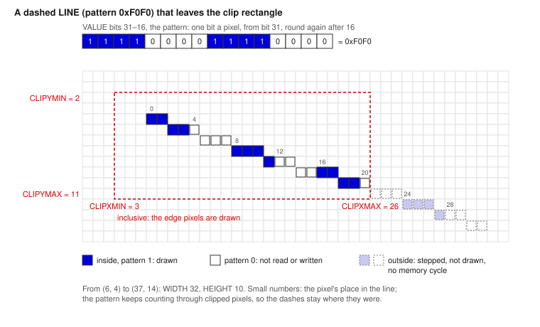
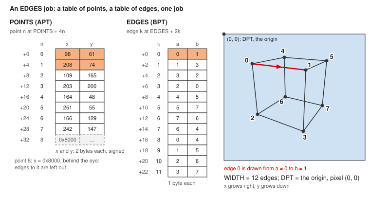

# Chapter 6: Blitter and DMA Hardware

## Introduction

The **blitter** draws for you. You tell it where an image is, where it should go and how to combine it with what is already there, and it does the work while the Z80 gets on with something else: on the board it clears a whole 360 × 288 screen in under 2 ms, where `LDIR` would take five and a half frames.

It is part of the **DMA engine**, which has four **channels**. Each channel runs one job at a time, and all four can run at once, taking turns at memory. A job is 32 bytes of settings: you can write them straight into a channel's registers, or leave a list of jobs in memory and let the channel work through them on its own.

The blitter works like the Amiga's. Each job has up to three inputs and one output:

```
   A  the mask        (which pixels to draw)
   B  the image       (what to draw)
   C  the background  (what is on the screen now)
            │
            ▼
   ┌──────────────────┐
   │  MINTERM         │   any logic function of A, B and C,
   │  D = f(A, B, C)  │   worked out bit by bit
   └──────────────────┘
            │
            ▼
   D  the destination (the screen, or any memory)

             Figure 6-1: The Blitter's Inputs and Output
```

C and D are the same place: the blitter reads what is there, combines it, and writes the result back. A **minterm** is one byte that says how A, B and C combine. With the right minterm the same hardware copies, fills, draws with a transparent colour, sets, clears or flips bits, and inverts areas.

### The four job types

Every job has an operation, OP, in the low bits of its first byte. There are four (Table 6-1). All four channels can run all four, and they share the same 32-byte layout; only the meaning of some fields changes.

**Table 6-1: Job Types**

| OP | Name | What it does | Shape | Section |
|----|------|--------------|-------|---------|
| 0 | BLIT | D = MINTERM(A, B, C) for every pixel: copy, fill, draw with a mask, any logic of image and screen | A rectangle, or one long row | "A Job's 32 Bytes" to "Filling and Adding" |
| 1 | ADD | D = C + B for every pixel, wrapping or saturating; the mask still chooses which pixels | A rectangle, or one long row | "Filling and Adding" |
| 2 | LINE | One straight line, each pixel through the minterm, with a 16-bit pattern, cut by a clip rectangle | WIDTH pixels along the line | "Drawing Lines" |
| 3 | EDGES | Every edge of a wireframe object, from a table of points and a table of edges in memory, each drawn as a LINE | WIDTH edges | "Drawing Wireframe Objects" |
| 4–7 | – | Reserved: 5 is MIX (on hold), 6 and 7 are kept for 3D. All stop the channel with an error | – | – |

BLIT and ADD work on rows of pixels and are what most programs use. LINE and EDGES step through single pixels for vector graphics: lines, outlines and 3D wireframes.

This chapter covers:

- the DMA engine: turning it on, its four channels, and how a channel's registers are reached;
- a job's 32 bytes, field by field, with a fill worked out byte by byte;
- running a job: the control and status registers, then a first example;
- lists of jobs (descriptors and chains);
- status, interrupts and errors;
- minterms, and how to work one out;
- masks: drawing a shape with a transparent colour, or through a mask image;
- moving objects about: saving and restoring the background;
- pixel depths, and placing an image at any pixel;
- rectangles, strides and clipping;
- overlapping copies, and scrolling;
- filling with a value or a pattern, and adding to pixels;
- drawing lines, with patterns and a clip rectangle;
- drawing wireframe objects with one job each;
- starting jobs from the copper and timers;
- speed, measured on the board, and how to keep jobs fast;
- what the blitter cannot do, and how it compares with the Amiga's;
- a summary of the registers.

You should have read the Playfield Hardware chapter: the blitter mostly draws into the layers described there.

**Version 1 works on SRAM only.** Copying into the hardware registers, the palettes, from the boot ROM, and to and from the SD card and USB serial link are planned for later (spec 14, section 4). Until then, a job that names one of them stops with an error. "What the Blitter Cannot Do" lists the rest.

**LINE and EDGES need room on the FPGA.** The KS3 has them. On the KS2 they fit only in the build without the copper (`fpga/ks2/build.sh --no-copper`); in the KS2's usual build, with the copper, OP 2 and 3 stop the channel with an error (ticket #75).

---

## Conventions in This Chapter

- Examples are Z80 assembly language for sjasmplus and start with `include "hw.inc"`. Numbers are hexadecimal when they start with `0x`.
- **Registers are reached through their ports**, as the Playfield Hardware chapter describes: `LD BC,name_P`, then `OUT (C),A` or `IN A,(C)`. "The DMA Engine" below gives the channels' ports.
- **Addresses are physical.** The blitter reads and writes SRAM by its 23-bit physical address, not through the MMU windows: physical address = MMU page × `0x2000` + offset in the page. Names in capitals, such as `SCREEN`, are physical addresses.
- **The examples run in the boot ROM's program map.** There a Z80 address in `0x2000`–`0xFFFF` is also its physical address, so a job kept in the program, or an image, goes into NEXT, CHDESC or BPT as it is. A program that maps other pages adds the difference.
- The complete examples are in `examples/blitter/`. Each starts with `device zxspectrum48`, `org 0x8000` and `include "hw.inc"`, and ends by putting back what it changed and returning to the monitor.
- The examples share `examples/blitter/screen.inc`, described with Example 6-1. It borrows layer L0 from the console and makes it a **360 × 288 bitmap**, shown at 2× each way over the whole picture, at physical `SCREEN` (`0x040000`). At 8 bpp a row is 360 bytes, and the pixel at (x, y) is at `SCREEN + y × 360 + x`. The colours are palette 0's first 16 entries, the Spectrum colours. At the end it gives L0 back to the console.
- Channel 2 does the examples' drawing.
- `screen.inc` names CTRL's middle byte, CTRL1, as below. `hw.inc` gives the same bits for the whole 3-byte CTRL register, so they are shifted down by 8:

```
BPP1    equ     0                       ; CTRL1: bits per pixel (the layer's BPP codes are the same)
BPP2    equ     1
BPP4    equ     2
BPP8    equ     3
DESC    equ     DMX_CTRL_DESC_M >> 8    ; 0x04  run backwards
IRQ     equ     DMX_CTRL_IRQ_M >> 8     ; 0x08  interrupt when this job ends
BCONST  equ     DMX_CTRL_BCONST_M >> 8  ; 0x10  B is VALUE, not memory
MASKIMG equ     1 << 5                  ; 0x20  A is a 1 bpp mask image
MASKKEY equ     2 << 5                  ; 0x40  A is "B is not the key colour"
OP_BLIT equ     0                       ; CTRL0
OP_ADD  equ     1
OP_LINE equ     2
OP_EDGES equ    3
```

- Examples 6-5 and 6-6 draw lines and need a bitstream with LINE and EDGES: on the KS2, the build without the copper.

---

## The DMA Engine

The DMA engine is the part of the chipset that moves and draws data on its own. It has four channels, and every channel has the same registers: 32 bytes that describe a job, and four that control the channel and report on it. Before a job can be described, you need to know how the engine is turned on and how its registers are reached.

### Turning it on

The engine runs only while **DMACON.DMAEN** and **DMACON.BLTEN** are both set. DMACON is a set/clear register: a write with SETCLR (bit 7) set sets the bits written as 1, and a write with it clear clears them. Do this once, when the program starts:

```
        ld      bc,DMACON_P
        ld      a,DMACON_SETCLR_M | DMACON_DMAEN_M | DMACON_BLTEN_M
        out     (c),a
```

Clearing BLTEN later holds every channel where it is; setting it again lets them carry on. The boot ROM leaves DMAEN set, since the console's layer needs it, and BLTEN clear.

### The four channels

Each channel is a page of 64 register bytes (Table 6-2). Any channel can run any job. The suggested use keeps 0 and 1 for the SD card and the USB serial link, once they are targets, 2 for general copies and fills, and 3 for graphics and the copper's jobs. The examples use channel 2.

**Table 6-2: The Channels**

| Channel | Name in `hw.inc` | Ports | Suggested use |
|---------|------------------|-------|---------------|
| 0 | `DMX0` | `0x4011`–`0x7F11` | The SD card (later) |
| 1 | `DMX1` | `0x8011`–`0xBF11` | The USB serial link (later) |
| 2 | `DMX2` | `0xC011`–`0xFF11` | Copies and fills; this chapter's examples |
| 3 | `DMX3` | `0x0012`–`0x3F12` | Graphics, and the copper's jobs |

### A channel's registers

A channel's registers are in two groups (Table 6-3). The first 32 bytes are the **job registers**: they hold the job the channel runs, in the layout the next section gives. The other four tell the channel what to do and say what it is doing.

**Table 6-3: A Channel's Registers**

| Offset | Name | Bytes | What it is for |
|--------|------|-------|----------------|
| `+0x00`–`+0x1E` | The job registers | 31 | The job: CTRL, MINTERM, the addresses, the size, the strides, VALUE and NEXT ("A Job's 32 Bytes") |
| `+0x20` | CHDESC | 3 | The address of a job in memory, for START ("Lists of Jobs") |
| `+0x24` | CHCTRL | 1 | Start, stop and pause the channel ("Running a Job") |
| `+0x28` | CHSTAT | 1 | Busy, done, error, paused ("Running a Job") |
| `+0x2C` | CHERR | 3 | After an error, the address that caused it ("Status, Interrupts and Errors") |

Each byte is one port, named in `hw.inc` as `DMX2_` plus the register's name and `_P`: `DMX2_CHCTRL_P`, `DMX2_CHSTAT_P`. A register of several bytes has a port for each, lowest first: `DMX2_DPT0_P`, `DMX2_DPT1_P`, `DMX2_DPT2_P`. The ports of one channel share their low byte (`0x11` for channels 0 to 2, `0x12` for channel 3), so after `LD BC,name_P` the register is in B and `INC B` steps to the next byte:

```
        ld      bc,DMX2_DPT0_P          ; DPT's low byte
        out     (c),l
        inc     b                       ; DPT's middle byte
        out     (c),h
        inc     b                       ; DPT's top byte
        out     (c),e
```

Two rules about the job registers:

- **They can be written only while the channel is idle.** A write while CHSTAT.BUSY is set is ignored.
- **They keep their values.** After a job, the registers still hold it, so a second job that differs in a few fields needs only those written.

There are two ways to give a channel a job. Write the 32 job registers yourself and write RUN to CHCTRL, as the first example does; or leave the 32 bytes in memory, give their address to CHDESC and write START, which "Lists of Jobs" describes. Either way the channel runs the same job from the same registers.

---

## A Job's 32 Bytes

A job is 32 bytes, which are also the first 32 registers of a channel, in the same order (Table 6-4). Each value is stored low byte first, as the Z80 stores words.

**Table 6-4: A Job's 32 Bytes**

| Offset | Name | Bytes | What it holds |
|--------|------|-------|---------------|
| `+0x00` | CTRL | 3 | CTRL0: the operation (Table 6-1) and its options. CTRL1: bits per pixel, DESC, IRQ, BCONST, MASK. CTRL2: 0 |
| `+0x03` | MINTERM | 1 | How A, B and C combine |
| `+0x04` | APT | 3 | Where the mask A starts (if MASK says it is an image) |
| `+0x07` | BPT | 3 | Where the image B starts |
| `+0x0A` | DPT | 3 | Where the destination D starts (C is read from here too) |
| `+0x0D` | WIDTH | 3 | Pixels across |
| `+0x10` | HEIGHT | 2 | Rows down |
| `+0x12` | SHIFT | 2 | Which pixel of its first byte A, B and D start at (0 unless below 8 bpp) |
| `+0x14` | ABSTRIDE | 2 | Bytes from one row of A and B to the next |
| `+0x16` | CDSTRIDE | 2 | Bytes from one row of D to the next |
| `+0x18` | VALUE | 4 | A colour: B's value when BCONST is set, or the transparent colour |
| `+0x1C` | NEXT | 3 | The next job in a list, or 0 |
| `+0x1F` | – | 1 | Spare: ignored |

Table 6-4 describes a BLIT or ADD job. LINE and EDGES use the same 32 bytes, but some fields mean something else there: Tables 6-16 and 6-20 give them. The fields follow, one by one, with what a fill of the whole screen puts in each; the fill is then shown as 32 bytes.

### CTRL: the operation and its options

CTRL's three bytes hold the operation and its options (Table 6-5, byte by byte, top bit first). The names in brackets are the equates from the conventions above and from `hw.inc`.

**Table 6-5: CTRL Bits**

| Byte | Bits | Name | Meaning |
|------|------|------|---------|
| CTRL0 | 7 | YNEG | LINE: the line goes up the screen (`DMX_CTRL_YNEG_M`). Other jobs: write 0 |
| | 6 | XNEG | LINE: the line goes left (`DMX_CTRL_XNEG_M`). Other jobs: write 0 |
| | 5 | SIGNED | ADD: pixels are signed numbers (`DMX_CTRL_SIGNED_M`) |
| | 4 | SAT | ADD: stop at the limit instead of wrapping round (`DMX_CTRL_SAT_M`) |
| | 3 | YMAJOR | LINE: the line is longer in y than in x (`DMX_CTRL_YMAJOR_M`). Other jobs: write 0 |
| | 2–0 | OP | 0 BLIT (`OP_BLIT`), 1 ADD (`OP_ADD`), 2 LINE (`OP_LINE`), 3 EDGES (`OP_EDGES`), 4–7 reserved: an error |
| CTRL1 | 7 | – | Reserved, write 0 |
| | 6–5 | MASK | Where A comes from: 0 none, 1 a mask image (`MASKIMG`), 2 the key colour (`MASKKEY`), 3 reserved: an error |
| | 4 | BCONST | B is VALUE, not read from memory |
| | 3 | IRQ | Set the channel's DMXINT bit when this job ends |
| | 2 | DESC | Run backwards |
| | 1–0 | BPP | Bits per pixel: 0 = 1 (`BPP1`), 1 = 2, 2 = 4, 3 = 8 (`BPP8`) |
| CTRL2 | 7–0 | – | Reserved for the targets that come later, write 0: anything else is an error |

A fill is a BLIT whose B is a constant: CTRL0 is `OP_BLIT`, CTRL1 is `BPP8|BCONST` for an 8 bpp screen, and CTRL2 is 0.

### MINTERM: how A, B and C combine

MINTERM is one byte: a truth table of the function the blitter works out for every bit of every pixel. `0xCC` means D = B, which copies B onto D, or with BCONST fills D with VALUE. "Minterms" gives the byte's bits, how to work out any function, and a table of the useful ones.

### APT, BPT and DPT: where A, B and D are

Three physical addresses, 23 bits each in 3 bytes: the first byte of the mask, of the image and of the destination. C is read from DPT, since C and D are the same place. A job that does not read A or B ignores APT or BPT: a fill needs only DPT. The addresses must be in SRAM.

### WIDTH and HEIGHT: the size

A job covers WIDTH pixels across and HEIGHT rows down. WIDTH is in pixels at the job's depth, so at 8 bpp it is in bytes. A job of HEIGHT 1 is one long row, like `LDIR`; a job of WIDTH or HEIGHT 0 does nothing. The screen fill is 360 across and 288 down.

### SHIFT: the first pixel's place in its byte

Below 8 bpp a byte holds several pixels, and SHIFT says which pixel of its first byte each of A, B and D starts at. At 8 bpp a pixel is a byte, so SHIFT is 0. "Pixel Depths and Positions" gives its bits.

### ABSTRIDE and CDSTRIDE: from one row to the next

A **stride** is the number of bytes from the start of one row to the start of the next: ABSTRIDE for A and B, CDSTRIDE for D. Each is a signed 16-bit number. The screen's stride is its row length, 360 bytes, and an image cut from a wider sheet has the sheet's. A stride of 0 draws the same row again and again, and a negative stride runs up the memory. "Rectangles, Strides and Clipping" has more. A fill does not read B, so its ABSTRIDE does not matter.

### VALUE: a colour

Four bytes. With BCONST set, VALUE is what B would have been read as: at 8 bpp, byte n of each 4-byte group gets VALUE's byte n, so a fill in one colour puts that colour in all four bytes (`0x01010101` for blue). With MASKKEY, VALUE is the transparent colour. "Filling and Adding" and "Masks" have the details.

### NEXT: the next job

The physical address of the next job in a list, or 0 for the last job. A job on its own has NEXT 0. "Lists of Jobs" has the rest.

### A fill, byte by byte

With `SCREEN` at physical `0x040000`, this is the job that fills the examples' screen with blue, as Example 6-1 keeps it:

```
clearjob:
        db      OP_BLIT, BPP8|BCONST, 0 ; CTRL: draw with the value, 8 bpp
        db      0xCC                    ; MINTERM: D = B
        d24     0                       ; APT: no mask
        d24     0                       ; BPT: not read (BCONST)
        d24     SCREEN                  ; DPT
        d24     360                     ; WIDTH
        dw      288                     ; HEIGHT
        dw      0                       ; SHIFT
        dw      0                       ; ABSTRIDE: B is not read
        dw      360                     ; CDSTRIDE: the screen's row length
        dd      0x01010101              ; VALUE: colour 1, blue, in all four bytes
        d24     0                       ; NEXT: no more jobs
        db      0
```

The assembler turns it into the 32 bytes below. Each raw line has the source form in its comment, and the two give the same job:

```
        db      0x00,0x13,0x00          ; CTRL: OP_BLIT; BPP8|BCONST; 0
        db      0xCC                    ; MINTERM: D = B
        db      0x00,0x00,0x00          ; APT: 0
        db      0x00,0x00,0x00          ; BPT: 0
        db      0x00,0x00,0x04          ; DPT: SCREEN, 0x040000, low byte first
        db      0x68,0x01,0x00          ; WIDTH: 360 = 0x000168
        db      0x20,0x01               ; HEIGHT: 288 = 0x0120
        db      0x00,0x00               ; SHIFT: 0
        db      0x00,0x00               ; ABSTRIDE: 0
        db      0x68,0x01               ; CDSTRIDE: 360
        db      0x01,0x01,0x01,0x01     ; VALUE: 0x01010101
        db      0x00,0x00,0x00          ; NEXT: 0
        db      0x00                    ; spare
```

CTRL1 is `0x13`: BCONST (bit 4) and BPP 3 (bits 1–0) in Table 6-5. Since the screen's rows follow each other with no gap, the same fill could also be one row of 103,680 pixels and HEIGHT 1, as Example 6-4's `clearjob` is.

---

## Running a Job

A job in the registers is started and watched through two one-byte registers: **CHCTRL** (Table 6-6) starts and stops the channel, and **CHSTAT** (Table 6-7) says what it is doing.

**Table 6-6: CHCTRL Bits**

| Bits | Name | Meaning |
|------|------|---------|
| 7–4 | – | Reserved, write 0 |
| 3 | PAUSE | While set, hold the list after its current group; clear it to carry on. Also readable |
| 2 | STOP | End the list after the current group of at most 32 bytes |
| 1 | RUN | Run the job already in the registers, then follow its NEXT |
| 0 | START | Load the descriptor at CHDESC and run it |

**Table 6-7: CHSTAT Bits**

| Bits | Name | Meaning |
|------|------|---------|
| 7–4 | – | Read 0 |
| 3 | PAUSED | The list is held by CHCTRL.PAUSE |
| 2 | ERR | A job stopped with an error. Write 1 to clear |
| 1 | DONE | A list ended or was stopped. Write 1 to clear |
| 0 | BUSY | A list is running, paused, or waiting for DMACON.BLTEN |

Running a job from the registers takes four steps.

### Step 1: Wait until the channel is idle

The job registers can be written only while the channel is idle. BUSY is bit 0 of CHSTAT, so `RRA` puts it in carry:

```
wait2:  ld      bc,DMX2_CHSTAT_P
.busy:  in      a,(c)
        rra                             ; BUSY into carry
        jr      c,.busy
```

### Step 2: Write the job registers

The easiest way to set a job is to keep it in memory as 32 bytes, as `clearjob` above, and copy it into the channel's registers with a loop, one port after another. `OTIR` cannot do it: it counts B down, and B is the register.

```
load2:  ld      bc,DMX2_P               ; B = the first register, C = page 0x11
.next:  ld      a,(hl)
        out     (c),a
        inc     hl
        inc     b                       ; the next register
        ld      a,b
        cp      (high DMX2_P) + 32
        jr      nz,.next
        ret
```

The spare byte is ignored. Since the registers keep their values, a job that differs from the last in a few fields needs only those fields written.

### Step 3: Start it

Write **RUN** to the channel's CHCTRL:

```
        ld      bc,DMX2_CHCTRL_P
        ld      a,DMX_CHCTRL_RUN_M
        out     (c),a
```

The channel is busy from that moment.

### Step 4: Wait, or do something else

The job runs by itself. The Z80 carries on at full speed: the blitter never takes a memory cycle the CPU wants. When you need the result, wait until BUSY is clear, with `wait2` again. Or ask for an interrupt when the job ends: IRQ in CTRL1, described in "Status, Interrupts and Errors".

### Example 6-1: Clear the screen

`examples/blitter/clear.asm` turns the engine on, fills the screen with blue with the job above, and keeps the picture up until a key is pressed. It also times the fill with TIME, the microsecond counter (spec 9). Then it gives the screen back to the console and prints the time.

```
; Example 6-1 (docs/guide/blitter.md): clear the screen with one blitter job.
; It shows a 360 x 288 8 bpp layer, fills it with blue on channel 2, and
; keeps the picture up until a key is pressed. Then it puts the console back
; and prints how long the fill took.

        device  zxspectrum48            ; sjasmplus writes source lines (--sld) only inside a DEVICE
        org     0x8000

        include "hw.inc"

start:  ld      a,BPP8                  ; the layer: 8 bpp,
        ld      hl,360                  ; 360 bytes a row
        call    scr_on                  ; also sets DMACON.DMAEN and BLTEN
        call    wait2                   ; wait until channel 2 is free
        ld      hl,clearjob
        call    load2                   ; the job into channel 2's registers
        ld      bc,TIME0_P
        in      e,(c)                   ; TIME in us: reading TIME0 captures all 4 bytes
        inc     b
        in      d,(c)
        ld      bc,DMX2_CHCTRL_P
        ld      a,DMX_CHCTRL_RUN_M
        out     (c),a                   ; go
        call    wait2                   ; CHSTAT.BUSY clear: the screen is blue
        ld      bc,TIME0_P
        in      l,(c)
        inc     b
        in      h,(c)
        or      a
        sbc     hl,de
        ld      (took),hl               ; us, to print once the console is back
        call    waitkey                 ; the picture until a key is pressed
        call    scr_off
        ld      hl,msg
        rst     18h                     ; PUTS
        ld      hl,(took)
        rst     28h
        db      0x08                    ; PUTDEC
        ld      hl,us
        rst     18h
        ret                             ; back to the monitor

took:   dw      0
msg:    db      "The fill took ", 0
us:     db      " us", 13, 10, 0

clearjob:
        ; ... the 32 bytes of "A fill, byte by byte"

        include "screen.inc"
```

The blitter's part is the four steps: `wait2`, `load2`, RUN, `wait2`. The rest is the screen and the console. `examples/blitter/screen.inc`, which every example in this chapter includes, holds the CTRL equates of the conventions and these routines:

- `scr_on` saves L0's registers and makes L0 a bitmap of A bits per pixel, HL bytes a row, at `SCREEN`, shown at 2× each way, as the Playfield Hardware chapter describes. Then it sets DMACON's DMAEN, BPLEN and BLTEN.
- `frame` waits for the vertical blank, then points L0 at `SCREEN` again: nothing resets a bitmap's pointer at the start of a frame (the copper can do it instead).
- `waitkey` calls `frame` until a key is pressed.
- `scr_off` puts L0's registers back, clears BLTEN, and clears channel 2's DONE and ERR.
- `wait2` and `load2` are Steps 1 and 2 above.
- `run2` is `wait2`, `load2`, RUN and `wait2`: it runs the job at HL and waits for it.
- `start2` starts the list whose first job is at HL ("Lists of Jobs").

On the board the whole picture turns blue at once, and after a key the console comes back with `The fill took 1955 us`. The job "draws" B onto D, and B is the constant VALUE: so every pixel becomes colour 1. With VALUE 0 it clears to black.

---

## Lists of Jobs

Each job ends with NEXT: the physical address of another job in SRAM, or 0. A list of jobs runs one after another, with no help from the CPU. Jobs in memory are called **descriptors**; they must start at an address that is a multiple of 4 (`align 4`). Figure 6-2 shows a list of three, as Example 6-2 uses.



*Figure 6-2: A List of Jobs*

To start a list, write the first descriptor's address to the channel's **CHDESC** and **START** to CHCTRL. The channel loads each descriptor in turn into its job registers and runs it. This is `start2` from `screen.inc`, with HL the first descriptor:

```
start2: ld      bc,DMX2_CHDESC0_P
        out     (c),l
        inc     b
        out     (c),h
        inc     b
        xor     a                       ; bits 23-16: the program is below 0x10000
        out     (c),a
        ld      bc,DMX2_CHCTRL_P
        ld      a,DMX_CHCTRL_START_M
        out     (c),a
        ret
```

RUN follows NEXT too: a job written into the registers with a NEXT that is not 0 runs, and then the list at NEXT. While a list runs, CHDESC reads as the descriptor now running. STOP ends the list after the current group of at most 16 bytes, and PAUSE holds it there until PAUSE is cleared; both are in CHCTRL (Table 6-6).

Lists are the quickest way to start a lot of work: the CPU writes four registers, and a whole frame's drawing runs on its own. A list can be built once and reused, changing only the positions each frame, as Example 6-2 does. The jobs must stay where they are while the channel uses them, and a program changes them only while the channel is idle. Loading a descriptor costs 16 memory reads; Example 6-2's three jobs, started with START, take 114 µs where the single draw job takes 39 µs (Table 6-21).

---

## Status, Interrupts and Errors

**DONE and ERR** in CHSTAT (Table 6-7) stay set until you clear them by writing 1 to that bit; `scr_off` clears both before the examples return. DONE is set when a list reaches its end or is stopped, never after an error.

**Interrupts.** A job with IRQ in CTRL1 sets its channel's bit in **DMXINT** when it ends. If the same bit is set in **DMXINTEN**, the channel interrupts the Z80: sources DMA0–DMA3 in the interrupt controller. The handler clears the bit by writing 1 to it in DMXINT. Put IRQ on the last job of a list to hear when the whole list is done, or on any job in it. DMXINT and DMXINTEN have the same bits (Table 6-8).

**Table 6-8: DMXINT and DMXINTEN Bits**

| Bits | Name | Meaning |
|------|------|---------|
| 7–4 | – | Read 0 |
| 3 | CH3 | Channel 3 (source DMA3) |
| 2 | CH2 | Channel 2 (source DMA2) |
| 1 | CH1 | Channel 1 (source DMA1) |
| 0 | CH0 | Channel 0 (source DMA0) |

**Errors** stop only that channel: an address outside SRAM (in version 1, the registers, palettes and ROM too), a reserved operation or MASK value, a non-zero CTRL2, or a descriptor address that is not a multiple of 4. BUSY clears, ERR is set, **CHERR** says where, and the channel's DMXINT bit is set. The other channels carry on.

On the board, five bad jobs started with RUN on channel 2 (a mask image on the KS2, MASK 3, OP 2 in a bitstream without LINE, CTRL2 = 1, and a DPT of `0x200000`, just past the KS2's 2 MB) each ended with CHSTAT `0x04`: ERR, with DONE clear. DMXINT read `0x04`, channel 2's bit. CHERR held `0x200000` for the bad address, and 0 for the other four, which have no address to blame.

---

## Minterms

For every bit of every pixel, the blitter takes the bits of A, B and C at that place and looks up the result in MINTERM (Table 6-9).

**Table 6-9: MINTERM Bits**

| Bits | Name | Meaning: D when |
|------|------|-----------------|
| 7 | ABC | A = 1, B = 1, C = 1 |
| 6 | ABc | A = 1, B = 1, C = 0 |
| 5 | AbC | A = 1, B = 0, C = 1 |
| 4 | Abc | A = 1, B = 0, C = 0 |
| 3 | aBC | A = 0, B = 1, C = 1 |
| 2 | aBc | A = 0, B = 1, C = 0 |
| 1 | abC | A = 0, B = 0, C = 1 |
| 0 | abc | A = 0, B = 0, C = 0 |

(The names are the Amiga's: a capital letter for an input at 1, a small one for an input at 0.)

So the minterm is a truth table of the function you want. Figure 6-3 shows it as a diagram: each of the eight areas of the three circles is one combination of A, B and C, and so one bit of MINTERM.



*Figure 6-3: How MINTERM's Bits Map to A, B and C*

There is a quick way to work one out, as on the Amiga: write the function you want with **A = `0xF0`, B = `0xCC`, C = `0xAA`**, and work it out with ordinary logic. The answer is the minterm.

- D = B: `0xCC`.
- D = B OR C: `0xCC | 0xAA` = `0xEE`.
- D = B XOR C: `0xCC ^ 0xAA` = `0x66`.
- D = A ? B : C, "B where the mask is set, otherwise C": `(0xF0 & 0xCC) | (~0xF0 & 0xAA)` = `0xC0 | 0x0A` = `0xCA`.

The assembler can do the working for you. These two lines give the same byte:

```
        db      0xCA                            ; MINTERM: A ? B : C
        db      (0xF0 & 0xCC) | (~0xF0 & 0xAA)  ; the same, worked out by sjasmplus
```

Table 6-10 lists the ones you will use most.

**Table 6-10: Common Minterms**

| MINTERM | D = | Use |
|---------|-----|-----|
| `0xCC` | B | Copy an image; with BCONST, fill with a colour |
| `0xCA` | A ? B : C | Draw a shape: B where the mask is set, the background elsewhere |
| `0x0A` | A ? 0 : C | Cut a shape out (colour 0 where the mask is set) |
| `0xEE` | B OR C | Set bits |
| `0x88` | B AND C | Keep only bits set in both |
| `0x22` | C AND NOT B | Clear the bits B has set |
| `0x66` | B XOR C | Flip bits: drawing the same thing twice removes it again |
| `0x55` | NOT C | Invert an area |
| `0x00` | 0 | Clear (but a fill with VALUE 0 is just as fast) |

Table 6-11 gives common jobs as CTRL1 and MINTERM.

**Table 6-11: Common Jobs as Minterms**

| Job | CTRL1 | MINTERM |
|-----|-------|---------|
| Copy | BPPn | `0xCC` |
| Fill | BPPn + BCONST | `0xCC` |
| Copy with a transparent colour | BPPn + MASKKEY | `0xCA` |
| Any function FN of B and C (4 bits, as a truth table) | BPPn | FN × `0x11` |

**The minterm works on bits, not colours.** At 8 bpp, B XOR C flips the bits of each pixel's colour number, which gives another colour; it is drawing and undrawing that make XOR useful, not the colour you see. On the board, XOR with VALUE 7 over a screen of colour 5 left colour 2. For colour arithmetic, use ADD.

---

## Masks

The mask, A, says which pixels to draw. It is one bit per pixel: where it is 1, the minterm sees A = 1 in all of that pixel's bits; where it is 0, A = 0. MASK in CTRL1 says where it comes from (Table 6-12).

**Table 6-12: MASK Values**

| MASK | A comes from | Costs |
|------|--------------|-------|
| 0 (none) | Nothing: A is 1 everywhere | Nothing |
| 1 (`MASKIMG`) | A **mask image** at APT: 1 bit per pixel, the leftmost pixel in bit 7 of each byte. Not on the KS2 | One memory read per 16 pixels |
| 2 (`MASKKEY`) | Comparing each pixel of B with the **key colour** in VALUE: A is 0 where B is that colour, 1 elsewhere | Nothing: no memory is read |
| 3 | Reserved: the channel stops with an error | – |

With no mask, a minterm that uses A sees A = 1, so `0xCA` is just a copy.

### Drawing with a transparent colour

Most game graphics keep one colour, usually 0, for "nothing here". MASKKEY with VALUE = that colour and MINTERM `0xCA` draws only the other pixels:

```
        db      OP_BLIT, BPP8|MASKKEY, 0
        db      0xCA                    ; A ? B : C
        ...
        dd      0                       ; VALUE: the key colour
```

At 8 bpp this costs no more than a plain copy: where the mask is 0 the blitter simply does not write that byte, and it never needs to read the screen. Examples 6-2 and 6-3 draw this way. Figure 6-4 follows one small image through.



*Figure 6-4: Drawing with a Key Colour (Cookie-Cut)*

### Drawing through a mask image

When a shape uses every colour, or when the same image needs different shapes, keep a mask image: 1 bit per pixel, 1 where the image should show. Set MASK to MASKIMG and APT to the mask. The mask's rows are the same distance apart as the image's (ABSTRIDE serves both), so a row of an 8 bpp mask uses only one byte in eight of its row's space. Keeping the masks of a sprite sheet in their own sheet, with the same row length as the images, puts that space to use.

**The KS2 has no room for mask images.** There a MASKIMG job stops the channel with an error, as tried above in "Status, Interrupts and Errors". The KS3 has them. On the KS2, use MASKKEY.

---

## Moving Objects: Save, Draw, Restore

The classic way to move an object around a screen ("bobs", blitter objects, on the Amiga) uses three jobs per object, per frame:

1. **Restore** the background where the object was last frame, from a saved copy.
2. **Save** the background where it is going.
3. **Draw** it there.

### Example 6-2: One moving object

`examples/blitter/bob.asm` bounces a 32 × 32 ball over eight bands of colour. The ball is at 8 bpp, 32 bytes a row, with colour 0 transparent. `SAVE` (physical `0x060000`) is 1,024 bytes for the saved background. The three jobs are a list, as Figure 6-2 shows; each frame the program writes the old and new positions into them and starts the list with `start2`. These are the jobs:

```
SAVE    equ     0x060000                ; physical: 1,024 bytes for the saved background

        align   4
restore: db     OP_BLIT, BPP8, 0, 0xCC  ; copy
        d24     0, SAVE                 ; APT, BPT: the saved background
oldpos: d24     SCREEN                  ; DPT: where the ball was (set each frame)
        d24     32
        dw      32, 0                   ; HEIGHT, SHIFT
        dw      32, 360                 ; ABSTRIDE: SAVE's rows; CDSTRIDE: the screen's
        dd      0
        d24     save                    ; NEXT
        db      0

save:   db      OP_BLIT, BPP8, 0, 0xCC  ; copy
        d24     0
newpos1: d24    SCREEN                  ; BPT: where the ball goes (set each frame)
        d24     SAVE                    ; DPT
        d24     32
        dw      32, 0
        dw      360, 32                 ; ABSTRIDE: now the screen; CDSTRIDE: SAVE's rows
        dd      0
        d24     draw
        db      0

draw:   db      OP_BLIT, BPP8|MASKKEY, 0, 0xCA  ; A ? B : C, key colour 0
        d24     0, ball                 ; APT (not used), BPT: the ball
newpos2: d24    SCREEN                  ; DPT: where the ball goes (set each frame)
        d24     32
        dw      32, 0
        dw      32, 360
        dd      0                       ; VALUE: the key colour
        d24     0                       ; NEXT: end of the list
        db      0
```

And this is the frame loop:

```
loop:   call    frame                   ; once a frame, in the vertical blank
        call    wait2                   ; last frame's list is long done
        ld      hl,(newpos2)            ; where the ball is now ...
        ld      (oldpos),hl
        ld      a,(newpos2+2)
        ld      (oldpos+2),a            ; ... is where to restore next
        call    move
        call    place
        ld      hl,restore              ; restore, save, draw
        call    start2
        rst     20h                     ; POLLC: a key ends it
        jr      z,loop
```

The file has the rest: `move` steps the ball and bounces it off the edges, `place` works out `SCREEN + y × 360 + x` (360 = 256 + 104) into `newpos1` and `newpos2`, the background is a list of eight fills built by a macro, and the first frame starts at `save`, since it has nothing to restore. The ball itself is made by the assembler with `DUP`.

A job's own Z80 address is its physical address in the program map, so `save` and `draw` go into NEXT as they are (see "Conventions").

Note how the strides swap: when the screen is the source, its stride is ABSTRIDE; when it is the destination, CDSTRIDE.

On the board the ball moves smoothly over the bands, and the bands stay whole behind it: each restore puts back exactly what the save took. The three jobs take 114 µs a frame (Table 6-21).

---

## Pixel Depths and Positions

BPP in CTRL1 sets the bits per pixel: 1, 2, 4 or 8. A job works on whole pixels at that depth. B and D are read and written at the same depth; A is always 1 bit per pixel.

Below 8 bpp, a byte holds several pixels, the leftmost in the most significant bits (Table 6-13).

**Table 6-13: Pixels in a Byte**

| BPP | Pixels per byte | Pixel x is in byte | At position |
|-----|-----------------|--------------------|-------------|
| 1 | 8 | x / 8 | x mod 8 |
| 2 | 4 | x / 4 | x mod 4 |
| 4 | 2 | x / 2 | x mod 2 |
| 8 | 1 | x | 0 |

An image can start at any pixel. Give its byte address in APT, BPT or DPT, and its position within that byte in **SHIFT** (Table 6-14). Positions count pixels from the most significant end of the byte. The blitter shifts A and B into line with D, so an image stored at the start of its bytes can be drawn at any x.

**Table 6-14: SHIFT Bits**

| Bits | Name | Meaning |
|------|------|---------|
| 15–11 | – | Reserved, write 0 |
| 10–8 | DBIT | D's first pixel in its byte, in pixels of the job's depth: 0–7 at 1 bpp, 0–3 at 2 bpp, 0–1 at 4 bpp, 0 at 8 bpp |
| 7 | – | Reserved, write 0 |
| 6–4 | BBIT | B's first pixel in its byte, counted as DBIT |
| 3 | – | Reserved, write 0 |
| 2–0 | ABIT | A's first pixel in its byte, in 1-bit pixels: 0–7 |

### Example 6-3: Placing an image at any x, at 4 bpp

`examples/blitter/shift.asm` makes the screen 4 bpp, 360 pixels across, so 180 bytes a row. It draws a yellow line at x = 99, then the same 16 × 16 image (8 bytes a row, starting at the beginning of its bytes) eight times, at x = 100, 101, … 107, one under another. The corners of the image are colour 0, the key. The jobs are a list, made by the assembler; this is the part that makes the eight image jobs:

```
ROW     equ     180                     ; bytes a row at 4 bpp

; Image k at x = 100 + k, y = 8 + 35 k: DPT the byte holding pixel x, and
; DBIT where x falls in it
img0:
k = 0
        DUP     8
x = 100 + k
y = 8 + 35 * k
        db      OP_BLIT, BPP4|MASKKEY, 0, 0xCA  ; A ? B : C, key colour 0
        d24     0, image
        d24     SCREEN + y * ROW + x / 2        ; DPT: the byte holding pixel x
        d24     16
        dw      16
        dw      (x % 2) << 8                    ; SHIFT: DBIT = x mod 2
        dw      8, ROW                          ; ABSTRIDE: the image's rows; CDSTRIDE: the screen's
        dd      0
        IF k < 7
        d24     $ + 4                           ; NEXT: the next image
        ELSE
        d24     0
        ENDIF
        db      0
k = k + 1
        EDUP
```

For the second image, x = 101 and y = 43, the assembler makes DPT `0x041E6E`, SHIFT `0x0100` (DBIT 1 in Table 6-14) and CTRL1 `0x42` (MASKKEY and BPP 2 in Table 6-5):

```
        db      0x6E,0x1E,0x04          ; DPT: the same as SCREEN + 43*180 + 101/2
        dw      0x0100                  ; SHIFT: the same as (101 % 2) << 8
        db      0x42                    ; CTRL1: the same as BPP4|MASKKEY
```

The blitter handles the bytes at each end of every row that the image covers only in part: it reads them, changes only the image's pixels, and writes them back. You never set edge masks. Figure 6-5 shows one row of it.



*Figure 6-5: An Image Drawn from the Second Pixel of a Byte (4 bpp)*

On the board the eight images step one pixel to the right each, away from the line. The bytes show it: the second image's second row reads `16 12 77 77 77 77 77 77 77 21` from byte 49. Byte 49 holds pixel 98 (background, 1) and the line at 99 (6); byte 50 holds pixel 100 (background) and the image's red edge at 101; byte 58 holds the right edge at 116 and the background at 117. The first row starts `11 22`: the corner pixel at 101 is the key colour, so the background shows through it.

8 bpp is the fastest depth for game graphics: every pixel is a whole byte, so nothing needs to be read back.

---

## Rectangles, Strides and Clipping

A job covers WIDTH × HEIGHT pixels. After each row it moves on by the **stride**: ABSTRIDE bytes for A and B, CDSTRIDE bytes for D. So an image can come out of a sheet of many images, of any row length, into a screen of a different row length.

- A **linear** job (one long run, like `LDIR`) is HEIGHT 1 and WIDTH the length; at 8 bpp the width is in bytes.
- A stride of **0** repeats the same row: a 1-row pattern fills a whole rectangle.
- A **negative** stride runs up the memory: an image drawn upside down.

Figure 6-6 shows an image copied out of a sheet into the screen, and the same job trimmed where it runs off the left edge.



*Figure 6-6: Rectangles and Strides*

**Clipping is up to you.** Before starting a job, trim it to the screen:

- **Off the left edge by k pixels:** add k pixels to BPT and DPT (bytes, plus BBIT and DBIT below 8 bpp), k bits to APT (bytes, plus ABIT), and take k from WIDTH.
- **Off the right edge:** take the pixels past the edge from WIDTH.
- **Off the top by r rows:** add r × ABSTRIDE to APT and BPT, r × CDSTRIDE to DPT, and take r from HEIGHT.
- **Off the bottom:** take the rows past the edge from HEIGHT.

If WIDTH or HEIGHT comes to 0 or less, the object is off the screen: skip the job (a job with WIDTH or HEIGHT 0 does nothing).

---

## Overlapping Copies and Scrolling

A job reads up to 32 bytes ahead of where it writes. When the source and destination overlap, that matters:

- If the destination is **before** the source (scrolling up or left), run forwards, as usual.
- If the destination is **after** the source (scrolling down or right), set **DESC** in CTRL1. The job then runs backwards, from the last pixel of the last row to the first. You still give the addresses of the first pixel: the blitter works out the end for itself.



*Figure 6-7: Overlapping Copies: Forwards and Backwards*

### Example 6-4: Scroll the screen down by 8 lines

`examples/blitter/scroll.asm` scrolls the screen down by 8 lines every frame, and fills the 8 new lines at the top with a colour that changes every three frames. Bands of colour 24 lines deep roll down the screen. The scroll is one job, and the new lines another:

```
scrolljob:
        db      OP_BLIT, BPP8|DESC, 0, 0xCC     ; copy, backwards
        d24     0
        d24     SCREEN                          ; BPT: the top of the screen
        d24     SCREEN + 8*360                  ; DPT: 8 lines further down
        d24     360
        dw      280                             ; the 280 lines that stay visible
        dw      0
        dw      360, 360
        dd      0
        d24     0
        db      0

topjob: db      OP_BLIT, BPP8|BCONST, 0, 0xCC   ; fill the top 8 lines
        d24     0, 0, SCREEN
        d24     360
        dw      8, 0, 0, 360
        dd      0                               ; VALUE: set by colour
        d24     0
        db      0
```

Each frame, in the vertical blank, the program runs `scrolljob` with `run2`, writes the next colour into `topjob`'s VALUE and runs that. Without DESC the copy would read lines it has already written, and smear the top band down the whole screen. On the board the bands roll down cleanly, and after a key the console shows `The last scroll took 3288 us`: 100,800 bytes, starting at the vertical blank.

---

## Filling and Adding

### Filling with a value or a pattern

With BCONST set, B is not read: every pixel of B is VALUE. At 1, 2 and 4 bpp, VALUE's low bits give the colour (Example 6-3's fills use VALUE 1 and 6 at 4 bpp). At 8 bpp, VALUE's four bytes repeat **by address**: the byte at address a gets VALUE's byte number a mod 4 (byte 0 is the low byte). So:

- for one colour, put it in all four bytes: VALUE = `0x07070707`;
- for a tile map of 2-byte entries, put the entry in both halves (`0x01230123`) and start at an even address;
- for a 4-byte pattern, start at a multiple of 4.

Since the pattern goes by address, a 2D fill whose stride is not a multiple of 4 starts each row at a different point of it.

A fill through a mask image is also useful: MASKIMG with MINTERM `0xCA` and BCONST paints a shape in one colour (a shadow, or a sprite flashing white when hit). That needs the KS3. A key mask cannot do it: with BCONST, MASKKEY compares VALUE with itself, so A is 0 everywhere and nothing is drawn.

### ADD: shading and effects

OP_ADD adds B to C, pixel by pixel, at the job's depth: D = C + B. A carry never spills into the next pixel. The minterm is not used; the mask is (where A is 0, D keeps C). CTRL0 has two more bits for ADD:

- **SAT** (`DMX_CTRL_SAT_M`): stop at the limit instead of wrapping round. At 8 bpp, 250 + 10 gives 4 without SAT and 255 with it.
- **SIGNED** (`DMX_CTRL_SIGNED_M`): pixels are numbers from −128 to +127 (at 8 bpp), for saturating signed sums.

Table 6-15 shows what the three settings give for a few 8 bpp pixels.

**Table 6-15: ADD at 8 bpp**

| C | B | SAT = 0 (wrap) | SAT = 1, SIGNED = 0 | SAT = 1, SIGNED = 1 |
|---|---|----------------|---------------------|---------------------|
| 250 | 10 | 4 | 255 | 4 (−6 + 10) |
| 100 | 100 | 200 | 200 | 127 (+100 + 100 stops at +127) |
| 5 | `0xFF` | 4 | 255 | 4 (+5 − 1) |
| `0x90` (−112) | `0xF0` (−16) | `0x80` | 255 | `0x80` (−128) |

At 1, 2 and 4 bpp the limits are those of the pixel: 0–15 unsigned and −8 to +7 signed at 4 bpp, for example.

Uses:

- **Darken or brighten** an area when the palette is laid out in ramps (for example 16 shades of each colour): add a constant, with SAT, to step every pixel along its ramp.
- **Move an area to another palette block:** add 16, 32 and so on.
- **Glows and light maps:** add an image of light onto the scene.
- **Subtract:** add the two's complement: at 8 bpp, adding `0xFF` with wrap takes 1 away.

---

## Drawing Lines

A **LINE** job (OP 2) draws one straight line. You give the first pixel, which way the line goes and how long it is along each axis; the blitter steps from pixel to pixel by Bresenham's rule and draws each one through the minterm, as a BLIT draws its pixels. Three things come with it:

- a **colour**, B, from VALUE's low byte;
- a 16-bit **pattern**, A, from VALUE's high half, for dashed and dotted lines;
- a **clip rectangle**, shared by all channels: pixels outside it are stepped over but not drawn.

LINE works at 1, 2, 4 and 8 bpp, into any bitmap in SRAM.

### Step 1: Work out the octant and the lengths

For a line from (x0, y0) to (x1, y1), with y growing down the screen:

1. dx = x1 − x0 and dy = y1 − y0.
2. **XNEG** if dx is negative (the line goes left); **YNEG** if dy is negative (it goes up the screen).
3. **YMAJOR** if \|dy\| > \|dx\|: the line is steeper than 45° and steps along y. A tie goes along x.
4. **WIDTH** = the longer of \|dx\| and \|dy\|, plus 1, since both ends are drawn. **HEIGHT** = the shorter.

The three bits pick one of eight **octants** (Figure 6-8).



*Figure 6-8: A Line's Octant*

### Step 2: Fill in the job

Table 6-16 gives the fields of a LINE job. Most keep their BLIT meaning; APT and BPT hold the first pixel's coordinates instead of addresses, for the clip test.

**Table 6-16: A LINE Job's Fields**

| Field | In a LINE job |
|-------|---------------|
| CTRL0 | OP = 2; YMAJOR, XNEG and YNEG from Step 1. SAT and SIGNED are ignored |
| CTRL1 | BPP and IRQ as usual. BCONST is ignored: B is always VALUE. DESC and MASK must be 0 (an error otherwise) |
| MINTERM | D = MINTERM(A, B, C) for each pixel, as for BLIT |
| APT | **LX**: the first pixel's x, signed 16 bits (bits 15–0). Used only for clipping |
| BPT | **LY**: the first pixel's y, signed 16 bits (bits 15–0). Used only for clipping |
| DPT, SHIFT.DBIT | The first pixel's address, and its position in the byte below 8 bpp, as for BLIT |
| WIDTH | Pixels drawn: the longer length + 1, from 1 to 32,768. 0 does nothing |
| HEIGHT | The shorter length, from 0 to WIDTH − 1 |
| ABSTRIDE | Not used |
| CDSTRIDE | Bytes from one row of the screen to the next. YNEG steps back by it |
| VALUE | The pattern and the colour (Table 6-17) |
| NEXT | As for any job |

In a LINE or EDGES job, VALUE is split as Table 6-17 shows.

**Table 6-17: VALUE in a LINE or EDGES Job**

| Bits | Name | Meaning |
|------|------|---------|
| 31–16 | PATTERN | A for each pixel in turn: bit 31 for the first, bit 30 for the second, and round again after bit 16. `0xFFFF` is a solid line |
| 15–8 | – | Ignored |
| 7–0 | COLOUR | B: the colour, its low BPP bits below 8 bpp |

Here is the first ray of Example 6-5 as a descriptor: from the centre (180, 128) to the top left corner (0, 0) of the 360-byte-wide screen, in colour 14 with a dash-and-dot pattern. dx = −180 and dy = −128, so XNEG and YNEG are set, YMAJOR is clear, WIDTH is 181 and HEIGHT 128. The raw bytes, from the assembler's listing, are beside each source line:

```
ray:    db      OP_LINE|DMX_CTRL_XNEG_M|DMX_CTRL_YNEG_M, BPP8, 0, 0xCA
                                        ; C2 03 00 CA: CTRL0 0xC2 = YNEG, XNEG, OP 2
        d24     180, 128                ; B4 00 00  80 00 00: LX, LY
        d24     SCREEN + 128*360 + 180  ; B4 B4 04: DPT 0x04B4B4
        d24     181                     ; B5 00 00: WIDTH
        dw      128, 0, 0, 360          ; 80 00  00 00  00 00  68 01: HEIGHT, SHIFT, ABSTRIDE, CDSTRIDE
        dd      0xFF18000E              ; 0E 00 18 FF: colour 14, pattern 0xFF18
        d24     0                       ; 00 00 00: NEXT
        db      0
```

### How the blitter steps

With M = WIDTH − 1, the longer length, and N = HEIGHT, the shorter, the blitter keeps an error term E, which starts at 2N − M. For each of the WIDTH pixels:

1. It draws the pixel, unless the pixel is outside the clip rectangle.
2. Unless that was the last pixel: if E > 0 it steps one pixel along the shorter axis and adds 2(N − M) to E; otherwise it adds 2N. Then it steps one pixel along the longer axis.

A step along x moves one pixel through the bytes at the job's depth; a step along y moves DPT by CDSTRIDE. Figure 6-9 follows a short line through.



*Figure 6-9: Stepping a Line*

A tie (E = 0) goes straight on, so a line drawn from the other end can differ by a pixel at a tie. To undraw a line with XOR, draw it the same way both times.

### Colour, pattern and minterm

Each pixel goes through the minterm as for BLIT: **A** is the pattern's bit for that pixel, **B** the colour and **C** the pixel already on the screen. So the BLIT minterms that use the mask work for lines too (Table 6-18).

**Table 6-18: Minterms for Lines**

| MINTERM | D = | The line |
|---------|-----|----------|
| `0xCA` | A ? B : C | The colour where the pattern is 1; the screen shows through the gaps |
| `0xC0` | A ? B : 0 | The colour where the pattern is 1; colour 0 in the gaps |
| `0xEA` | A ? (B OR C) : C | Sets the colour's bits in each pixel |
| `0x6A` | A ? (B XOR C) : C | Flips the colour's bits: the same job draws and undraws |
| `0xCC` | B | The colour everywhere: the pattern is ignored |

The pattern moves on for every pixel, drawn or not, and starts again at bit 31 for each job. So a dashed line keeps its dashes where the clip rectangle cuts it.

**Gaps cost nothing.** Where the pattern is 0 and the minterm leaves C alone, as `0xCA` does, the pixel is neither read nor written. At 8 bpp a pixel whose result does not depend on C is only written. Otherwise each pixel is a read of the byte holding it and a write.

### The clip rectangle

A pixel is drawn only if CLIPXMIN ≤ x ≤ CLIPXMAX and CLIPYMIN ≤ y ≤ CLIPYMAX. x and y start at LX and LY and move with each step. The four limits are global registers, shared by all channels (Table 6-19 has their bits; their ports follow each other, so `INC B` steps through them).

**Table 6-19: Clip Rectangle Registers**

| Offset | Port | Name | Access | Bits | After reset |
|--------|------|------|--------|------|-------------|
| `0x238` | `0x3812` | CLIPXMIN | RW | 15–0: the least x drawn, signed | `0x8000` (−32,768) |
| `0x23A` | `0x3A12` | CLIPXMAX | RW | 15–0: the most x drawn, signed | `0x7FFF` (32,767) |
| `0x23C` | `0x3C12` | CLIPYMIN | RW | 15–0: the least y drawn, signed | `0x8000` |
| `0x23E` | `0x3E12` | CLIPYMAX | RW | 15–0: the most y drawn, signed | `0x7FFF` |

Each is two bytes, low byte first (`CLIPXMIN0_P`, `CLIPXMIN1_P`). Both limits are inclusive. After reset nothing is clipped. The rectangle is read as each pixel is stepped, so change it only while no LINE or EDGES job is running: once a picture, typically. Setting it is a loop of eight writes, as `load2` is of 32:

```
; setclip: the 8 bytes at HL into CLIPXMIN ... CLIPYMAX (ports in a row)
setclip:
        ld      bc,CLIPXMIN_P
.next:  ld      a,(hl)
        out     (c),a
        inc     hl
        inc     b
        ld      a,b
        cp      (high CLIPXMIN_P) + 8
        jr      nz,.next
        ret

box:    dw      30, 329, 16, 239        ; XMIN, XMAX, YMIN, YMAX, inclusive
whole:  dw      -32768, 32767, -32768, 32767
```

A clipped pixel costs a step, about 10 ns, and no memory cycle. Figure 6-10 shows a dashed line leaving the rectangle.



*Figure 6-10: The Pattern and the Clip Rectangle*

Keep the rectangle inside the screen: the blitter checks a pixel against the rectangle, not against the screen. A line may start off the screen, as long as DPT is the address the first pixel would have (worked out in 23 bits, wrapping). Example 6-5 keeps it simple by starting every line on the screen, and leaves it to the rectangle to cut the far end.

### Example 6-5: Lines through a clip rectangle

`examples/blitter/line.asm` draws 48 lines from the centre of the 8 bpp screen to points round its edge, in the eight bright colours. A clip rectangle a little inside the screen (`box` above) cuts every one of them, and a white frame just outside it shows where it is. Below, with the rectangle opened again, four lines show four patterns: solid (`0xFFFF`), long dashes (`0xFF00`), short dashes (`0xF0F0`), and dash and dot (`0xFF18`).

Channel 2's registers keep their values between jobs, so the fields that every line shares are loaded once, with `load2`, from a 32-byte job:

```
linejob:
        db      OP_LINE, BPP8, 0        ; CTRL: LINE, 8 bpp (CTRL0 changes per line)
        db      0xCA                    ; MINTERM: A ? B : C, the colour where the pattern is 1
        d24     0, 0, 0                 ; APT (LX), BPT (LY), DPT: per line
        d24     0                       ; WIDTH: per line
        dw      0                       ; HEIGHT: per line
        dw      0                       ; SHIFT: DBIT 0 at 8 bpp
        dw      0                       ; ABSTRIDE: not used
        dw      ROW                     ; CDSTRIDE: the screen's row length
        dd      0xFFFF0000              ; VALUE: a solid pattern; the colour per line
        d24     0                       ; NEXT: none
        db      0
```

Then each line needs only CTRL0, APT, BPT, DPT, WIDTH and HEIGHT. The routine `lineset` in the file works them out from four words, `x0`, `y0`, `x1` and `y1`, as Steps 1 and 2 describe. This is the octant part, which builds CTRL0 in C:

```
lineset:
        ld      c,OP_LINE               ; C = CTRL0: the operation and the octant
        ld      hl,(x1)
        ld      de,(x0)
        or      a
        sbc     hl,de                   ; dx
        jp      p,.right
        call    neghl
        set     DMX_CTRL_XNEG_B,c       ; the line goes left
.right: ld      (adx),hl
        ld      hl,(y1)
        ld      de,(y0)
        or      a
        sbc     hl,de                   ; dy
        jp      p,.down
        call    neghl
        set     DMX_CTRL_YNEG_B,c       ; the line goes up the screen
.down:  ld      de,(adx)                ; HL = |dy|, DE = |dx|
        push    hl
        or      a
        sbc     hl,de
        pop     hl
        jr      c,.lens                 ; |dy| < |dx|: along x
        jr      z,.lens                 ; a tie goes along x too
        set     DMX_CTRL_YMAJOR_B,c     ; |dy| > |dx|: along y
        ex      de,hl
.lens:  inc     de                      ; DE = WIDTH: the longer length + 1
        ...                             ; DPT = SCREEN + y0 * 360 + x0, then wait2 and
                                        ; the six fields into channel 2's registers
```

After `lineset`, RUN starts the line. The Z80 works out the next line while the blitter draws the last: `lineset` waits for the channel only just before it writes the registers. The program sets `whole` again before it returns, since the rectangle is shared and stays set.

On the board the rays fan out from the centre and every one stops exactly at the frame; the patterned lines below keep their dashes along their whole length. After a key the console shows:

```
48 rays took 3398 us; a 300-pixel line 20 us to draw, 53 us to set up
```

The last line (dash and dot, about 190 of its 300 pixels drawn) took the blitter 20 µs, but the Z80 took 53 µs to work it out and write it, over 1,000 T-states. So the rays, about 71 µs each, are paced by the Z80, not the blitter. For many short lines, such as a 3D object's, that is the limit, and EDGES removes it.

---

## Drawing Wireframe Objects

An **EDGES** job (OP 3) draws every edge of a wireframe object. You leave the object's points, already projected to the screen, in one table and its edges in another; the blitter reads them, works out each edge's octant, lengths and first pixel itself, and draws it as a LINE. So the Z80 starts one job per object instead of one per line.

### Points and edges in memory

- **Points:** point n is 4 bytes at POINTS + 4n: x, then y, each a signed 16-bit word, in pixels from the origin, with y growing down the screen. An x of `0x8000` marks a point behind the eye: edges to it are left out.
- **Edges:** edge k is 2 bytes at EDGES + 2k: the numbers of its two points, 0–255. It is drawn from the first point to the second.

Both tables start at an even address. Figure 6-11 shows a cube's.



*Figure 6-11: An EDGES Job's Data*

**Table 6-20: An EDGES Job's Fields**

| Field | In an EDGES job |
|-------|-----------------|
| CTRL0 | OP = 3. YMAJOR, XNEG, YNEG, SAT and SIGNED are ignored: the blitter works out each edge's octant |
| CTRL1 | BPP and IRQ as usual. BCONST is ignored. DESC and MASK must be 0 (an error otherwise) |
| MINTERM | As for LINE (Table 6-18) |
| APT | POINTS: the points table. Even (an error otherwise) |
| BPT | EDGES: the edges table. Even (an error otherwise) |
| DPT, SHIFT.DBIT | The **origin**: the address of pixel (0, 0), and its position in the byte below 8 bpp |
| WIDTH | The number of edges, 0–65,535 |
| HEIGHT, ABSTRIDE | Not used |
| CDSTRIDE | Bytes from one row of the screen to the next |
| VALUE | The pattern and the colour, as for LINE (Table 6-17) |
| NEXT | As for any job |

For each edge, from point a to point b, the blitter:

1. leaves it out if either point's x is `0x8000`, if either point is outside −16,384 to 16,383 on either axis, or if both ends are beyond the same side of the clip rectangle;
2. otherwise draws it exactly as a LINE job from (xa, ya) to (xb, yb), clipped pixel by pixel, with the pattern starting again at bit 31.

Two edges that meet both draw the point where they meet. With a minterm that uses C, such as XOR, that point is flipped twice and vanishes. To remove an object, draw it again in the background colour with `0xCA`, rather than with XOR.

### Example 6-6: A turning cube

`examples/blitter/edges.asm` turns a cube and moves it from side to side through a clip rectangle, at 50 frames a second. `examples/blitter/cube.py` works out the cube's 8 points for each of 64 frames and writes them to `cube.inc`, 32 bytes a frame:

```
cube_pts:
        dw      98, 62, 262, 62, 98, 226, 262, 226, 125, 89, 235, 89, 125, 199, 235, 199   ; frame 0
        ...
```

Point i is the corner with x, y and z given by its bits 0, 1 and 2, so an edge joins two points that differ in one bit:

```
        align   2
edges:  db      0,1, 2,3, 4,5, 6,7      ; along x
        db      0,2, 1,3, 4,6, 5,7      ; along y
        db      0,4, 1,5, 2,6, 3,7      ; along z
```

Each frame runs a list of two EDGES jobs: `erase` draws last frame's cube in black, then `draw` draws this frame's in bright cyan. They differ only in APT and VALUE:

```
        align   4
erase:  db      OP_EDGES, BPP8, 0       ; CTRL: EDGES, 8 bpp
        db      0xCA                    ; MINTERM: A ? B : C
        d24     0                       ; APT: POINTS, last frame's (set each frame)
        d24     edges                   ; BPT: EDGES
        d24     SCREEN                  ; DPT: the origin, pixel (0, 0)
        d24     12                      ; WIDTH: 12 edges
        dw      0                       ; HEIGHT: not used
        dw      0                       ; SHIFT: DBIT 0 at 8 bpp
        dw      0                       ; ABSTRIDE: not used
        dw      ROW                     ; CDSTRIDE: the screen's row length
        dd      0xFFFF0000              ; VALUE: a solid pattern, colour 0 (black)
        d24     draw                    ; NEXT
        db      0

draw:   db      OP_EDGES, BPP8, 0
        db      0xCA
        d24     0                       ; APT: POINTS, this frame's (set each frame)
        d24     edges
        d24     SCREEN
        d24     12
        dw      0, 0, 0, ROW
        dd      0xFFFF000D              ; VALUE: solid, colour 13, bright cyan
        d24     0                       ; NEXT: the end
        db      0
```

With `edges` at `0x80C6` and `SCREEN` at `0x040000`, the assembler makes `draw` these bytes:

```
        db      0x03,0x03,0x00,0xCA     ; CTRL: OP 3; BPP8; 0. MINTERM 0xCA
        db      0x00,0x00,0x00          ; APT: set each frame
        db      0xC6,0x80,0x00          ; BPT: edges
        db      0x00,0x00,0x04          ; DPT: SCREEN, the origin
        db      0x0C,0x00,0x00          ; WIDTH: 12 edges
        db      0x00,0x00,0x00,0x00     ; HEIGHT, SHIFT: 0
        db      0x00,0x00,0x68,0x01     ; ABSTRIDE 0, CDSTRIDE 360
        db      0x0D,0x00,0xFF,0xFF     ; VALUE: colour 13, pattern 0xFFFF
        db      0x00,0x00,0x00,0x00     ; NEXT: 0; spare
```

Each frame, in the vertical blank, the loop moves `draw`'s APT to `erase` (the cube on the screen now is the one to erase), steps `draw`'s APT on by 32 to the next frame's points, round again after the last, and starts the list at `erase` with `start2`. The file has the loop.

On the board the cube turns smoothly and leaves no trace behind it. As it drifts past the frame, its edges are cut exactly at the rectangle, and the ones wholly outside disappear. After a key the console shows `Erase and draw took 82 us`: 24 edges, about 2,350 pixels stepped, including loading both descriptors. That is about 35 ns a pixel, and the Z80's part of each frame is a few register writes. The same list started from the copper or a timer would need no Z80 time at all.

---

## Starting Jobs from the Copper and Timers

The **copper** can start jobs at a chosen place on the screen. The channel registers are beyond a copper MOVE's reach, so it uses MOVEF, one byte per instruction: four MOVEFs write CHDESC and START. With the **B** bit, a copper WAIT also waits until every channel is idle, so a copper list can start a job and wait for it.

A **timer** can start a channel when it runs out (its CTRL.DMA and DMACH): the channel loads and runs the descriptor at its CHDESC, as if START had been written. It is ignored while that channel is busy.

Both are built; the Copper chapter and spec 14, section 9, have the details.

---

## Speed

The blitter uses only memory cycles that nobody else wants: the Z80, the display, the sprites and the copper always come first. How fast it goes therefore depends on the screen and on what the CPU is doing.

### Example 6-7: Timing jobs with TIME

`examples/blitter/speed.asm` times seven jobs with TIME, which counts microseconds. Each job starts on the first visible line of a frame, so it runs while the display is fetching. Every job is timed twice: with the 360 × 288 8 bpp screen showing, and with the layers' fetches off (DMACON.BPLEN clear). Then the program puts the console back and prints the results. This is how one job is timed: TIME's low 16 bits before RUN and after `wait2`, which is enough for anything up to 65 ms:

```
        call    load2                   ; the job into the registers
        call    t0                      ; TIME's low 16 bits into t0time
        ld      bc,DMX2_CHCTRL_P
        ld      a,DMX_CHCTRL_RUN_M
        out     (c),a
        call    wait2
        call    t1                      ; HL = TIME now - t0time, in us
```

The jobs, the wait for the first visible line, the list of tests and the printing are in the file.

### Measured times

Table 6-21 gives what the KS2 printed. **Screen on** is the examples' screen: L0 a 360 × 288 8 bpp bitmap at 2× each way (180 words fetched a line), no sprites, the copper off. **Screen off** has the layers' fetches off as well. In both, the CPU runs at 20 MHz in `wait2`'s polling loop (`IN`, `RRA`, `JR`: a memory read about every 5½ T-states). The times include starting the job and reading TIME, a few µs. The worked-out figures are spec 14's, for one 8 bpp layer at 2×, 8 sprites and a busy CPU.

**Table 6-21: Times for Common Jobs, Measured on the KS2**

| Job | Bytes of D | Screen on | Screen off | Worked out |
|-----|------------|-----------|------------|------------|
| Fill, one row (Example 6-4's `clearjob`) | 103,680 | 1,416 µs (73 MB/s) | 1,252 µs (83 MB/s) | about 1.4 ms |
| Fill, 360 × 288 with a stride (Example 6-1) | 103,680 | 1,433 µs | 1,267 µs | about 1.4 ms |
| Copy, one row | 103,680 | 2,688 µs (39 MB/s) | 2,359 µs (44 MB/s) | about 2.8 ms |
| XOR with VALUE, which reads C | 103,680 | 2,922 µs | 2,582 µs | about 4.2 ms |
| Draw a 32 × 32 object with a transparent colour | 1,024 | 33 µs | 31 µs | about 30 µs |
| Restore, save and draw one 32 × 32 object (Example 6-2) | 3 × 1,024 | 94 µs | 83 µs | about 90 µs |
| `LDIR`, for comparison | 16,384 | 17,208 µs (0.95 MB/s) | 17,209 µs | 17,203 µs |
| A 300-pixel dash-and-dot line (Example 6-5), about 190 pixels drawn | about 190 | 20 µs | – | 15–20 µs |
| Erase and draw a 12-edge cube, two EDGES jobs in a list (Example 6-6) | about 2,350 pixels stepped | 82 µs | – | 120–160 µs |

So on the board the blitter fills about 77 times as fast as `LDIR` copies, and copies about 41 times as fast: `LDIR` would take 109 ms for the screen. `LDIR` takes the same time with the screen on or off, because the CPU never waits for memory.

The fills and copies now take about as long as the worked-out figures. The engine works in groups of up to 16 words, and starts a group's writes while its last reads are still coming back, so it uses most of the free cycles it is given: with the screen off it has about 14% more of them, and it is about 13% faster. A job that reads C reads all of a group's C words before it writes, so it costs about a tenth more than a copy.

The times were measured with the KS2's build without the copper (the jobs and lines on 31 October 2026, after ticket #78 made the groups 16 words), on the same screen. The line and cube times are from before #78, which does not change LINE or EDGES. Lines are quicker than spec 14's worked-out rate, which counts two cycles a pixel: at 8 bpp with `0xCA`, a pixel is one write and a gap is nothing.

### What a job costs

Table 6-22 gives what a job costs in memory cycles, from the design: per 2 bytes of D for BLIT and ADD, per pixel for LINE and EDGES. The measured times above follow the order of the table, but not its ratios.

**Table 6-22: What Jobs Cost in Memory Cycles**

| Job | Cycles | Why |
|-----|--------|-----|
| Fill (BCONST, no C) | 1 per 2 bytes | Only writes |
| Copy, or draw with MASKKEY at 8 bpp | 2 per 2 bytes | Read B, write D |
| Draw with a mask image (KS3) | 2 per 2 bytes, + 1 per 16 pixels | A is small |
| Any minterm that uses C, and ADD | 3 per 2 bytes | Read B, read C, write D |
| A line pixel at 8 bpp whose result does not use C (`0xCA` where the pattern is 1) | 1 per pixel | Write D |
| A line pixel that uses C, or any line pixel below 8 bpp | 2 per pixel | Read C, write D |
| A gap in the pattern with `0xCA`, or a clipped pixel | 0 | A step only, about 10 ns |
| An EDGES edge, drawn or left out | 5, + its pixels | Read the edge and its two points |
| Loading a descriptor | 16 | 32 bytes |

Tips:

- **Use 8 bpp for moving graphics.** No byte is shared between pixels, so nothing is read back.
- **Use a transparent colour (MASKKEY) rather than a mask image** where you can: it costs nothing, and it is the only mask on the KS2.
- **Use fills where you can:** a fill takes about half the time of a copy of the same size.
- **Put several jobs in a list** rather than starting each from the CPU, but count 16 memory reads for each descriptor.
- Waiting for the blitter in a loop gives it few extra cycles: the CPU's reads in a polling loop take about as many cycles as other code. Slowing the CPU (CPUSPEED) does give it more.

---

## What the Blitter Cannot Do

- **No area fill, no scaled or rotated blits.** OP 6 (span fill) and OP 7 (triangle) are kept for the 3D hardware; today they, OP 4 and OP 5 (MIX, on hold) stop the channel with an error.
- **LINE and EDGES only where there is room.** The KS3 has them; on the KS2, only the build without the copper.
- **Lines are one pixel wide**, start on a whole pixel (no sub-pixel start), and have no one-pixel-per-row mode for area fills, as the Amiga's has.
- **One clip rectangle for all channels**, and it applies only to LINE and EDGES.
- **EDGES takes at most 256 points an object** (a point number is a byte), each within −16,384 to 16,383.
- **SRAM only, in version 1.** A job cannot read or write the hardware registers, the palettes, the boot ROM, the SD card or the USB serial link yet. An address outside SRAM, or a non-zero CTRL2, stops the channel with an error. So a job cannot load a palette, set up a layer, or start another channel by writing its CHCTRL; the CPU or the copper does that.
- **SRAM past the end of the board is an error**, not a mirror as the display sees: on the KS2's 2 MB, a DPT of `0x200000` stopped the channel with CHERR `0x200000`.
- **No mask image on the KS2.** MASKIMG stops the channel with an error there (tried on the board). Use MASKKEY; the KS3 has mask images.
- **The mask shares B's stride**, so a mask image's rows are as far apart as the image's, and most of each row is unused at 8 bpp.
- **No clipping for BLIT and ADD.** Trim those jobs yourself ("Rectangles, Strides and Clipping").
- **No overlap check.** Set DESC yourself when the destination is after the source.
- **No descriptor memory of its own.** Every descriptor is in SRAM and costs 16 memory reads to load.
- **It never takes a cycle from the CPU**, so it cannot be made faster by holding the Z80 up; slowing the CPU with CPUSPEED gives it more cycles.
- **Strides are 16 bits, signed**: rows at most 32,767 bytes apart.

---

## Comparison with the Amiga

If you have used the Amiga's blitter, the ideas are the same. Table 6-23 lists the differences.

**Table 6-23: The Blitter Compared with the Amiga's**

| Feature | Amiga | retro-z80 |
|---------|-------|-----------|
| Inputs and output | A, B, C into D, minterm LF7–LF0 | The same, with the same minterm numbering |
| Pixels | Planar: one bitplane per blit | Chunky: 1, 2, 4 or 8 bits per pixel, all of a pixel's bits in one blit |
| Shifting | A and B shifted 0–15 bits (ASH, BSH) | A, B and D each start at any pixel in a byte; the blitter lines them up for you |
| Edge masks | First and last word masks (BLTAFWM, BLTALWM) set by software | Automatic, from the destination's position and the width |
| Mask | Channel A, read from memory | Channel A from memory (1 bit per pixel), or made on the fly by comparing B with a transparent colour, which costs no memory |
| Channels | One blit at a time | Four channels, running at once, each working through its own list of jobs |
| Starting | Writing BLTSIZE | RUN or START in a channel's CHCTRL; also the copper, a timer, or a list |
| CPU | The blitter can hold up the CPU ("blitter nasty") | Never: the blitter only uses memory cycles nobody else wants |
| Line mode | Software works out the octant and Bresenham terms; one bitplane per line | LINE: software gives the octant and the two lengths, the blitter does the rest, at any depth, with a pattern and a clip rectangle |
| Wireframe objects | One line at a time | EDGES: a whole object from its points and edges in memory, in one job |
| Area fill mode | Yes | No: span fill and triangles are kept for the 3D hardware |
| ADD | No | Yes: per-pixel add, wrapping or saturating |

---

## Summary of Blitter Registers

Channel n's registers are at custom offset `0x140 + n × 0x40` (`DMX0`–`DMX3` in `hw.inc`), ports named with `_P` (`DMX2_CTRL_P` and so on; spec 14, section 8, lists them), and register page offset `0x1000` + custom offset. Table 6-24 lists them.

**Table 6-24: Channel Registers**

| Offset | Name | Bytes | Access | Bits |
|--------|------|-------|--------|------|
| `+0x00` | CTRL | 3 | RW | CTRL0: YNEG (7), XNEG (6), SIGNED (5), SAT (4), YMAJOR (3), OP (2–0: 0 BLIT, 1 ADD, 2 LINE, 3 EDGES). CTRL1: MASK (6–5: 0 none, 1 image, 2 key), BCONST (4), IRQ (3), DESC (2), BPP (1–0). CTRL2: 0. Table 6-5 |
| `+0x03` | MINTERM | 1 | RW | One result bit per combination of A, B and C: Table 6-9 |
| `+0x04` | APT | 3 | RW | Mask image address; LINE: LX; EDGES: the points |
| `+0x07` | BPT | 3 | RW | Image address; LINE: LY; EDGES: the edges |
| `+0x0A` | DPT | 3 | RW | Destination address; LINE: the first pixel; EDGES: the origin |
| `+0x0D` | WIDTH | 3 | RW | Pixels across; LINE: pixels along; EDGES: edges |
| `+0x10` | HEIGHT | 2 | RW | Rows; LINE: the shorter length |
| `+0x12` | SHIFT | 2 | RW | DBIT (10–8), BBIT (6–4), ABIT (2–0): Table 6-14 |
| `+0x14` | ABSTRIDE | 2 | RW | Signed: A's and B's row to row |
| `+0x16` | CDSTRIDE | 2 | RW | Signed: D's row to row |
| `+0x18` | VALUE | 4 | RW | B's value with BCONST; the key colour with MASKKEY; LINE and EDGES: PATTERN (31–16), COLOUR (7–0), Table 6-17 |
| `+0x1C` | NEXT | 3 | RW | Next descriptor, or 0 |
| `+0x20` | CHDESC | 3 | RW | First descriptor for START; the one running |
| `+0x24` | CHCTRL | 1 | W | PAUSE (3, also readable), STOP (2), RUN (1), START (0): Table 6-6 |
| `+0x28` | CHSTAT | 1 | R, W1C | PAUSED (3), ERR (2), DONE (1), BUSY (0): Table 6-7 |
| `+0x2C` | CHERR | 3 | R | Address of the last error |

Writes to the job registers (`+0x00`–`+0x1E`) and CHDESC are ignored while the channel is busy. Table 6-25 gives the registers shared by all channels.

**Table 6-25: Global DMA Registers**

| Offset | Port | Name | Access | Bits |
|--------|------|------|--------|------|
| `0x230` | `0x3012` | DMXINT | W1C | CH3–CH0 (3–0): a channel's interrupt is pending. Table 6-8 |
| `0x234` | `0x3412` | DMXINTEN | RW | CH3–CH0 (3–0): the interrupt enables. Table 6-8 |
| `0x238` | `0x3812` | CLIPXMIN | RW | 15–0, signed: the least x a LINE or EDGES job draws. Table 6-19 |
| `0x23A` | `0x3A12` | CLIPXMAX | RW | 15–0, signed: the most x drawn |
| `0x23C` | `0x3C12` | CLIPYMIN | RW | 15–0, signed: the least y drawn |
| `0x23E` | `0x3E12` | CLIPYMAX | RW | 15–0, signed: the most y drawn |
| `0x00C` | `0x0C10` | DMACON | Set/clear | SETCLR (7): a write sets (1) or clears (0) the bits written as 1. DMAEN (6) and BLTEN (3) let the engine run |

The full definition is spec 14, `docs/spec/dma-engine.md`.

### State after reset and when a program starts

After reset every channel register is 0, and so are DMXINT and DMXINTEN. The clip rectangle is the whole range, −32,768 to 32,767 each way, so LINE and EDGES clip nothing. DMACON.DMAEN and DMACON.BLTEN are clear, so no channel runs until a program sets them ("The DMA Engine").

When the boot ROM starts a program, the DMA engine is stopped: every channel is idle and BLTEN is clear. DMAEN is set, since the console's layer needs it. The examples set BLTEN when they start and clear it again before they return. The boot ROM does not set the clip rectangle, so a program that changed it, as Examples 6-5 and 6-6 do, puts the whole range back before it returns.

### Names in `hw.inc`

- `DMX0`–`DMX3`: each channel's first register, as a custom offset; `DMXn_name` for each register (`DMX2_CHSTAT`), and `DMXn_name_P` for its port (`DMX2_CHSTAT_P`). Each byte of a wider register has a name too, lowest first: `DMX2_CHDESC0_P`, `DMX2_CHDESC1_P`, `DMX2_CHDESC2_P`.
- `DMX_name`: a register's offset within a channel (`DMX_MINTERM` is 3, `DMX_VALUE` is `0x18`).
- `DMX_CTRL_name_M`, `DMX_SHIFT_name_M`, `DMX_CHCTRL_name_M` and `DMX_CHSTAT_name_M`: masks for the fields, with `_B` for the lowest bit and `_W` for the width. CTRL's masks are for the whole 3-byte register, so CTRL1's are shifted up by 8.
- `DMXINT_CHn_M`, `DMXINTEN_CHn_M`: the channel bits of the global registers.
- `DMX_CTRL_YMAJOR_M`, `DMX_CTRL_XNEG_M`, `DMX_CTRL_YNEG_M`: LINE's octant bits in CTRL0, with `_B` for `SET n,r`.
- `CLIPXMIN`–`CLIPYMAX` and their ports `CLIPXMIN_P`–`CLIPYMAX_P`; each byte as `CLIPXMIN0_P`, `CLIPXMIN1_P` and so on.
- `hw.inc` has no names for LX and LY: they are APT and BPT (`DMX2_APT0_P`, `DMX2_BPT0_P`).
