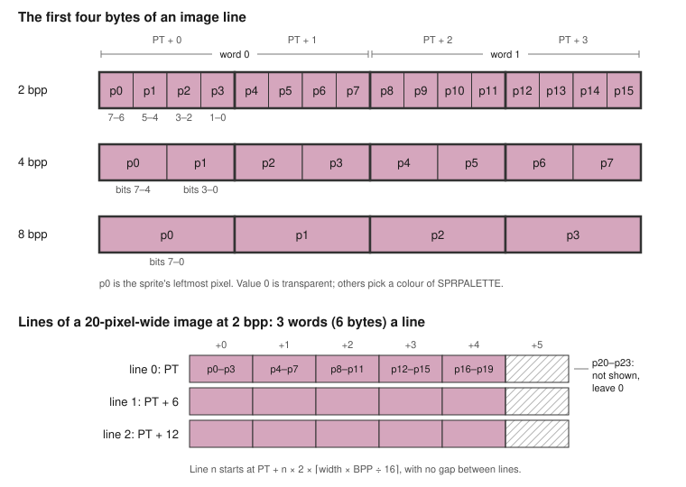
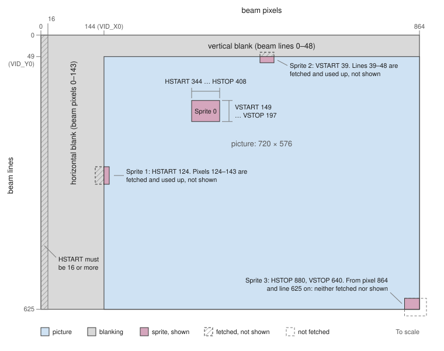
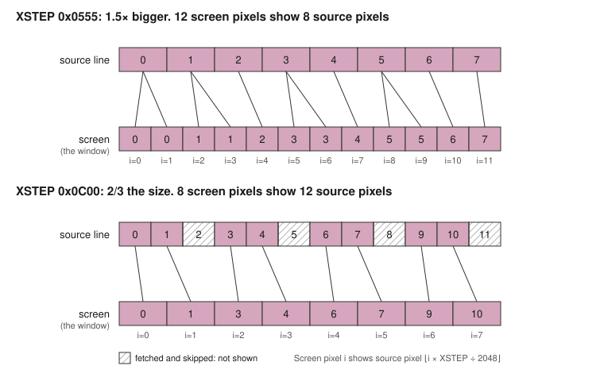
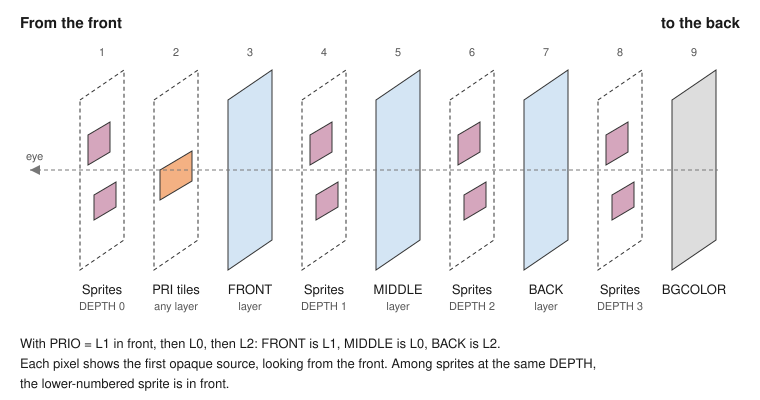
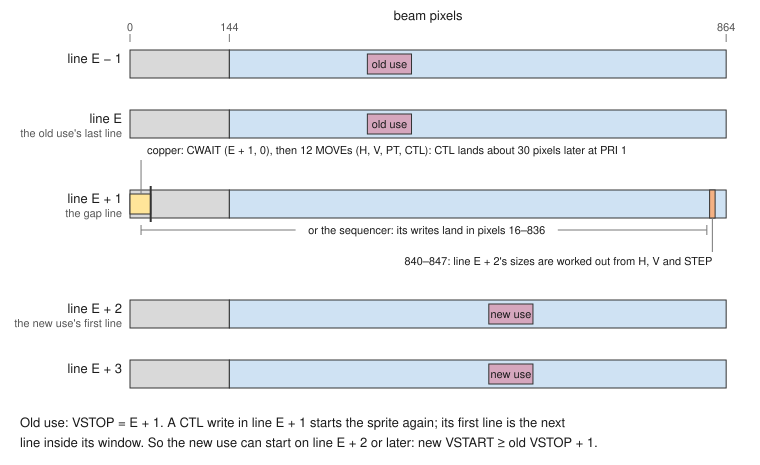
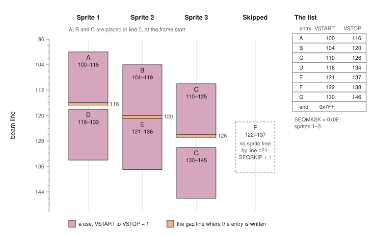
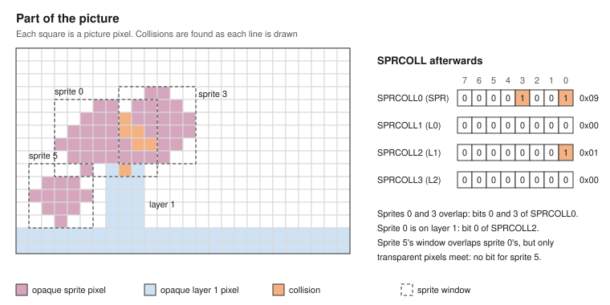
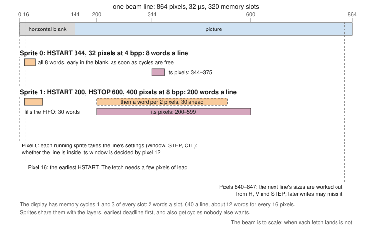
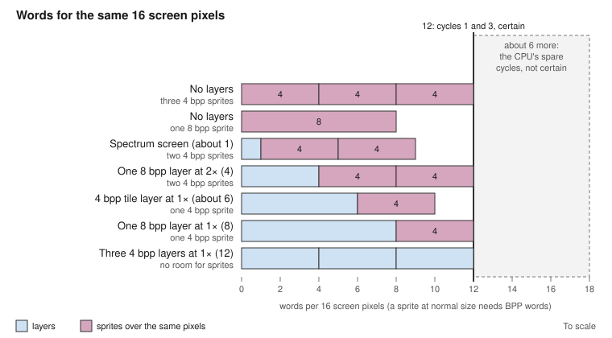

# Chapter 4: Sprite Hardware

## Introduction

**Sprites** are small images that the hardware draws over, or between, the layers, at any position on the screen, without your program touching the layers' memory. Moving a sprite is a matter of writing a few registers: nothing has to be drawn, saved or restored. They are the natural choice for anything that moves on its own: a player's ship, bullets, a mouse pointer, a cursor.

retro-z80 has eight sprites, SPR0 to SPR7. Each one is a little playfield of its own: an image in SRAM, which the hardware fetches by DMA while the beam sweeps the screen, and a **window** that says where on the screen the image goes. A sprite can be any size; it can have 3, 15 or 255 colours; it can be scaled, bigger or smaller, by any amount from 16 times bigger to 16 times smaller; and each sprite can be put in front of all the layers, between any two of them, or behind them all. The hardware also reports when sprites touch each other or the layers.

This chapter covers:

- forming a sprite, step by step, ending with a complete program;
- the image in memory: pixel formats, colours and transparency;
- the window, and how it sets the image's size;
- positioning, and clipping at the edges of the screen;
- moving a sprite, and when writes to its registers take effect;
- scaling;
- depth: where each sprite goes among the layers;
- reusing a sprite further down the screen with the copper;
- the sprite sequencer, which reuses sprites from a list without a copper list;
- collision detection;
- the data FIFO, the DMA, and how many sprites the memory can feed;
- a summary of the registers.

You should have read the Playfield Hardware chapter, because sprites are mixed with the layers described there, and because it explains how the Z80 reaches the registers ("Reaching the registers from the Z80"). Some examples use the copper, which has its own chapter.

### About this chapter

"Forming a Sprite" goes through the registers in the order you set them and ends with a complete program: a ball bouncing round the screen. The sections after it explain each part in more depth: the image, the window and size, positioning and clipping, moving, scaling, and depth. Then come the techniques: reusing a sprite down the screen with the copper, the sprite sequencer, and collisions. "Sprite DMA" explains how the hardware fetches sprite images, how much it can fetch, and what happens when it cannot keep up. The chapter ends with a summary of the registers.

---

## Conventions in This Chapter

- Examples are Z80 assembly language for sjasmplus and start with `include "hw.inc"`; those that use the copper also `include "copper.inc"`. Numbers in the text are hexadecimal when they start with `0x`.
- As in the Playfield Hardware chapter, **the register page is in window 7** (`REGS` = `0xE000`), and the examples write registers through it: `CREG` (`0xF000`) + custom offset, `SREG` + system register, `PREG` + palette offset. The sprite palette, SPRPALETTE, is at `PREG + 3 × REGS_PAL_SPAN` (`0xFD00`); this chapter calls it `SPRPAL`.
- In `hw.inc`, `SPR0` … `SPR7` are the offsets of the eight sprites in the custom block (`0x010`, `0x020` … `0x080`: 16 bytes apart), and `SPR_PT`, `SPR_H`, `SPR_V`, `SPR_CTL` and `SPR_STEP` are the offsets of the registers inside a sprite (`0x0`, `0x3`, `0x7`, `0xB`, `0xC`). So sprite 3's window across is at `CREG+SPR3+SPR_H`. The same offset also has a ready-added name, `SPR3_H`, and a port, `SPR3_H_P`.
- **IX points at a sprite** when code sets one up field by field: `ld ix,CREG+SPR0`, then `ld (ix+SPR_CTL),value`.
- `hw.inc` has no `CPORT()`: sjasmplus has no function-like defines. Use the `_P` names, or write a computed port out as `((off & 0xFF) << 8) | 0x10 | (off >> 8)` (Table 4-16).
- Sprite positions are in **beam coordinates**, which count the blanking (see "Beam coordinates" in the Playfield Hardware chapter): the 720 × 576 picture is beam pixels 144–863 and beam lines 49–624. `hw.inc` gives the picture's top left corner as `VID_X0` (144) and `VID_Y0` (49), so picture position (x, y) is beam position (VID_X0 + x, VID_Y0 + y). In the text, "pixel 200, line 100" is a picture position unless it is called a beam pixel or beam line.
- **Physical and Z80 addresses.** The sprites read SRAM by 22-bit physical address, not through the MMU. Physical addresses have names like `BALL` (`0x040000`), and the Z80 reaches them by mapping their 8 KB page into window 6 (`DRAWWIN`, `0xC000`). As in Chapter 3, the complete examples are loaded at `0x8000` with windows 2–6 still showing SRAM pages 0–4, so a Z80 address a in `0x4000`–`0xDFFF` is physical a − `RAMOFS` (`0x4000`).
- Comments give T-states where they help. The CPU runs at 20 MHz: a line is 640 T-states, a frame 400,000.
- Tables are numbered Table 4-1, 4-2 …, and figures Figure 4-1, 4-2 …, separately. Bit tables list the top bit first.

---

## Forming a Sprite

A sprite needs four things: an image in SRAM, a window on the screen, its settings, and its DMA turned on.

### Step 1: the image

A sprite's image is stored line by line, top line first, with no gaps between lines. Each line is a whole number of 16-bit words. The pixels are **chunky**, as in a chunky layer: 2, 4 or 8 bits per pixel, packed into bytes left to right at rising addresses, with the leftmost pixel in the highest bits of each byte. A pixel value of 0 is **transparent**: whatever is behind the sprite shows through.

For a 32-pixel-wide sprite at 4 bits per pixel, each line is 32 × 4 = 128 bits: 8 words, 16 bytes. A 32 × 24 image takes 24 × 16 = 384 bytes.

The image can be anywhere in SRAM, at an even address.

### Step 2: the window

Two registers give the sprite's window, as WINX and WINY give a layer's. **SPRxH** gives its beam pixels across and **SPRxV** its beam lines down. Each is two 2-byte words, low byte first: word 0 is bytes 0–1, word 1 is bytes 2–3.

**Table 4-1: SPRxH and SPRxV Words**

| Word | Bits | Meaning |
|------|------|---------|
| SPRxH 0 (bytes 0–1) | 15–11 | Not used: write 0, read 0 |
| | 10–0 | HSTART: the first beam pixel of the sprite |
| SPRxH 1 (bytes 2–3) | 15–11 | Not used: write 0, read 0 |
| | 10–0 | HSTOP: the beam pixel just after it |
| SPRxV 0 (bytes 0–1) | 15–11 | Not used: write 0, read 0 |
| | 10–0 | VSTART: the first beam line of the sprite |
| SPRxV 1 (bytes 2–3) | 15–11 | Not used: write 0, read 0 |
| | 10–0 | VSTOP: the beam line just after it |

Note the order: a sprite's start comes first, where a layer's WINX has its end first.

So a 32 × 24 sprite with its top left corner at picture pixel 200, line 100 has HSTART = VID_X0 + 200 = 344, HSTOP = 376, VSTART = VID_Y0 + 100 = 149 and VSTOP = 173. As the four words of a record in memory (see "Setting up a sprite from a record"):

```asm
        DW      0x0158,0x0178               ; SPRxH: HSTART 344, HSTOP 376
        DW      VID_X0+200,VID_X0+232       ; the same two words
        DW      0x0095,0x00AD               ; SPRxV: VSTART 149, VSTOP 173
        DW      VID_Y0+100,VID_Y0+124       ; the same two words
```

Written to the registers through IX:

```asm
        ld   ix,CREG+SPR0           ; IX = sprite 0
        ld   hl,VID_X0+200
        ld   (ix+SPR_H),l           ; HSTART 344
        ld   (ix+SPR_H+1),h
        ld   hl,VID_X0+232
        ld   (ix+SPR_H+2),l         ; HSTOP 376
        ld   (ix+SPR_H+3),h
        ld   hl,VID_Y0+100
        ld   (ix+SPR_V),l           ; VSTART 149
        ld   (ix+SPR_V+1),h
        ld   hl,VID_Y0+124
        ld   (ix+SPR_V+2),l         ; VSTOP 173
        ld   (ix+SPR_V+3),h         ; 206 T with the LD IX
```

The window also sets the image's size: there is no separate width or height register. The hardware works out from the window how many words each line of the image has (see "The Window and the Image's Size").

### Step 3: the settings

**SPRxCTL** holds the sprite's settings, in one byte:

**Table 4-2: SPRxCTL Bits**

| Bits | Name | Meaning |
|------|------|---------|
| 7–4 | PAL | 2 and 4 bpp: the 16-colour block of the sprite palette |
| 3–2 | DEPTH | 0 = in front of all layers … 3 = behind all layers |
| 1–0 | BPP | Bits per pixel: 0 = 2, 1 = 4, 2 = 8 (3 is reserved, and counts as 8) |

For a 4-bit sprite in colours 32–47 of the sprite palette (block 2), in front of everything: PAL 2, DEPTH 0, BPP 1.

```asm
CTL_SHIP    equ     (2<<SPR_CTL_PAL_B)|(0<<SPR_CTL_DEPTH_B)|(1<<SPR_CTL_BPP_B)

        DB      0x21                        ; PAL 2, DEPTH 0, BPP 1 (4 bpp)
        DB      CTL_SHIP                    ; the same byte
```

**Writing SPRxCTL starts the sprite**, so it is written last (step 4).

**SPRxSTEP** holds the sprite's scale (see "Scaling"). 0, its value after reset, counts as normal size; a program that does not scale its sprites can write it 0 once and leave it.

### Step 4: the pointer, CTL last, and DMA on

**SPRxPT** points at the image's first line: 3 bytes, the physical address. It moves on through the image as the sprite is drawn, so it must be written again for every frame.

**Writing SPRxCTL starts the sprite** (any write, even of the value it already holds), and **the vertical blank stops every sprite**. So in each vertical blank, by the CPU or (more usually) by the copper, write each sprite's pointer, and its window and scale if they changed, then **its CTL last**:

```asm
SHIP        equ     0x040000            ; the image: physical address

        ld   hl,SHIP&0xFFFF
        ld   (CREG+SPR0_PT),hl      ; bits 15-0
        ld   a,SHIP>>16
        ld   (CREG+SPR0_PT+2),a     ; bits 21-16
        ld   a,CTL_SHIP
        ld   (CREG+SPR0_CTL),a      ; last: starts the sprite         (56 T)
```

Sprite DMA needs three enables: the sprite's bit in **SPRDMA** (all eight are on after reset), and **SPREN** and **DMAEN** in DMACON:

```asm
        ld   a,DMACON_SETCLR_M|DMACON_DMAEN_M|DMACON_SPREN_M
        ld   (CREG+DMACON),a
```

### Example 4-1: A bouncing ball

This program draws a ball into SRAM, shows it as sprite 0 over the background colour, and bounces it round the screen. It uses no interrupts and no copper: in each vertical blank the CPU writes the sprite's window and pointer, and then its CTL to start it.

```asm
; Example 4-1: a 32 x 24 ball on sprite 0, 4 bpp, in colours 33-44 of the
; sprite palette, bouncing round the screen. No interrupts, no copper.
; Uses map_regs and video_off from Example 3-1.

            include "hw.inc"

REGS        equ     0xE000              ; the register page, in window 7
SREG        equ     REGS+REGS_SYSTEM
CREG        equ     REGS+REGS_CUSTOM
PREG        equ     REGS+REGS_PALETTE
SPRPAL      equ     PREG+3*REGS_PAL_SPAN    ; 0xFD00: SPRPALETTE
DRAWWIN     equ     0xC000              ; window 6
STACK       equ     0xBF00

BALL        equ     0x040000            ; the image: physical, 8 KB-aligned
BW          equ     32                  ; pixels across
BH          equ     24                  ; lines
CTL_BALL    equ     (2<<SPR_CTL_PAL_B)|(0<<SPR_CTL_DEPTH_B)|(1<<SPR_CTL_BPP_B)

            org     0x8000
start:      di
            ld      sp,STACK
            call    map_regs            ; the register page into window 7
            call    video_off           ; layers, copper and sprites off
            call    draw                ; step 1: the image in SRAM

            ; sprite colours 33-47: from dark red to yellow
            ld      hl,SPRPAL+33*3
            ld      de,0x0040           ; D = green, E = red
            ld      b,15
.col:       ld      (hl),0              ; blue
            inc     hl
            ld      (hl),d              ; green
            inc     hl
            ld      (hl),e              ; red: the entry changes
            inc     hl
            ld      a,d
            add     a,0x10
            ld      d,a
            ld      a,e
            add     a,0x0C
            ld      e,a
            djnz    .col

            ld      ix,CREG+SPR0        ; IX = sprite 0
            xor     a
            ld      (ix+SPR_STEP),a     ; normal size (0 counts as 0x0800)
            ld      (ix+SPR_STEP+1),a
            ld      (ix+SPR_STEP+2),a
            ld      (ix+SPR_STEP+3),a
            ld      a,DMACON_SETCLR_M|DMACON_DMAEN_M|DMACON_SPREN_M
            ld      (CREG+DMACON),a
            ld      a,VIDCON_EN_M
            ld      (CREG+VIDCON),a

.frame:     ld      a,(CREG+VIDSTAT)    ; wait for the vertical blank
            and     VIDSTAT_VBLANK_M
            jr      z,.frame
            ld      (CREG+VIDSTAT),a    ; clear the flag
            ; the window and the pointer, then CTL: always last, it starts the sprite
            ld      hl,(xaxis)          ; HSTART
            ld      (ix+SPR_H),l
            ld      (ix+SPR_H+1),h
            ld      de,BW
            add     hl,de
            ld      (ix+SPR_H+2),l      ; HSTOP
            ld      (ix+SPR_H+3),h
            ld      hl,(yaxis)          ; VSTART
            ld      (ix+SPR_V),l
            ld      (ix+SPR_V+1),h
            ld      de,BH
            add     hl,de
            ld      (ix+SPR_V+2),l      ; VSTOP
            ld      (ix+SPR_V+3),h
            ld      (ix+SPR_PT),BALL&0xFF
            ld      (ix+SPR_PT+1),(BALL>>8)&0xFF
            ld      (ix+SPR_PT+2),BALL>>16
            ld      (ix+SPR_CTL),CTL_BALL   ; starts it: about 330 T after line 0 began
            ; move, bouncing half off each edge
            ld      iy,xaxis
            call    axis
            ld      iy,yaxis
            call    axis
            jr      .frame

; One axis of the ball: IY points at its position, its speed, the lowest
; position inside and the number of positions inside (2 bytes each). The
; position moves; the speed turns round when it leaves the range.
axis:       ld      l,(iy+0)
            ld      h,(iy+1)
            ld      e,(iy+2)
            ld      d,(iy+3)
            add     hl,de               ; the new position
            ld      (iy+0),l
            ld      (iy+1),h
            ld      e,(iy+4)
            ld      d,(iy+5)
            or      a
            sbc     hl,de               ; minus the lowest position inside
            ld      e,(iy+6)
            ld      d,(iy+7)
            or      a
            sbc     hl,de               ; inside: below the number inside
            ret     c
            xor     a                   ; outside: speed = -speed
            sub     (iy+2)
            ld      (iy+2),a
            ld      a,0
            sbc     a,(iy+3)
            ld      (iy+3),a
            ret

;                   position    speed   lowest inside       number inside
xaxis:      dw      VID_X0+100, 3,      VID_X0-BW/2+1,      VID_W-1
yaxis:      dw      VID_Y0+50,  2,      VID_Y0-BH/2+1,      VID_H-1

; The ball: line y has pixels 16 - r to 16 + r inside, r from the table
; (the square root of 144 - (y - 12)^2, rounded down). Inside pixels get
; colour 1 + y/2 (1-12: palette entries 33-44); the others 0, transparent.
draw:       ld      hl,BALL>>13         ; the image's 8 KB page
            ld      (SREG+MMU6),hl      ; into window 6
            ld      de,DRAWWIN+(BALL&0x1FFF)
            ld      ix,radius
            ld      c,0                 ; C = y
.line:      ld      a,c
            srl     a
            inc     a
            ld      (colour),a          ; this line's colour
            ld      a,16
            sub     (ix+0)
            ld      h,a                 ; H = the first x inside
            ld      a,(ix+0)
            add     a,a
            inc     a
            add     a,h
            ld      l,a                 ; L = the first x after it
            ld      b,0                 ; B = x
.byte:      call    .pixel              ; the left pixel ...
            add     a,a
            add     a,a
            add     a,a
            add     a,a                 ; ... in bits 7-4
            ld      (de),a
            call    .pixel              ; the right pixel, in bits 3-0
            ex      de,hl
            or      (hl)
            ld      (hl),a
            ex      de,hl
            inc     de
            ld      a,b
            cp      BW
            jr      nz,.byte            ; 16 bytes a line
            inc     ix
            inc     c
            ld      a,c
            cp      BH
            jr      nz,.line
            ret
.pixel:     ld      a,b                 ; A = the colour of pixel B; B moves on
            inc     b
            cp      h
            jr      c,.out
            cp      l
            jr      nc,.out
            ld      a,(colour)
            ret
.out:       xor     a
            ret

colour:     db      0
radius:     db      0,4,6,7,8,9,10,10,11,11,11,11
            db      12,11,11,11,11,10,10,9,8,7,6,4
```

The ball goes half off each edge of the picture before it bounces: the hardware clips it there, as "Positioning and Clipping" explains. Its position is always a positive beam position, so `axis` compares it unsigned. The leftmost HSTART it reaches is 126, well above the lowest allowed, 16.

The CTL write lands in beam line 0, so the sprite starts in time for any VSTART from line 1. The polling loop finds the flag up to about 30 T-states after line 0 begins; the writes take about 300 more.

### Setting up a sprite from a record

A sprite's registers are 16 consecutive bytes: PT (3), H (4), V (4), CTL (1) and STEP (4). A **sprite record** is the same 16 bytes in memory, so one routine can start any sprite from a table. The sprite sequencer's list uses exactly this layout too (see "The Sprite Sequencer").

`LDIR` over all 16 bytes would write CTL before STEP. Writing STEP after the start acts only from the next line, so the first line could come out at the old scale. This routine writes STEP first, then PT, H, V and CTL, the last:

```asm
; Start a sprite from a record. HL = the 16-byte record (PT, H, V, CTL,
; STEP, as the registers), DE = CREG + SPRn. About 410 T.
spr_load:   push    hl
            push    de
            ld      bc,SPR_STEP
            add     hl,bc
            ex      de,hl
            add     hl,bc
            ex      de,hl               ; HL: the record's STEP; DE: the sprite's
            ldi
            ldi
            ldi
            ldi                         ; STEP
            pop     de
            pop     hl
            ld      bc,SPR_CTL+1
            ldir                        ; PT, H, V, then CTL: it starts the sprite
            ret

ship_rec:   d24     SHIP                    ; PT
            dw      VID_X0+200,VID_X0+232   ; H: HSTART, HSTOP
            dw      VID_Y0+100,VID_Y0+124   ; V: VSTART, VSTOP
            db      CTL_SHIP                ; CTL
            dw      0,0                     ; STEP: XSTEP, YSTEP (0: normal size)

        ld   hl,ship_rec
        ld   de,CREG+SPR0
        call spr_load
```

---

## The Image

### Pixels and colours

**Table 4-3: Sprite Pixel Formats**

| BPP | Pixels per byte | Pixels per word | Colours | Palette entries used |
|-----|-----------------|-----------------|---------|----------------------|
| 0: 2 bits | 4 | 8 | 3 + transparent | PAL × 16 + 1 to PAL × 16 + 3 |
| 1: 4 bits | 2 | 4 | 15 + transparent | PAL × 16 + 1 to PAL × 16 + 15 |
| 2: 8 bits | 1 | 2 | 255 + transparent | 1 to 255: the whole sprite palette |

The sprites share a palette of their own, **SPRPALETTE**: 256 entries of 24-bit colour, 3 bytes each (blue, green, red), at register page `0x1D00`–`0x1FFF` (`SPRPAL`, `0xFD00`, in this chapter's window 7), or palette 3 through PALIDX and PALDAT. As with the layers' palettes, an entry changes when its red byte is written (see "Colour Registers and Palette Offsets" in the Playfield Hardware chapter). The layers do not use it, so sprite colours never clash with the scenery's.

At 2 and 4 bits per pixel, PAL in SPRxCTL picks a 16-colour block of it, as a layer's PALOFS does: a pixel value v shows colour PAL × 16 + v. At 8 bits the value is the colour number and PAL is not used. Value 0 is always transparent, at every depth.

Giving each sprite, or each kind of object, a block of its own lets you change one object's colours without touching the others'.

With **VIDCON.SHAREPAL** set, sprites take their colours from PALETTE0 instead, as every layer then does (Chapter 3, "One palette for everything"); PAL then picks a block of PALETTE0.

At power-on SPRPALETTE, like every palette, holds the Spectrum's 16 colours in entries 0–15, so a 4-bit sprite with PAL 0 shows the Spectrum colours with no set-up.

### How the pixels are packed



*Figure 4-1: An Image in Memory*

The bytes of a line go left to right at rising addresses, and inside each byte the leftmost pixel is in the highest bits. This is the order of the chunky layers, so a routine that draws into a 4 bpp layer also draws into a 4 bpp sprite image.

### Line length

Each line of the image is a whole number of words. For a source width of w pixels:

> words per line = ⌈w × bits per pixel ÷ 16⌉, bytes per line = twice that

**Table 4-4: Image Line Lengths**

| Width | 2 bpp | 4 bpp | 8 bpp |
|-------|-------|-------|-------|
| 16 | 2 words (4 bytes) | 4 words (8 bytes) | 8 words (16 bytes) |
| 24 | 3 (6) | 6 (12) | 12 (24) |
| 32 | 4 (8) | 8 (16) | 16 (32) |
| 64 | 8 (16) | 16 (32) | 32 (64) |
| 20 | 3 (6): 4 pixels unused | 5 (10) | 10 (20) |

If the width does not fill the last word, the pixels left over at the end of each line are not shown; leave them 0. The lines follow one another with no padding, so line n of the image starts at SPRxPT + n × 2 × (words per line).

### Drawing an image from the Z80

The Z80 draws an image as it draws a layer: it maps the image's 8 KB page into window 6 and writes the bytes there (see "Drawing into a layer" in Chapter 3). An image of up to 8 KB that starts on a page boundary needs one MMU write. Example 4-1's `draw` does this.

---

## The Window and the Image's Size

The window says where the sprite is on the screen and, with the scale (SPRxSTEP, see "Scaling"), how big its image is:

> source width = ⌈(HSTOP − HSTART) × XSTEP ÷ 2048⌉ pixels, source height = ⌈(VSTOP − VSTART) × YSTEP ÷ 2048⌉ lines

At normal size (XSTEP and YSTEP `0x0800`, or 0) the image is the window's size. A sprite 32 pixels wide shown twice as big has a window 64 pixels wide.

There is no limit on the size except the memory's speed (see "Sprite DMA"): a sprite can be 8 pixels or the whole screen wide, and as tall as the screen. Making a sprite bigger is a matter of widening its window and storing a bigger image.

The sizes are worked out for each line from the settings at its start, so a window or scale changed while a sprite is drawn changes the size of its lines from there on (see "Changing a sprite while it is drawn").

A sprite shows in its window from when its CTL is written until the next vertical blank. If HSTOP is not greater than HSTART, or VSTOP not greater than VSTART, the window is empty and the sprite does not show. After reset all the windows are empty.

To hide a sprite:

- don't write its CTL this frame;
- set VSTART to 625 (BEAM_H) or more: on a running sprite this acts from the next line;
- turn its bit in SPRDMA off: it then shows only the words already in its FIFO (see "Turning sprite DMA on and off");
- or, for every sprite and layer at once, set VIDCON.BLANKALL, which shows the background colour over the whole picture.

---

## Positioning and Clipping

HSTART, HSTOP, VSTART and VSTOP are **unsigned** 11-bit beam coordinates: beam pixels 0–863 across and beam lines 0–624 down, of which the picture is pixels 144–863 and lines 49–624. A beam line starts with its horizontal blank, and a frame with its vertical blank, so a sprite can start left of or above the picture with ordinary positive numbers.



*Figure 4-2: Sprite Windows and Clipping*

The hardware clips a sprite at all four edges:

- **Left.** Pixels in the horizontal blank, before beam pixel 144, are not shown. They are still fetched, so the sprite costs the same memory. **HSTART must be 16 or more**: the DMA fetches each line's words during that line, from its start, and needs a few pixels before the sprite's first. So a sprite can hang off the left edge by up to 128 pixels. (What a smaller HSTART does is not specified.)
- **Top.** Lines in the vertical blank, before beam line 49, are not shown. They are still fetched and used up, so the first line that shows is the right line of the image: there is nothing to do in software. VSTART can be as low as 1, so a sprite can hang off the top by up to 48 lines, as long as its CTL is written before its first line starts. A sprite never shows on beam line 0, where the vertical blank stops every sprite.
- **Right.** Pixels from beam pixel 864 on are not shown, and not fetched. An HSTOP above 864 counts as 864. An HSTART of 864 or more shows nothing.
- **Bottom.** Lines from beam line 625 on are not shown, and not fetched. A VSTOP above 625 counts as 625. A VSTART of 625 or more shows nothing.

A 32-pixel sprite hanging 20 pixels off the left edge, at picture pixels −20 to 11, is beam pixels 124–155:

```asm
        ld   hl,VID_X0-20
        ld   (CREG+SPR0_H),hl       ; HSTART 124
        ld   hl,VID_X0+12
        ld   (CREG+SPR0_H+2),hl     ; HSTOP 156                       (52 T)
```

For a 24-line sprite whose top 10 lines are above the picture, the window starts on beam line 39, and the pointer still points at the image's first line: lines 0–9 are fetched and used up, but not shown.

```asm
        ld   hl,VID_Y0-10
        ld   (CREG+SPR0_V),hl       ; VSTART 39
        ld   hl,VID_Y0+14
        ld   (CREG+SPR0_V+2),hl     ; VSTOP 63
```

---

## Moving a Sprite

### When writes take effect

- **Writing SPRxCTL starts the sprite** (any write, even of the same value). The hardware empties its FIFO and drops any reads still on their way; the sprite's first line is the next beam line after the write that is inside its window, and it shows the image line at SPRxPT. A CTL written after VSTART has gone by shows the image from its first line, from the next line down, to VSTOP.
- **The vertical blank stops every sprite** (beam line 0, pixel 0): its FIFO is emptied, and nothing more is fetched or shown until its CTL is written again. Nothing starts again by itself. So each frame, write each sprite's pointer (and its window and step if they change), then **CTL last**.
- **SPRxPT, SPRxH, SPRxV and SPRxSTEP act from the next line.** On a running sprite, a write changes it from the next line that starts after the write, without starting it again. On a stopped sprite, they are taken when its CTL is written.
- **SPRDMA** acts at once and does not start or stop a sprite: off pauses its fetching (see "Turning sprite DMA on and off").

Table 4-5 sums these up.

**Table 4-5: When Sprite Register Writes Take Effect**

| Register | Takes effect |
|----------|--------------|
| SPRxCTL | On the write: starts the sprite. Its FIFO empties; its first line is the next line inside its window, from SPRxPT, with the new BPP, DEPTH and PAL |
| SPRxPT, SPRxH, SPRxV, SPRxSTEP | A running sprite: from the next line that starts after the write. A stopped sprite: when it is started |
| The vertical blank (beam line 0, pixel 0) | Stops every sprite until its CTL is written again |
| SPRDMA, DMACON.SPREN, DMACON.DMAEN | At once. They pause or resume a sprite's fetching; they do not start or stop it |
| SPRCOLL | At once |
| SPRPALETTE, VIDCON.SHAREPAL, PRIO | As for the layers (Chapter 3, "When Register Writes Take Effect") |

**Each byte is written at once**, with no latch, and the other bytes keep their values. So:

- **SPRxH, SPRxV, SPRxSTEP:** a value caught half written at a line's start gives at worst one wrong line. Writing only the bytes that change is enough: to move a sprite across within the same 256 pixels, write only the low bytes of HSTART and HSTOP.
- **SPRxPT:** the fetch moves it as the sprite runs, so a line that starts between its bytes can send the rest of the sprite to a mixed address. Write its three bytes while the sprite is stopped (in the vertical blank, before its CTL write), or all within one line (`LD (nn),HL` then `LD (nn),A` takes 29 T-states; a copper `CMOVEA` three slots).

The copper's writes and the CPU's land in the order the register bus takes them, and the last write to each byte wins: let one of them own each sprite.

**Reading SPRxPT** gives where the sprite is in its image: the address of its next word. Reading its lowest byte captures all three, as for BPL0PT and BEAMPOS (Chapter 3, "Reading the lowest byte captures"):

```asm
        ld   hl,(CREG+SPR0_PT)      ; bits 15-0: reading byte 0 captures
        ld   a,(CREG+SPR0_PT+2)     ; bits 21-16, from the capture
```

### Who writes the registers

There are two common ways to move sprites each frame:

- **The CPU**, in its VBLANK interrupt handler (or after polling VIDSTAT.VBLANK, as Example 4-1 does), writes each sprite's window and pointer, then its CTL.
- **The copper**, at the top of its list, writes each sprite's window, pointer and CTL, and the CPU changes the values **in the copper list**: the data bytes of its MOVEs. This is the same technique as scrolling with the copper (see the Copper chapter).

Either way, the sprite must be started (its CTL written) before its first line. A third way, the sprite sequencer, has its own section below.

### Example 4-2: Sprites from the copper list

```asm
; Example 4-2: two sprites started by the copper in every frame. The CPU
; moves sprite 1 by changing the list's data bytes between frames.

            include "hw.inc"
            include "copper.inc"

BALL        equ     0x040000
CTL_BALL    equ     (2<<SPR_CTL_PAL_B)|(1<<SPR_CTL_BPP_B)

            ALIGN   2
spr_list:   CMOVEL  SPR0+SPR_H,((VID_X0+232)<<16)|(VID_X0+200)  ; sprite 0: 200-231 across
            CMOVEL  SPR0+SPR_V,((VID_Y0+124)<<16)|(VID_Y0+100)  ;           100-123 down
            CMOVEA  SPR0+SPR_PT,BALL
            CMOVE   SPR0+SPR_CTL,CTL_BALL           ; CTL last: starts the sprite
spr1_h:     CMOVEL  SPR1+SPR_H,((VID_X0+432)<<16)|(VID_X0+400)
spr1_v:     CMOVEL  SPR1+SPR_V,((VID_Y0+324)<<16)|(VID_Y0+300)
            CMOVEA  SPR1+SPR_PT,BALL
            CMOVE   SPR1+SPR_CTL,CTL_BALL
            ; ... the rest of the list (pointers, colour changes)
            CSTOP

; Move sprite 1 to beam position (HL across, DE down). A MOVE is one word,
; its data byte first (the low byte, at the even address), so the window's
; four bytes are the bytes at +0, +2, +4 and +6 of each CMOVEL.
move1:      ld      ix,spr1_h
            ld      (ix+0),l            ; HSTART
            ld      (ix+2),h
            ld      bc,32
            add     hl,bc
            ld      (ix+4),l            ; HSTOP
            ld      (ix+6),h
            ld      ix,spr1_v
            ld      (ix+0),e            ; VSTART
            ld      (ix+2),d
            ex      de,hl
            ld      bc,24
            add     hl,bc
            ld      (ix+4),l            ; VSTOP
            ld      (ix+6),h
            ret                         ; about 240 T
```

Each sprite costs 12 list words a frame: 4 + 4 MOVEs for the window, 3 for the pointer and 1 for CTL. The list is in the program's memory, so the copper reads it at its physical address (`spr_list − RAMOFS`, written to COP1LC), and the CPU writes it as ordinary memory.

Call `move1` when the copper is not reading those words: for example, once the picture has started (BEAMPOS line VID_Y0 or more), after the copper's work at the start of the frame is done. For many sprites, or to make the change exact, use two lists and swap them (see the Copper chapter).

### Changing a sprite while it is drawn

A running sprite takes its window, step and pointer afresh at the start of every line (pixel 0, the start of the horizontal blank). So the copper can change them from one line to the next, while the sprite is on the screen:

- **Wobble or shear:** write SPRxH on every line, moving the sprite across.
- **Zoom or perspective:** change XSTEP, with the window, on every line. The number of words each line takes follows the window and XSTEP of that line.
- **Switch images** part way down: write SPRxPT. The next line shows the image line it points at, exactly (YSTEP does not move it on that time), and the lines after move on from there.
- **End it early or let it go on:** the window is checked on every line, so a VSTOP written while the sprite is drawn ends it, or lengthens it. A VSTART moved later leaves it off until the window reaches it again.

A write acts from the next line that **starts** after it: a write during line n's picture acts from line n + 1. A `CWAIT` for pixel 0 of a line, then the moves, acts from the line after. Keep these writes clear of the very end of a line: the sprite hardware works out the next line's sizes from H, V and STEP at beam pixels 840–847, so a write after that may miss the next line. (The sequencer finishes its writes by pixel 836 for this reason; what a write in pixels 840–863 does is not specified yet.)

```asm
; A wobble: sprite 0 (32 pixels wide, picture lines 100-123) moves two
; pixels right on each of its lines. Only HSTART's and HSTOP's low bytes
; change while they stay within one 256-pixel span.
            CWAIT   VID_Y0+100,0
            CMOVE   SPR0+SPR_H,(VID_X0+202)&0xFF        ; HSTART, for line 101
            CMOVE   SPR0+SPR_H+2,(VID_X0+202+32)&0xFF   ; HSTOP
            CWAIT   VID_Y0+101,0
            CMOVE   SPR0+SPR_H,(VID_X0+204)&0xFF        ; for line 102
            CMOVE   SPR0+SPR_H+2,(VID_X0+204+32)&0xFF
            ; ... four words a line, or a loop stepping MOVR through a table
```

This only works while the high bytes stay the same: here HSTART and HSTOP stay within beam pixels 256–511 (`0x100`–`0x1FF`) on all 24 lines. A wobble that crosses a 256-pixel boundary writes all four bytes with `CMOVEL`: six words a line.

---

## Scaling

Each sprite can be shown bigger or smaller than its image, across and down separately, by any amount from 16 times bigger to 16 times smaller. **SPRxSTEP** holds two steps: **XSTEP** (bytes 0–1) and **YSTEP** (bytes 2–3). A step is how far through the image the hardware moves for each screen pixel (or line), in 1/2048ths of a source pixel: 5.11 fixed point.

**Table 4-6: SPRxSTEP Words**

| Word | Bits | Meaning |
|------|------|---------|
| XSTEP (bytes 0–1) | 15–11 | Whole source pixels per screen pixel |
| | 10–0 | Fraction of a source pixel, in 1/2048ths |
| YSTEP (bytes 2–3) | 15–11 | Whole source lines per screen line |
| | 10–0 | Fraction of a source line, in 1/2048ths |

**Table 4-7: Common Steps**

| Step | Size | Step | Size |
|------|------|------|------|
| `0x0080` | 16× bigger (the most) | `0x0800` | Normal |
| `0x0200` | 4× bigger | `0x0C00` | 2/3 |
| `0x0400` | 2× bigger | `0x1000` | Half |
| `0x0555` | 1.5× bigger | `0x8000` | 1/16 (the least) |

For any other size the step is 2048 ÷ the scale: 1.25× bigger is 2048 ÷ 1.25 = 1638 = `0x0666`. Steps below `0x0080` count as `0x0080`, steps above `0x8000` as `0x8000`, and a step of 0 counts as `0x0800`, so a sprite whose SPRxSTEP was never written is normal size.

So the two words for a sprite at 2/3 of its size across (1 whole source pixel and 1024/2048 per screen pixel) and twice its size down (0 and 1024/2048) are:

```asm
        DW      0x0C00,0x0400               ; SPRxSTEP: XSTEP 1.5, YSTEP 0.5
        DW      2048*3/2,2048/2             ; the same two words
```

The hardware works out which source pixel each screen pixel shows: screen pixel i of the window (counting from 0 at HSTART) shows source pixel ⌊i × XSTEP ÷ 2048⌋, and screen line j of the sprite shows source line ⌊j × YSTEP ÷ 2048⌋. So the first pixel and line of the window always show the image's first, and every step works the same way, with no rounding to choose.



*Figure 4-3: Fractional Scaling*

At `0x0555`, slightly less than 2048 ÷ 1.5, some source pixels are shown twice and some once, in a pattern that repeats every 3 source pixels; at `0x0C00` every third source pixel is skipped. Make the window the size you want on the screen; the image is the window's size × the step ÷ 2048, rounded up.

```asm
; The 32 x 24 ship at 2x: a 64 x 48 window, both steps 0x0400
        ld   ix,CREG+SPR0
        ld   hl,VID_X0+200
        ld   (ix+SPR_H),l
        ld   (ix+SPR_H+1),h
        ld   hl,VID_X0+200+64
        ld   (ix+SPR_H+2),l
        ld   (ix+SPR_H+3),h
        ld   hl,VID_Y0+100
        ld   (ix+SPR_V),l
        ld   (ix+SPR_V+1),h
        ld   hl,VID_Y0+100+48
        ld   (ix+SPR_V+2),l
        ld   (ix+SPR_V+3),h
        ld   hl,0x0400
        ld   (ix+SPR_STEP),l        ; XSTEP
        ld   (ix+SPR_STEP+1),h
        ld   (ix+SPR_STEP+2),l      ; YSTEP
        ld   (ix+SPR_STEP+3),h
        ; then SPRxPT, and CTL last
```

**Zooming** an object in or out is a matter of changing the window and the steps together, once a frame (or, for a stretch down the sprite, on each line: see "Changing a sprite while it is drawn"). For a scale s, the window is 32 × s by 24 × s and the steps 2048 ÷ s. Because the steps are fractions, the size changes smoothly, a pixel at a time.

A YSTEP changed part way down the sprite carries on from the fraction it has reached; a PT written part way down starts again from there.

**What it costs.** Bigger across is free: the same words are spread over more pixels. Smaller across costs memory cycles in proportion, because every pixel of the image's lines is still fetched, the skipped ones too (they stream through the FIFO): at half size across a sprite needs twice the words for the same screen width (see "Sprite DMA"). Down, it is the other way round: a line shown on several screen lines is fetched again for each, since the FIFO cannot replay a line, but lines skipped when the sprite is smaller are not fetched at all. Keep wide sprites that are shrunk across narrow on the screen, or use fewer bits per pixel.

The hardware does not mirror sprites. For an object that faces either way, store both images and point SPRxPT at the one you want.

---

## Depth: Sprites and Layers

Each sprite's **DEPTH** puts it among the three layers, in the order PRIO gives them (see "Priority and Transparency" in the Playfield Hardware chapter). Tile pixels whose map entry has PRI set have a place of their own. From the front of the screen to the back:

**Table 4-8: Sprites and Layers, from the Front**

| Place | Source |
|-------|--------|
| 1 | Sprites with DEPTH 0 |
| 2 | Tile pixels with PRI set, from any layer (among them, PRIO's order) |
| 3 | The layer PRIO names FRONT |
| 4 | Sprites with DEPTH 1 |
| 5 | The layer PRIO names MIDDLE |
| 6 | Sprites with DEPTH 2 |
| 7 | The layer PRIO names BACK |
| 8 | Sprites with DEPTH 3 |
| 9 | The background colour, BGCOLOR |



*Figure 4-4: Sprites among the Layers*

For each pixel the hardware shows the front-most source that is not transparent. Where two sprites overlap, the order is **DEPTH first, then number**: a sprite at a front depth is in front of one at a deeper depth whatever their numbers, and at the same depth the **lower-numbered** sprite is in front. Where a layer's pixel is transparent (a layer with TRANSP set, pixel value 0, or outside its window), the sprites and layers behind it show through; a layer without TRANSP hides everything behind it inside its window, so a sprite behind such a layer only shows outside the layer's window.

Depth is how a sprite goes behind scenery: in a dual-playfield screen with the scenery as the front layer and the sky as the back, a bird with DEPTH 1 flies behind trees but in front of the sky. A PRI tile (a tree trunk, say) comes in front of sprites of DEPTH 1–3, but not of DEPTH 0.

Depth is per sprite, set in SPRxCTL. A CTL write starts the sprite again, so change it in the vertical blank, or when starting the sprite.

In **direct colour** mode (VIDCON.DIRECT) the layers make one picture together, so there is nothing to go between: sprites are drawn in front of the whole picture, in their colours from SPRPALETTE, and DEPTH is not used.

The attribute layer (a Spectrum extra) does not act on sprites.

---

## Reusing a Sprite down the Screen

Eight sprites can show at once on any line. To show more than eight objects on a screen, reuse a sprite further down: once its first use has been drawn, the copper writes the sprite's registers again for the next use, and starts it again with CTL. It is the same idea as the Amiga's, where the sprite's data holds more control words, but here the copper does it.

The rules:

- the copper's writes must come **after the old use's last line** has been drawn: for a last line E (VSTOP = E + 1), a `CWAIT` for (E + 1, 0) is enough;
- as always, the window and pointer first, then CTL;
- the CTL write lands in line E + 1, the **gap line**, so the new use can start on line E + 2 or later: **new VSTART ≥ old VSTOP + 1**.



*Figure 4-5: Reusing a Sprite (to scale across; lines spaced out)*

### Example 4-3: One sprite, three ships

```asm
; Example 4-3: sprite 0 shows three 32 x 24 ships, at picture lines 100,
; 200 and 300, each with its own position, image or colours.

            include "hw.inc"
            include "copper.inc"

SHIP        equ     0x040200            ; two 32 x 24 images at 4 bpp
SHIP2       equ     SHIP+24*16
CTL_SHIP    equ     (3<<SPR_CTL_PAL_B)|(1<<SPR_CTL_BPP_B)

            ALIGN   2
ships:      CMOVEL  SPR0+SPR_H,((VID_X0+232)<<16)|(VID_X0+200)  ; ship 1
            CMOVEL  SPR0+SPR_V,((VID_Y0+124)<<16)|(VID_Y0+100)  ; lines 100-123
            CMOVEA  SPR0+SPR_PT,SHIP
            CMOVE   SPR0+SPR_CTL,CTL_SHIP           ; start it

            CWAIT   VID_Y0+124,0                    ; ship 1's last line, 123, is drawn
            CMOVEL  SPR0+SPR_H,((VID_X0+532)<<16)|(VID_X0+500)  ; ship 2
            CMOVEL  SPR0+SPR_V,((VID_Y0+224)<<16)|(VID_Y0+200)  ; lines 200-223
            CMOVEA  SPR0+SPR_PT,SHIP
            CMOVE   SPR0+SPR_CTL,CTL_SHIP|(4<<SPR_CTL_PAL_B)    ; colours 112-127 (block 7)

            CWAIT   VID_Y0+224,0                    ; ship 2 finished
            CMOVEL  SPR0+SPR_H,((VID_X0+392)<<16)|(VID_X0+360)  ; ship 3
            CMOVEL  SPR0+SPR_V,((VID_Y0+324)<<16)|(VID_Y0+300)
            CMOVEA  SPR0+SPR_PT,SHIP2               ; the other image
            CMOVE   SPR0+SPR_CTL,CTL_SHIP
            CSTOP
```

Each reuse is 14 words: 2 for the WAIT and 4 + 4 + 3 + 1 MOVEs. At the copper's PRI 1 rate (one word per slot) the CTL write lands about 1.1 µs, 30 pixels, after the WAIT, in the gap line's horizontal blank. Writing only the bytes that change is enough. CTL must be written even when its value does not change, since only that write starts the sprite.

Each start empties the FIFO; the sprite's DMA fetches each line's words during that line, so the new ship is ready as soon as its first line comes.

---

## The Sprite Sequencer

The **sprite sequencer** reuses the sprites down the screen without a copper list: the program keeps a **list of sprite uses** in SRAM, sorted by start line, and each frame the sequencer gives each use to a free sprite, in the gap line before it starts, CTL last. A Z80 has little time to spare for building copper lists; building this list is mostly copying 16 bytes per object.

The sequencer only writes sprite registers, the same ones the copper and the CPU write, by the same rules. So everything in this chapter still holds, and the three can be mixed.

### The list

The list is in SRAM at an even physical address, which **SEQLC** (3 bytes) holds. The sequencer takes SEQLC at every frame start, as the copper takes COP1LC. Each entry is 16 bytes: exactly a sprite's registers, a sprite record (see "Setting up a sprite from a record"):

**Table 4-9: A Sequencer List Entry**

| Bytes | Register | Meaning |
|-------|----------|---------|
| 0–2 | SPRxPT | The image's first line |
| 3–6 | SPRxH | HSTART, HSTOP |
| 7–10 | SPRxV | VSTART, VSTOP. VSTART is the entry's **start line**, the key the list is sorted by |
| 11 | SPRxCTL | BPP, DEPTH, PAL |
| 12–15 | SPRxSTEP | XSTEP, YSTEP |

- **The end entry** has VSTART `0x7FF` (`SEQ_END`): byte 7 `0xFF`, byte 8 `0x07`. Nothing else in it is used. A list with no uses is just an end entry.
- **Sorted** by VSTART, smallest first; entries with the same VSTART are taken in list order. An unsorted list is not an error, but an entry whose start line has already passed is skipped, and one that starts later than those after it holds them back.
- **HSTART must be 16 or more**, as for any sprite. The sequencer does not check.
- **Cost:** 8 memory reads per entry, and 8 for the end entry. 20 uses cost 168 reads a frame.

One entry worked out: Example 4-4's first alien, a 16 × 16 image at physical `0x040000`, at picture pixel 200, line 60, 4 bpp in colours 16–31 (PAL 1), normal size. The raw bytes, then the source form Example 4-4's `build` writes:

```asm
        DB      0x00,0x00,0x04              ; PT: 0x040000
        DB      0x58,0x01,0x68,0x01         ; H: HSTART 344, HSTOP 360
        DB      0x6D,0x00,0x7D,0x00         ; V: VSTART 109, VSTOP 125
        DB      0x11                        ; CTL: PAL 1, DEPTH 0, BPP 1
        DB      0x00,0x00,0x00,0x00         ; STEP: 0, normal size

        D24     ALIEN                       ; the same 16 bytes
        DW      VID_X0+200,VID_X0+216
        DW      VID_Y0+60,VID_Y0+76
        DB      CTL_ALIEN
        DW      0,0
```

### Which sprite, and when

**SEQMASK** has a bit for each sprite the sequencer may use; the others stay with the copper and the CPU. Each entry goes to the **lowest-numbered free sprite** in SEQMASK. A sprite is free when it has not been started this frame (no write to its CTL, by anyone, since the frame start), or when its window has ended (the line is at or past its VSTOP).

The sequencer writes an entry's 16 bytes in the order H, V, STEP, PT, then CTL, which starts the sprite. All its writes land between beam pixels 16 and 836 of a line, so an entry placed in line G shows from its VSTART if VSTART ≥ G + 1: the copper's gap-line rule, **new VSTART ≥ old VSTOP + 1** (Figure 4-5). It places an entry as soon as a sprite is free, often many lines before its VSTART; entries for the first lines are placed in line 0 and the lines after it.



*Figure 4-6: The Sequencer Giving Out Three Sprites*

On a sorted list no entry is skipped while, on every line L, the entries with VSTART − 1 ≤ L < VSTOP (each use counted from its gap line) are no more than the sprites in SEQMASK, and the sequencer's reads keep up. In Figure 4-6, F needs a sprite by line 121, but A's replacement D, B's replacement E and C all still run.

### Skips

An entry whose start line comes before it could be placed (no sprite free in time, its words not read in time, or its start line already passed) is **skipped**: not shown this frame. The sequencer sets **SEQSTAT.SKIP** (sticky, write 1 to clear) and counts the skip in **SEQSKIP**, which stops at 255. At each frame start SEQSKIP is copied to **SEQSKIPL**, the count for the frame just ended, and cleared. With **SEQCON.IRQEN** set, SEQSTAT.SKIP raises the **VIDERR** interrupt, alongside the video unit's late-fetch flags; a VIDERR handler reads both VIDSTAT and SEQSTAT to see which.

A skip means the screen asks for more sprites on some lines than SEQMASK gives. A game can thin out a wave, spread objects down the screen, or change which object on a crowded line comes first in the list each frame, so that a different one drops out each time (flicker instead of a missing object).

### Sharing with the copper and the CPU

- **Sprites outside SEQMASK** can do anything this chapter describes: a player sprite written by the CPU each frame, or a copper list that reuses a sprite or makes it wobble.
- The copper can change SEQMASK with `CMOVEF`, so a sprite can be the copper's in one part of the screen and the sequencer's in another. A sprite added to SEQMASK is free only once its current use has ended.
- **Writes to a sequencer sprite** by the copper or the CPU land as on any sprite, but act on whichever use has the sprite at that moment, which the program does not choose. Per-line effects (wobbles, zooms, image switches) need a sprite outside SEQMASK.
- **Front and back:** the sequencer chooses the sprite number, so which of two overlapping sequencer objects at the same DEPTH is in front can change from frame to frame. Give them different DEPTHs, or put the one that must be in front on a lower-numbered sprite outside SEQMASK (a player on sprite 0 is in front of every sequencer sprite at its DEPTH).
- **Collisions:** SPRCOLL has a bit per sprite, not per object, and the sequencer does not report which entry went to which sprite. Keep objects whose collisions matter on sprites outside SEQMASK, and check which enemy was hit by its position in software.

**Turning it on:** set SEQCON.EN, with DMACON.SPREN and DMACON.DMAEN. It starts at the next frame start, never part way through a frame. Clearing any of the three stops it after the entry it is writing; the sprites it started run on until the frame start.

### Example 4-4: A formation from a list

```asm
; Example 4-4: a formation of 24 aliens, 6 rows of 4, each 16 x 16 at
; 4 bpp, on sprites 1-7 through the sequencer. Rows are 32 lines apart, so
; each row reuses the sprites of the row above. The CPU builds each frame's
; list in the buffer the sequencer is not reading.
; Uses map_regs and video_off from Example 3-1. ALIEN holds the image,
; drawn as Example 4-1 draws the ball.

            include "hw.inc"

REGS        equ     0xE000
CREG        equ     REGS+REGS_CUSTOM
RAMOFS      equ     0x4000              ; Z80 address - physical, windows 2-6
STACK       equ     0xBF00

ALIEN       equ     0x040000            ; 16 x 16 at 4 bpp: 128 bytes
CTL_ALIEN   equ     (1<<SPR_CTL_PAL_B)|(0<<SPR_CTL_DEPTH_B)|(1<<SPR_CTL_BPP_B)
ROWS        equ     6
COLS        equ     4
ROWGAP      equ     32                  ; lines from row to row: 16 + a gap line, and more
COLGAP      equ     40                  ; pixels from column to column

            org     0x8000
start:      di
            ld      sp,STACK
            call    map_regs
            call    video_off
            ld      hl,list0
            call    build               ; a first list
            ld      hl,list0
            call    point
            ld      a,0xFE              ; sprites 1-7; sprite 0 stays with the CPU
            ld      (CREG+SEQMASK),a
            ld      a,DMACON_SETCLR_M|DMACON_DMAEN_M|DMACON_SPREN_M
            ld      (CREG+DMACON),a
            ld      a,SEQCON_EN_M       ; from the next frame start
            ld      (CREG+SEQCON),a
            ld      a,VIDCON_EN_M
            ld      (CREG+VIDCON),a

main:       ld      a,(CREG+VIDSTAT)
            and     VIDSTAT_VBLANK_M
            jr      z,main
            ld      (CREG+VIDSTAT),a    ; a new frame: SEQLC has been taken
            call    move                ; the game: new fx, fy
            ld      hl,(back)
            call    build               ; next frame's list, about 10,000 T
            ld      hl,(back)
            call    point               ; taken at the next frame start
            ld      hl,(back)
            ld      de,(front)
            ld      (front),hl
            ld      (back),de
            ld      a,(CREG+SEQSKIPL)   ; entries dropped in the frame just shown
            or      a
            call    nz,too_many         ; the game's choice
            jr      main

; SEQLC = the physical address of the list at HL
point:      ld      de,-RAMOFS
            add     hl,de
            ld      (CREG+SEQLC),hl     ; bits 15-1
            xor     a
            ld      (CREG+SEQLC+2),a    ; bits 21-16: 0 here
            ret

; The list at HL: ROWS rows of COLS aliens from (fx, fy), then the end entry
build:      ld      de,(fy)
            ld      (rowy),de
            ld      c,ROWS
.row:       ld      de,(fx)             ; DE = this alien's HSTART
            ld      b,COLS
.alien:     ld      (hl),ALIEN&0xFF     ; PT (+0): the image
            inc     hl
            ld      (hl),(ALIEN>>8)&0xFF
            inc     hl
            ld      (hl),ALIEN>>16
            inc     hl
            push    de
            call    pair                ; H (+3): HSTART, HSTOP = HSTART + 16
            ld      de,(rowy)
            call    pair                ; V (+7): VSTART, VSTOP = VSTART + 16
            ld      (hl),CTL_ALIEN      ; CTL (+11)
            inc     hl
            xor     a
            ld      (hl),a              ; STEP (+12): 0, normal size
            inc     hl
            ld      (hl),a
            inc     hl
            ld      (hl),a
            inc     hl
            ld      (hl),a
            inc     hl
            pop     de
            push    hl
            ld      hl,COLGAP
            add     hl,de
            ex      de,hl               ; the next alien's HSTART
            pop     hl
            djnz    .alien
            push    hl
            ld      hl,(rowy)
            ld      de,ROWGAP
            add     hl,de
            ld      (rowy),hl           ; the next row's VSTART
            pop     hl
            dec     c
            jr      nz,.row
            ld      de,SPR_V            ; the end entry: only its VSTART is used
            add     hl,de
            ld      (hl),SEQ_END&0xFF
            inc     hl
            ld      (hl),SEQ_END>>8
            ret

; DE, then DE + 16, low bytes first, at HL; HL moves on by 4
pair:       ld      (hl),e
            inc     hl
            ld      (hl),d
            inc     hl
            ld      a,e
            add     a,16
            ld      (hl),a
            inc     hl
            ld      a,d
            adc     a,0
            ld      (hl),a
            inc     hl
            ret

fx:         dw      VID_X0+200          ; the formation's top left alien
fy:         dw      VID_Y0+60
rowy:       dw      0
front:      dw      list0               ; the list being read
back:       dw      list1               ; the list being built
            ALIGN   2
list0:      ds      (ROWS*COLS+1)*SEQ_ENTRY
list1:      ds      (ROWS*COLS+1)*SEQ_ENTRY
```

`move` and `too_many` are the game's. Building an entry takes about 420 T-states, so the 24 entries take about 10,000, half a millisecond. Each row needs four sprites; the sequencer gives row 0 sprites 1–4 and the first three aliens of row 1 sprites 5–7 at the frame start, and from then on each alien takes the sprite that the alien above it, or another, has finished with. No 17 lines ever hold more than 7 starts, so nothing is skipped.

SEQLC is written once the frame has started and long before the next one, so the frame start never finds it half written.

### Sequencer registers

**Table 4-10: Sequencer Registers**

| Name | Offset | Port | Access | Function |
|------|--------|------|--------|----------|
| SEQCON | `0x300` | `0x0013` | RW | IRQEN (1): SEQSTAT.SKIP raises VIDERR. EN (0): on from the next frame start, with DMACON.SPREN and DMAEN |
| SEQLC | `0x301`–`0x303` | `0x0113`–`0x0313` | RW | The list's physical address (21–1). Taken at every frame start |
| SEQMASK | `0x304` | `0x0413` | RW | Sprite n may be used (bit n). Acts at once |
| SEQSTAT | `0x305` | `0x0513` | R, W1C | RUN (2): working through this frame's list. END (1): the end entry reached this frame. SKIP (0): sticky |
| SEQSKIP | `0x306` | `0x0613` | R | Entries skipped so far this frame (stops at 255) |
| SEQSKIPL | `0x307` | `0x0713` | R | Entries skipped in the last whole frame |
| SEQPT | `0x308`–`0x30A` | `0x0813`–`0x0A13` | R, CAP | The next entry to read. Reading `0x308` captures all three bytes |

The copper writes them with `CMOVEF`. After reset they are all 0: the sequencer is off and may use no sprite.

**Table 4-11: SEQCON Bits**

| Bits | Name | Meaning |
|------|------|---------|
| 7–2 | – | Reserved: write 0 |
| 1 | IRQEN | SEQSTAT.SKIP raises VIDERR |
| 0 | EN | The sequencer runs from the next frame start, with DMACON.SPREN and DMAEN |

**Table 4-12: SEQSTAT Bits**

| Bits | Name | Meaning |
|------|------|---------|
| 7–3 | – | Reserved |
| 2 | RUN | Working through this frame's list. Read only |
| 1 | END | The end entry was reached this frame. Read only |
| 0 | SKIP | An entry was skipped. Sticky: write 1 to clear |

---

## Collisions

The hardware checks every picture pixel for sprites touching: **SPRCOLL** collects what it finds. It is four separate byte registers:

**Table 4-13: SPRCOLL Registers**

| Register | Bit n set when |
|----------|----------------|
| SPRCOLL0 (SPR) | An opaque pixel of sprite n was on the same pixel as an opaque pixel of another sprite |
| SPRCOLL1 (L0) | An opaque pixel of sprite n was on an opaque pixel of layer 0 |
| SPRCOLL2 (L1) | The same, against layer 1 |
| SPRCOLL3 (L2) | The same, against layer 2 |

A pixel is **opaque** if it is drawn: a sprite pixel with a value other than 0; a layer pixel inside the layer's window that is not transparent (TRANSP set and value 0). Depth does not matter: a sprite behind a layer still collides with it. Only picture pixels count (beam pixels 144–863 on lines 49–624), not those clipped at the edges or hanging into the blanking. A sprite that shows nothing (after an underrun, or with its DMA off and its FIFO empty) takes part in no collision.



*Figure 4-7: Collisions Are per Pixel*

The bits are **sticky**: once set, a bit stays set until you clear it by writing a 1 to it. Collisions are found on each line as it is drawn and reach SPRCOLL just after the line ends, so a frame's collisions are all there by the start of the next vertical blank. The usual way is to read SPRCOLL once a frame, in the vertical blank, and then clear the bits you read:

```asm
        ; in the vertical blank: what touched in the last frame?
        ld   a,(CREG+SPRCOLL0)      ; sprite-sprite bits
        ld   (CREG+SPRCOLL0),a      ; clear exactly the bits read
        bit  0,a                    ; ship (sprite 0) hit another sprite?
        jr   nz,hit_sprite
        ld   a,(CREG+SPRCOLL2)      ; against layer 1 (the walls)
        ld   (CREG+SPRCOLL2),a
        bit  0,a
        jr   nz,hit_wall            ; (82 T to here)
```

The sprite bits do not say which other sprite was hit: if bits 0 and 3 are set, sprites 0 and 3 might have touched each other, or each might have touched another sprite. If that matters, keep the candidates on sprites of their own, or check the objects' positions in software once SPRCOLL says something touched.

There is no collision interrupt.

---

## Sprite DMA

### How a sprite is fetched

Each sprite has a **FIFO** of 32 words: its data registers. The DMA fetches the image's words into the back of the FIFO, and the sprite takes them from the front as it is drawn, a line's worth per screen line. Because it is a FIFO, the image's lines can be any length: a line longer than 32 words simply streams through.



*Figure 4-8: Sprite Fetches in a Line*

The DMA fetches each line's words **during that line**, from its start (the horizontal blank), whenever the FIFO has room, up to 30 words ahead of the beam (it keeps 2 of the 32 places for words still on their way): 60 source pixels at 8 bpp, 120 at 4 bpp, 240 at 2 bpp. It never fetches into the next line, whose settings may still change. So a sprite's words are fetched **ahead** within the line: in the horizontal blank, and in quiet stretches before the sprite's pixels. The time from the line's start to the sprite's first pixel is its **lead**: at least 16 pixels (HSTART 16), and the whole horizontal blank, 144 pixels (5.3 µs), for a sprite at the picture's left edge.

Only when a FIFO is about to run dry does the sprite's fetch become urgent. Then it competes with the layers by deadline: whoever needs a word soonest goes first (see "The Fetch Budget" in the Playfield Hardware chapter). An urgent fetch never takes a memory cycle the Z80 is using: **the sprites never slow the CPU**. They can slow the copper at PRI 0 and the DMA engine, which come after them.

A line takes the words that hold its shown pixels, from HSTART to HSTOP or beam pixel 864, whichever comes first; words past the right edge are not fetched. Each word fetched moves SPRxPT on by 2. Each further line moves on by the source lines YSTEP gives: at normal size one line, when bigger down often none (the line is fetched again), when smaller some lines are skipped and not fetched.

The FIFO is emptied when the sprite's CTL is written (and the fetch starts from SPRxPT), and at the start of each vertical blank, which stops the sprite.

### How many sprites the memory can feed

Sprites and layers share one budget, the display's: memory cycles 1 and 3 of every slot, **1.48 bytes per screen pixel**, which is about **12 words for every 16 screen pixels** (Chapter 3, "The Fetch Budget"). Cycles that others leave give more.

- A **layer** needs what Chapter 3's table says: d ÷ 8 ÷ HS bytes per pixel for a bitmap of d bits per pixel.
- A **sprite** needs, while the beam is over it, BPP ÷ 8 × XSTEP ÷ 2048 bytes per screen pixel: 1.0 at 8 bpp, 0.5 at 4 bpp and 0.25 at 2 bpp at normal size. In words, BPP words per 16 source pixels: half at twice the size across, twice at half the size.

At every point across the screen, the layers whose windows cover it and the sprites there must add up to no more than the budget. Sprites side by side do not add up: only sprites over the **same** pixels at the same time do. And each FIFO lets a sprite fetch ahead into quieter parts of the line before its pixels, so short overlaps (up to about 60 pixels at 8 bpp, or 240 at 2 bpp) are smoothed out. A sprite near the left edge has less time to get ahead: as little as 16 pixels at HSTART 16.



*Figure 4-9: Sprites Stacked over the Same Pixels*

Table 4-14 gives how many sprites can be stacked over the same 16 screen pixels with only the certain cycles.

**Table 4-14: Sprites Stacked over the Same 16 Pixels**

| Layers | Words per 16 pixels | 8 bpp | 8 bpp, 2× across | 4 bpp | 2 bpp |
|--------|--------------------|-------|------------------|-------|-------|
| None | 0 | 1 | 3 | 3 | 6 |
| The Spectrum screen: 1 bpp at 2× with the attribute layer | About 1 | 1 | 2 | 2 | 5 |
| One 8 bpp layer at 2× | 4 | 1 | 2 | 2 | 4 |
| One 4 bpp tile layer at 1× | About 6 | 0 | 1 | 1 | 3 |
| One 8 bpp layer at 1×, or two 4 bpp layers at 1× | 8 | 0 | 1 | 1 | 2 |
| Three 4 bpp layers at 1× | 12 | 0 | 0 | 0 | 0 |

These are worst cases: wide sprites stacked exactly on top of each other for longer than their lead. Typical game screens, with sprites spread out, do far better. Sprites that are only partly stacked, or narrow, fit easily.

**The CPU's spare cycles.** The Z80 at 20 MHz makes at most one memory access in 1.5 slots, so at least one of its two cycles in every slot is spare. Spare cycles go to the layers and sprites first, so in practice there are about 6 more words per 16 pixels than the table counts. The table leaves them out, since they depend on what the program does; how far they go is still to be measured.

### Running out: SPRUNDER

If the DMA cannot keep a sprite's FIFO filled, the sprite **underruns**: **VIDSTAT.SPRUNDER** (bit 7) is set, and the sprite shows nothing more until its CTL is written again, because its words would no longer line up with its lines. SPRUNDER is sticky (clear it by writing a 1), and with its enable set in VIDINTEN it raises the VIDERR interrupt, as the layers' OVERRUN bits do. Nothing else on the screen goes wrong, and the Z80 is never affected.

An underrun means the screen asks too much of the memory at that point. Use fewer bits per pixel, scale a smaller image up across instead of using a wider image, spread the sprites out, or put fewer layers' fetches under them. As with OVERRUN, SPRUNDER is mainly a check while you develop:

```asm
        ld   a,VIDSTAT_SPRUNDER_M
        ld   (CREG+VIDSTAT),a       ; clear the flag
        ; ... wait for a frame or two ...
        ld   a,(CREG+VIDSTAT)
        and  VIDSTAT_SPRUNDER_M
        jr   nz,too_much            ; a sprite ran short
```

### Turning sprite DMA on and off

**Table 4-15: Sprite DMA Enables**

| Register | Bits | Name | Meaning |
|----------|------|------|---------|
| DMACON | 6 | DMAEN | The master DMA enable. Must be set, with SPREN |
| | 2 | SPREN | All sprite DMA, and the sequencer |
| SPRDMA0 | 7–0 | SPR | Bit n: sprite n. The sprites the next SPRDMA1 write acts on. Read: the enables. All on after reset |
| SPRDMA1 | 7 | SETCLR | Writing it acts: SETCLR = 1 sets the sprites' enables written as 1 in SPRDMA0, SETCLR = 0 clears them. Reads 0 |
| | 6–0 | – | Not used |

A sprite fetches only while its SPRDMA bit, SPREN and DMAEN are all set. SPRDMA acts at once and does not start or stop a sprite: off **pauses** its fetching, and on lets it carry on.

- While its DMA is off, a running sprite shows the words already in its FIFO (at most 32). When it needs a word and the FIFO is empty, it waits for it, transparent; it does not set SPRUNDER.
- Turned on again part way down the sprite, the fetch carries on where it stopped, so its words may no longer line up with its lines until its CTL is written again. Change SPRDMA in the vertical blank, or start the sprite again after it.

```asm
        ld   a,0x0C
        ld   (CREG+SPRDMA0),a       ; sprites 2 and 3 ...
        ld   a,SPRDMA_SETCLR_M>>8   ; (0x80: SETCLR is bit 15 of the 2-byte value)
        ld   (CREG+SPRDMA1),a       ; ... on
        ld   a,0x01
        ld   (CREG+SPRDMA0),a       ; sprite 0 ...
        xor  a
        ld   (CREG+SPRDMA1),a       ; ... off (SETCLR clear)
```

Writing SPRDMA0 alone changes nothing; only the SPRDMA1 write acts. Never read SPRDMA0, change it and write it back as an enable: write only the bits to change, then SPRDMA1.

There is no way to feed a sprite by hand: retro-z80 has no SPRxDAT, so only the DMA fills a FIFO.

---

## Summary of Sprite Registers

All offsets are custom offsets. Table 4-16 gives the port of an offset; in the register page offset k is at `0x1000` + k, which this chapter's convention puts at `0xF000` + k (`CREG + k`).

**Table 4-16: The Port of a Custom Offset**

| Bits | Meaning |
|------|---------|
| 15–8 | Offset bits 7–0 |
| 7–2 | `000100` |
| 1–0 | Offset bits 9–8 |

So SPR0CTL, offset `0x01B`, is port `0x1B10`, and SEQCON, offset `0x300`, is port `0x0013`:

```asm
        DW      0x1B10,0x0013               ; the ports of SPR0CTL and SEQCON
        DW      SPR0_CTL_P,SEQCON_P         ; the same two words
```

Sprite n's registers are at SPRn + offset, where SPRn = `0x010` + n × `0x10`; `hw.inc` also gives them ready-added, as `SPR3_H`, with `_P` for the port. Values wider than a byte are low byte first, and each byte is written at once. Access: R read only, RW read and write, W1C sticky flags cleared by writing 1, SC set/clear, CAP reading the lowest byte captures.

### Sprite registers

**Table 4-17: Sprite Registers**

| Name | Offset | Bytes | Access | Function |
|------|--------|-------|--------|----------|
| SPRxPT | SPRn + `0x0` | 3 | RW, CAP | Where the next image line starts (21–1; bit 0 reads 0). Read: the next word of the image. Write it each frame, before CTL |
| SPRxH | SPRn + `0x3` | 4 | RW | HSTART (bytes 0–1, 10–0), HSTOP (bytes 2–3, 10–0): unsigned beam pixels. HSTART 16 or more |
| SPRxV | SPRn + `0x7` | 4 | RW | VSTART (bytes 0–1, 10–0), VSTOP (bytes 2–3, 10–0): unsigned beam lines |
| SPRxCTL | SPRn + `0xB` | 1 | RW | PAL (7–4), DEPTH (3–2), BPP (1–0). Any write starts the sprite: write it each frame, last |
| SPRxSTEP | SPRn + `0xC` | 4 | RW | XSTEP (bytes 0–1), YSTEP (bytes 2–3): source pixels per screen pixel, 5.11 (`0x0800` normal, `0x0080`–`0x8000`; 0 counts as `0x0800`) |

**Table 4-18: Each Sprite's Offsets and Ports**

| Sprite | Offsets | Ports | Register page |
|--------|---------|-------|---------------|
| SPR0 | `0x010`–`0x01F` | `0x1010`–`0x1F10` | `0x1010`–`0x101F` |
| SPR1 | `0x020`–`0x02F` | `0x2010`–`0x2F10` | `0x1020`–`0x102F` |
| … | … | … | … |
| SPR7 | `0x080`–`0x08F` | `0x8010`–`0x8F10` | `0x1080`–`0x108F` |

The copper writes them with one-word MOVEs.

### SPRxCTL bits

**Table 4-19: SPRxCTL Bits in Full**

| Bits | Name | Meaning |
|------|------|---------|
| 7–4 | PAL | 2 and 4 bpp: colour block of SPRPALETTE (colour = PAL × 16 + value) |
| 3–2 | DEPTH | 0 = in front of all layers; 1 = behind FRONT; 2 = behind MIDDLE; 3 = behind BACK |
| 1–0 | BPP | 0 = 2, 1 = 4, 2 = 8 bits per pixel; 3 reserved (counts as 8) |

### Sprite globals

**Table 4-20: Sprite Global Registers**

| Name | Offset | Port | Access | Function |
|------|--------|------|--------|----------|
| SPRDMA0 | `0x120` | `0x2011` | RW | SPR (7–0): the sprites the next SPRDMA1 write acts on. Read: the enables. Reset `0xFF` |
| SPRDMA1 | `0x121` | `0x2111` | W | SETCLR (7): writing it sets (1) or clears (0) the enables written as 1 in SPRDMA0. Reads 0 |
| SPRCOLL0 | `0x124` | `0x2411` | R, W1C | SPR: sprite n touched another sprite |
| SPRCOLL1 | `0x125` | `0x2511` | R, W1C | L0: sprite n touched layer 0 |
| SPRCOLL2 | `0x126` | `0x2611` | R, W1C | L1: sprite n touched layer 1 |
| SPRCOLL3 | `0x127` | `0x2711` | R, W1C | L2: sprite n touched layer 2 |

The copper reaches the sprite globals with `CMOVEF` only.

Table 4-21 lists the related bits elsewhere.

**Table 4-21: Related Bits in Other Registers**

| Register | Bit | Function |
|----------|-----|----------|
| DMACON | DMAEN (6) | The master DMA enable: needed for sprite DMA, with SPREN |
| DMACON | SPREN (2) | Sprite DMA and the sequencer |
| VIDSTAT | SPRUNDER (7) | A sprite's FIFO ran dry. W1C |
| VIDINTEN | SPRUNDER (7) | Raise VIDERR on SPRUNDER |
| VIDCON | SHAREPAL (5) | Sprites use PALETTE0 |
| VIDCON | BLANKALL (2) | Background colour only: hides every layer and sprite |
| SPRPALETTE | – | The sprites' 256 entries, register page `0x1D00`–`0x1FFF`, 3 bytes each (blue, green, red); palette 3 through PALIDX |

The sequencer's registers are listed under "The Sprite Sequencer".

### State after reset

DMACON.SPREN is clear, SPRDMA has all eight sprites on, and every sprite's PT, H, V, CTL and STEP are 0: empty windows, so nothing shows, and STEP 0 counts as normal size. SPRCOLL is 0, the FIFOs are empty, and every sprite is stopped: none fetches until its CTL is written. The sequencer is off.

### Equates in hw.inc

**Table 4-22: Sprite Equates in hw.inc**

| Equate | Value |
|--------|-------|
| `SPR0` … `SPR7` | `0x010`, `0x020` … `0x080` |
| `SPR_NUM`, `SPR_SPAN` | 8, 16 |
| `SPR_PT`, `SPR_H`, `SPR_V`, `SPR_CTL`, `SPR_STEP` | `0x0`, `0x3`, `0x7`, `0xB`, `0xC` |
| `SPR0_PT` … `SPR7_STEP`, and `_P` | Each register's full offset, and its port |
| `SPR_CTL_BPP_B`, `SPR_CTL_DEPTH_B`, `SPR_CTL_PAL_B` | 0, 2, 4 (`_M` masks) |
| `SPR_H_HSTART_M`, `SPR_H_HSTOP_M`, `SPR_V_VSTART_M`, `SPR_V_VSTOP_M` | Fields in the 4-byte values |
| `SPR_STEP_XSTEP_B`, `SPR_STEP_YSTEP_B` | 0, 16: bit numbers in the 4-byte value |
| `SPRDMA0`, `SPRDMA1`, `SPRCOLL0` … `SPRCOLL3` | `0x120`, `0x121`, `0x124` … `0x127` |
| `SPRDMA_SETCLR_M` | `0x8000`: bit 15 of the 2-byte value, so `SPRDMA_SETCLR_M>>8` in SPRDMA1 |
| `DMACON_SPREN_M`, `VIDSTAT_SPRUNDER_M`, `VIDINTEN_SPRUNDER_M` | The enables and status |
| `REGS_SPRPALETTE` | `0x1D00` |
| `SEQCON` … `SEQPT`, `SEQ_END`, `SEQ_ENTRY` | The sequencer; `0x7FF`; 16 |
