# Appendix A: Timing and Screen Reference

## Introduction

This appendix collects the machine's timing and screen geometry in one place, mostly as pictures. It adds no new rules: everything here comes from the specs and is explained in the chapters. Use it when you plan a screen, time a raster effect, or work out whether a job fits in the vertical blank.

It covers:

- the clocks, from a frame down to a memory cycle;
- the frame and the line, to scale, with the events in each;
- converting between beam pixels, microseconds, slots and T-states at every CPU speed;
- the memory slot: who owns each cycle, and why the Z80 never waits;
- what fits in the vertical blank;
- screen positions: the beam, the common windows and the Spectrum screen;
- when a layer fetches, and when register writes take effect;
- interrupt timing;
- the timers and counters;
- Spectrum timing compared with this machine's.

All figures are drawn to scale unless the caption says otherwise. Numbers are decimal unless they start with `0x`.

---

## The Clocks

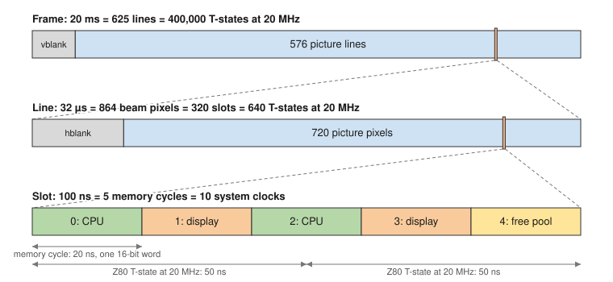

*Figure A-1: From a Frame Down to a Memory Cycle*

| Unit | Length | System clocks (100 MHz) | Contains |
|------|--------|-------------------------|----------|
| System clock | 10 ns | 1 | |
| Memory cycle | 20 ns | 2 | One 16-bit read or write |
| Z80 T-state at 20 MHz | 50 ns | 5 | |
| Slot | 100 ns | 10 | 5 memory cycles; 2 T-states at 20 MHz |
| Beam pixel | 37.04 ns | – (27 MHz pixel clock) | |
| Line | 32 µs | 3,200 | 864 beam pixels; 320 slots; 640 T-states at 20 MHz |
| Frame | 20 ms | 2,000,000 | 625 lines; 200,000 slots; 400,000 T-states at 20 MHz |

The system clock and the pixel clock both come from the board's one oscillator, so a line is always exactly 320 slots. The memory slots restart at the start of every line, so the display fetches at the same points on every line.

---

## The Frame

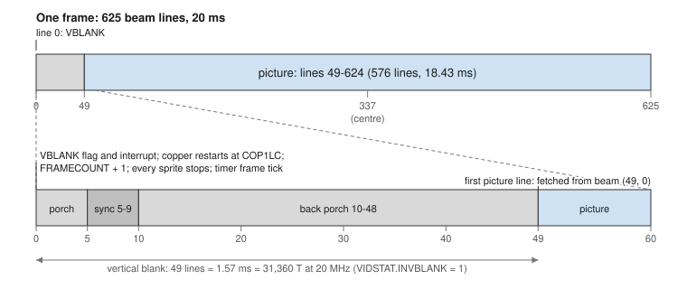

*Figure A-2: One Frame, with the Vertical Blank Enlarged*

A frame starts with its vertical blank, at beam line 0. The picture is lines 49–624.

| Beam lines | What | Length |
|------------|------|--------|
| 0–4 | Vertical front porch | 5 lines |
| 5–9 | Vertical sync | 5 lines |
| 10–48 | Vertical back porch | 39 lines |
| 0–48 | **Vertical blank**: VIDSTAT.INVBLANK reads 1 | 49 lines, 1.57 ms |
| 49–624 | **The picture** | 576 lines, 18.43 ms |

What happens at the start of the frame, beam (0, 0):

| Event | Notes |
|-------|-------|
| VIDSTAT.VBLANK is set | Interrupt source VBLANK (0), if enabled |
| The copper restarts at COP1LC | Its writes land in lines 0–48, before the picture is fetched |
| FRAMECOUNT counts up | Reading its first byte captures both bytes |
| Every sprite stops | The copper or the VBLANK handler starts each sprite again with SPRxCTL |
| Timers at SRC 2 tick | |
| The attribute layer's flash phase may change | Every 8, 16, 32 or 64 frames (ATCTL.RATE) |

The first picture line is fetched from beam (49, 0), so a VBLANK handler has **49 lines, 31,360 T-states at 20 MHz**, to set up the next frame.

The sync positions matter only to the monitor; they are given for completeness. The video outputs send black outside the picture.

---

## The Line

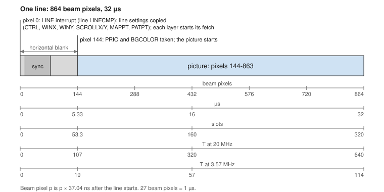

*Figure A-3: One Line*

A line starts with its horizontal blank, at beam pixel 0. The picture is pixels 144–863.

| Beam pixels | What | Length |
|-------------|------|--------|
| 0–11 | Horizontal front porch | 12 pixels, 0.44 µs |
| 12–75 | Horizontal sync | 64 pixels, 2.37 µs |
| 76–143 | Horizontal back porch | 68 pixels, 2.52 µs |
| 0–143 | **Horizontal blank** | 144 pixels, 5.33 µs, 107 T-states at 20 MHz |
| 144–863 | **The picture** | 720 pixels, 26.67 µs |

Two points in each line matter to programs:

| Beam pixel | What happens |
|------------|--------------|
| 0 | The LINE interrupt for line LINECMP. Each layer's line settings are copied (CTRL0–CTRL3, WINX, WINY, SCROLLX, SCROLLY, MAPPT, PATPT, and the attribute layer's registers). Each layer whose window covers the line starts its fetch. Timers at SRC 1 tick |
| 144 | PRIO and BGCOLOR are taken for the line's picture |

---

## Converting Units

A beam pixel lasts 1 ÷ 27 MHz = 37.04 ns, so **27 beam pixels make 1 µs**. A slot is 2.7 beam pixels.

| From | To | Multiply by |
|------|----|-------------|
| Beam pixels | ns | 37.04 |
| Beam pixels | slots | 0.370 (= 10 ÷ 27) |
| µs | beam pixels | 27 |
| Lines | µs | 32 |
| T-states at 20 MHz | beam pixels | 1.35 |
| Beam pixels | T-states at 20 MHz | 0.741 |

### T-states at each CPU speed

CPUSPEED, a system register, sets the Z80's speed. These are the T-states in each part of the frame:

| CPUSPEED | Speed | T-state | Per beam pixel | Per line | Per horizontal blank | Per vertical blank | Per frame |
|----------|-------|---------|----------------|----------|----------------------|--------------------|-----------|
| DIV 0 (reset) | 20 MHz | 50 ns | 0.741 | 640 | 107 | 31,360 | 400,000 |
| DIV 1 | 10 MHz | 100 ns | 0.370 | 320 | 53 | 15,680 | 200,000 |
| DIV 2 | 6.67 MHz | 150 ns | 0.247 | 213 | 36 | 10,453 | 133,333 |
| DIV 3 | 5 MHz | 200 ns | 0.185 | 160 | 27 | 7,840 | 100,000 |
| DIV 4 | 4 MHz | 250 ns | 0.148 | 128 | 21 | 6,272 | 80,000 |
| DIV 5 | 3.33 MHz | 300 ns | 0.123 | 107 | 18 | 5,227 | 66,667 |
| DIV 6 | 2.86 MHz | 350 ns | 0.106 | 91 | 15 | 4,480 | 57,143 |
| DIV 7 | 2.5 MHz | 400 ns | 0.093 | 80 | 13 | 3,920 | 50,000 |
| SPECTRUM | 3.57 MHz | 280 ns | 0.132 | 114 | 19 | 5,600 | 71,429 |

At DIV 0–7 the T-states are locked to the slots: at 20 MHz every T-state starts on slot edge 0 or 5. At 3.57 MHz they are not, so a line holds 114 or 115 T-states. The Z80 never waits at any speed.

### Where the beam is after n T-states

At 20 MHz, from the start of a line: **beam pixel = n × 1.35**. So:

| T-states after pixel 0 | Beam pixel | |
|------------------------|------------|--|
| 42 | 57 | The latest a LINE handler starts (IM 2) |
| 107 | 144 | The picture starts |
| 320 | 432 | The middle of the line |
| 640 | 864 = 0 of the next line | |

---

## The Memory Slot

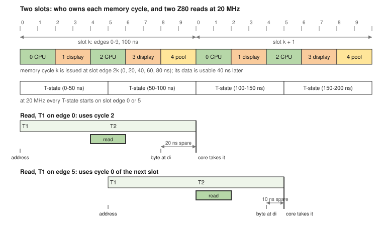

*Figure A-4: Two Slots, and Two Z80 Reads at 20 MHz*

Each 100 ns slot has five memory cycles of 20 ns. Each cycle has an owner, who gets it whenever they want it:

| Cycle | Starts | Owner | When the owner leaves it |
|-------|--------|-------|--------------------------|
| 0 | 0 ns | The Z80 | The free pool |
| 1 | 20 ns | The display: layers, the attribute layer and sprites | The free pool |
| 2 | 40 ns | The Z80 | The free pool |
| 3 | 60 ns | The display | The free pool |
| 4 | 80 ns | Audio (reserved; sound is not specified yet) | The free pool |

The **free pool** goes, in order, to display fetches that want more, the sprite sequencer, the copper and the DMA engine. The copper at COPCON.PRI 1 goes first and owns cycle 4.

**The Z80 never waits.** A read must be answered by the end of its T2, 100 ns after its address appears. A T-state at 20 MHz starts on slot edge 0 or 5, and either way a CPU cycle comes in time: cycle 2 of the same slot (20 ns to spare) or cycle 0 of the next (10 ns to spare). A write is posted: the Z80 goes on at once. The Z80 makes at most one memory access every 3 T-states, so it uses at most one of its two cycles in a slot; the other goes to the free pool.

| Owner | Per line | Bandwidth |
|-------|----------|-----------|
| The Z80 | 640 cycles offered; at most 213 used at 20 MHz | At most 6.67 M bytes a second |
| The display | 640 cycles: 1,280 bytes | 40 MB/s: **1.48 bytes per beam pixel** |
| Cycle 4 | 320 cycles | 20 MB/s |
| The free pool | At least 747 cycles | At least about 47 MB/s, and more in the vertical blank, when the display fetches nothing |

---

## What Fits in the Vertical Blank

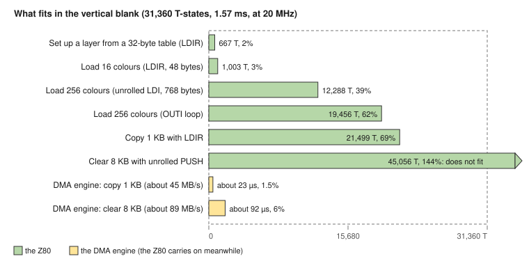

*Figure A-5: Jobs Against the Vertical Blank at 20 MHz*

The vertical blank is 1.57 ms: 31,360 T-states at 20 MHz. The copper and the DMA engine work alongside the Z80 and do not take its time.

| Job | Z80 T-states at 20 MHz | Share of the vertical blank |
|-----|------------------------|-----------------------------|
| Write a 1-byte register through the register page (`LD (nn),A`) | 13 | 0.04% |
| Write a 3-byte pointer through the register page | 29 | 0.1% |
| Set up a layer from a 32-byte table (`LDIR`) | 667 | 2% |
| Load 16 colours (`LDIR`, 48 bytes) | 1,003 | 3% |
| Load 256 colours (unrolled `LDI`, 768 bytes) | 12,288 | 39% |
| Load 256 colours (`OUTI` loop) | 19,456 | 62% |
| Copy 1 KB (`LDIR`, 21 T a byte) | 21,499 | 69% |
| Clear 8 KB (unrolled `PUSH`, 11 T per 2 bytes) | 45,056 | 144%: does not fit |

| Other units in the vertical blank | Amount |
|-----------------------------------|--------|
| The copper at PRI 1 | At least 15,680 MOVEs (one per slot) |
| The DMA engine, copying | About 70 KB (about 45 MB/s) |
| The DMA engine, filling | About 140 KB (about 89 MB/s) |

A job too big for the vertical blank can still be done safely if it changes only what the beam has already passed, or what is not on screen (a back buffer).

---

## Screen Positions

### The beam and the picture

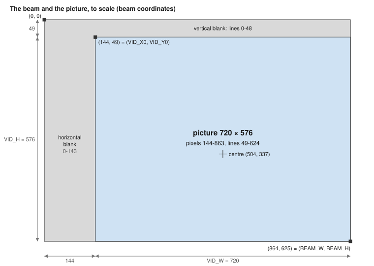

*Figure A-6: The Beam and the Picture*

Every position the hardware uses (BEAMPOS, LINECMP, the copper's WAIT and SKIP, layer windows and sprite positions) is in **beam coordinates**, which count the blanking too.

| Name (`hw.inc`) | Value | Meaning |
|-----------------|-------|---------|
| VID_X0 | 144 | The picture's first beam pixel |
| VID_Y0 | 49 | The picture's first beam line |
| VID_W | 720 | The picture's width |
| VID_H | 576 | The picture's height |
| BEAM_W | 864 | Beam pixels per line |
| BEAM_H | 625 | Beam lines per frame |

| To find | Formula |
|---------|---------|
| Beam position of picture pixel (x, y) | (VID_X0 + x, VID_Y0 + y) |
| XSTART of a centred window W wide | VID_X0 + (720 − W) ÷ 2 |
| YSTART of a centred window H high | VID_Y0 + (576 − H) ÷ 2 |
| Window width of S source pixels at scale HS | S × HS |
| The picture's centre | (504, 337) |

Pixels are not square: on a 4:3 screen each is 16/15 as wide as it is tall. A TV may crop a few percent off each edge; a computer monitor shows all 720 × 576.

### Common windows

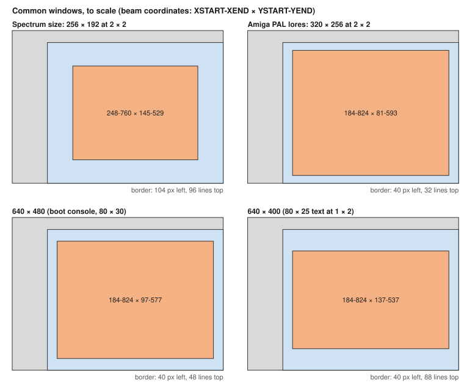

*Figure A-7: Common Windows*

| Screen | Source | Scale | XSTART–XEND | YSTART–YEND |
|--------|--------|-------|-------------|-------------|
| Full screen | 360 × 288 | 2 × 2 | 144–864 | 49–625 |
| Full screen | 720 × 576 | 1 × 1 | 144–864 | 49–625 |
| Spectrum size | 256 × 192 | 2 × 2 | 248–760 | 145–529 |
| Amiga PAL lores | 320 × 256 | 2 × 2 | 184–824 | 81–593 |
| 640 × 480 (the boot console, 80 × 30 text) | 640 × 240 | 1 × 2 | 184–824 | 97–577 |
| 640 × 400 (80 × 25 text) | 640 × 200 | 1 × 2 | 184–824 | 137–537 |
| Chunky 8-bit-era graphics | 180 × 144 | 4 × 4 | 144–864 | 49–625 |

The window's end is the first pixel or line after it: XEND = XSTART + width.

### The Spectrum screen

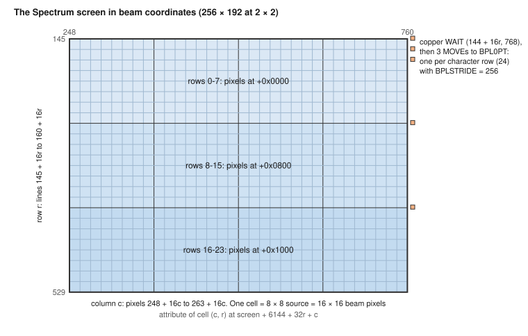

*Figure A-8: The Spectrum Screen in Beam Coordinates*

A 256 × 192 screen at 2 × 2, centred, as the Playfields chapter's "Spectrum Extras" sets it up:

| Item | Beam coordinates |
|------|------------------|
| The window | Pixels 248–759, lines 145–528 |
| Source pixel (x, y) | Beam pixels 248 + 2x and 249 + 2x, lines 145 + 2y and 146 + 2y |
| Character cell (c, r), c = 0–31, r = 0–23 | Pixels 248 + 16c to 263 + 16c, lines 145 + 16r to 160 + 16r |
| The border | Pixels 144–247 and 760–863 (104 each side); lines 49–144 and 529–624 (96 each) |
| The copper's pointer write for character row r | WAIT (144 + 16r, 768), the line before the row, after L0's last fetch |

The Spectrum's own screen memory puts its three thirds 2 KB apart; within a third, line y of a character row is 256 bytes after line y − 1. So BPLSTRIDE = 256 shows each character row with no help, and the copper writes BPL0PT once per row, 24 times a frame.

---

## When a Layer Fetches

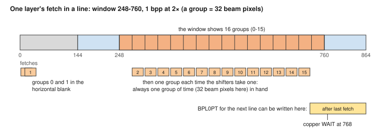

*Figure A-9: One Layer's Fetch in a Line (the fetch times are drawn approximately)*

A layer has no line buffer: it holds the group of 16 source pixels it is showing and the next group, no more.

1. At beam pixel 0, each layer whose window covers the line fetches its first two groups, in the horizontal blank.
2. Each time the shifters take a group, the layer fetches the next one. It always has one group of time in hand: 16 source pixels × HSCALE beam pixels.
3. The last group is fetched before the window's right edge (XEND).

| HSCALE | Beam pixels per group | Time per group |
|--------|-----------------------|----------------|
| 1× | 16 | 593 ns |
| 2× | 32 | 1,185 ns |
| 4× | 64 | 2,370 ns |
| 8× | 128 | 4,741 ns |

Between the layer's last fetch on a line and beam pixel 0 of the next line, its pointer can be rewritten for the next line without spoiling this one. For a window ending at 760, the copper waits for pixel 768.

The cost of a screen is a **rate**: at every point across the screen, the layers and sprites there must need no more than 1.48 bytes per beam pixel. The Playfields chapter's "The Fetch Budget" works through it.

---

## When Register Writes Take Effect

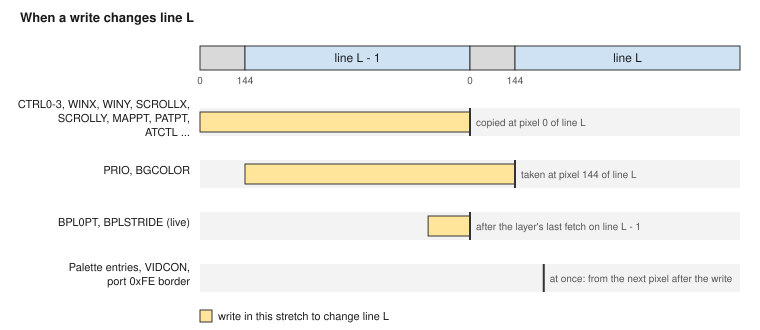

*Figure A-10: When a Write Changes Line L*

| Registers | Taken at | To change line L, write |
|-----------|----------|-------------------------|
| CTRL0–CTRL3, WINX, WINY, SCROLLX, SCROLLY, MAPPT, PATPT; ATCTL, ATADDR, ATSTRIDE, ATSCROLL | Beam pixel 0 of each line | During line L − 1 (or earlier) |
| PRIO, BGCOLOR | Beam pixel 144 of each line | Between pixel 144 of line L − 1 and pixel 144 of line L: the horizontal blank of line L still counts |
| BPL0PT, BPLSTRIDE | At once: they are live | After the layer's last fetch on line L − 1, before pixel 0 of line L |
| Palette entries, VIDCON, port `0xFE` border | At once: the next pixel | Anywhere: the change shows from that point in the line |
| LINECMP, VIDSTAT, VIDINTEN, PALIDX, DMACON | At once | – |
| Sprite registers | SPRxCTL starts a sprite; SPRxPT, SPRxH, SPRxV and SPRxSTEP act on a running sprite from the next line | See the Sprites chapter |

Every byte takes effect when it is written; there are no latches, except that a colour waits for its red byte and an MMU page for its second byte. So change a wide register in the vertical blank, or with the copper at a set position, so that no line sees it half written.

---

## Interrupt Timing

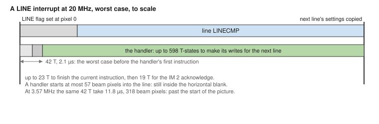

*Figure A-11: A LINE Interrupt at 20 MHz, Worst Case*

| Step | T-states |
|------|----------|
| Finish the current instruction | Up to 23 (`INC (IX+d)`); block instructions such as `LDIR` take interrupts between iterations |
| After `EI` | The next instruction always runs first |
| IM 2 acknowledge, push PC, read the table | 19 |
| IM 1 acknowledge, push PC | 13 |
| NMI, push PC | 11 |

The worst case before the first instruction of an IM 2 handler is 23 + 19 = 42 T-states, if interrupts are enabled:

| CPU speed | Worst IM 2 start | In beam pixels | A LINE handler starts |
|-----------|------------------|----------------|-----------------------|
| 20 MHz | 2.1 µs | 57 | In the horizontal blank |
| 10 MHz | 4.2 µs | 113 | In the horizontal blank |
| 6.67 MHz | 6.3 µs | 170 | Up to 26 pixels into the picture |
| 5 MHz | 8.4 µs | 227 | Up to 83 pixels into the picture |
| 3.57 MHz | 11.8 µs | 318 | Up to 174 pixels into the picture |
| 2.5 MHz | 16.8 µs | 454 | Past the middle of the line |

Code that runs with interrupts disabled adds its own time. A LINE handler's writes to the line settings land on the next line if they are made before its pixel 0: 640 T-states after the event at 20 MHz, less the start-up. Effects that must land on an exact pixel belong to the copper, whose first write after a WAIT lands within a pixel of its position.

| Handler | Starts at | Must finish its screen writes by |
|---------|-----------|----------------------------------|
| VBLANK | Beam (0, 0) + up to 42 T | Beam (49, 0), the first picture line's fetch: 31,360 T at 20 MHz |
| LINE for line L | Beam (L, 0) + up to 42 T | Beam (L + 1, 0) for line settings; (L + 1, 144) for PRIO and BGCOLOR |

Interrupt sources are level-sensitive: a handler must clear its flag before `EI`, or it is entered again at once.

---

## Timers and Counters

| Counter | Counts | Period | Wraps after |
|---------|--------|--------|-------------|
| TIME (32 bits) | Every µs from power-on | 1 µs | 65.5 ms (low 16 bits); 71.6 minutes (all 32) |
| FRAMECOUNT (16 bits) | Every frame | 20 ms | 21.8 minutes |
| BEAMPOS | The display beam: `hpixel` 0–863, `vline` 0–624 | – | Every line and every frame |
| A timer at SRC 0 | System clock ÷ (PRESCALE + 1) | 10 ns × (PRESCALE + 1) | – |
| A timer at SRC 1 | Every line (pixel 0) | 32 µs | – |
| A timer at SRC 2 | Every frame (0, 0) | 20 ms | – |

A repeating timer at SRC 0 underflows every (PRESCALE + 1) × (RELOAD + 1) × 10 ns:

| Rate | PRESCALE (or SRC) | RELOAD |
|------|----------|--------|
| 1 µs ticks | 99 | – |
| 1 kHz (1 ms) | 99 | 999 |
| 100 Hz (10 ms) | 99 | 9,999 |
| 3.57 MHz (a Spectrum-speed T-state) | 27 | – |
| Every 10 lines | SRC 1 | 9 |
| Every 3 frames | SRC 2 | 2 |

Reading the lowest byte of TIME, a timer's COUNT, BEAMPOS or FRAMECOUNT captures the whole value. The CPU has one capture for all of them, so read such a value with interrupts off if a handler reads one too, or use `LD HL,(nn)` through the register page for a 2-byte value.

---

## Spectrum Timing Compared

Programs ported from a Spectrum often count on its timing. This machine keeps the frame rate but not the rest. (A 128K Spectrum differs a little: 3.5469 MHz, 228 T a line, 70,908 T a frame.)

| | 48K Spectrum | retro-z80 at 3.57 MHz | retro-z80 at 20 MHz |
|--|--------------|-----------------------|---------------------|
| CPU clock | 3.5 MHz | 3.571 MHz | 20 MHz |
| Frame | 50.08 Hz, 69,888 T | 50 Hz, about 71,429 T | 50 Hz, 400,000 T |
| Line | 64 µs, 224 T | 32 µs, about 114 T | 32 µs, 640 T |
| Lines per frame | 312 | 625 | 625 |
| Screen lines | 192 | 384 (2 × 2) | 384 (2 × 2) |
| Contention | Yes, in the screen memory | None | None |
| Border changes | At once, mid-line | At once, mid-line (port `0xFE`) | At once, mid-line |
| Interrupt | Once a frame, from the ULA | VBLANK, once a frame | VBLANK, once a frame |

So code timed in frames carries over. Code timed in T-states per line (multicolour effects, border stripes timed to a line) does not: the line here is half as long, and each Spectrum line is two lines here. Use the copper for those effects, or the LINE interrupt for coarser ones.
